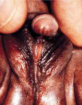

# Chapter 628: Disorders of Sex Development — Board-Style Self-Assessment MCQs
**Part XXIV: The Endocrine System** | [📖 Read Wiki Chapter](../chapters/628.md) | [🃏 Chapter Flashcards](../flashcards/628_flashcards.md) | [🏠 Course Master Index](../../index.md)

Total questions: **5** *(Click "Show Answer & Rationale" beneath each question)*

### Question 1 (Clinical Pediatrics Vignette)
A pediatric patient is evaluated for the following clinical and diagnostic profile: Intersex; Disorders of sex development; (DSDs); Male pseudohermaphrodite. Which of the following conditions or syndromes is the most likely diagnosis?

- **A.** 46,XY DSD (Disorders of Sex Development)
- **B.** CURRENTLY ACCEPTED
- **C.** Disorder of Ovarian Development
- **D.** 46,XX DSD (Disorders of Sex Development)

<b>Show Answer & Rationale</b>

**Correct Answer: B** — CURRENTLY ACCEPTED

**Rationale:** **CURRENTLY ACCEPTED** is characterized by: Intersex; Disorders of sex development; (DSDs); Male pseudohermaphrodite.

**Why Other Options Are Incorrect:** **46,XY DSD (Disorders of Sex Development)** is incorrect (characterized by Undervirilization of an XY male). **Disorder of Ovarian Development** is incorrect (characterized by XX gonadal dysgenesis; Testicular DSD (SRY+, SOX9 duplication)). **46,XX DSD (Disorders of Sex Development)** is incorrect (characterized by Overvirilization of an XX female).

### Question 2 (Clinical Pediatrics Vignette)
A pediatric patient is evaluated for the following clinical and diagnostic profile: Undervirilization of an XY male. Which of the following conditions or syndromes is the most likely diagnosis?

- **A.** 46,XX DSD (Disorders of Sex Development)
- **B.** 46,XY DSD (Disorders of Sex Development)
- **C.** Disorder of Ovarian Development
- **D.** CURRENTLY ACCEPTED

<b>Show Answer & Rationale</b>

**Correct Answer: B** — 46,XY DSD (Disorders of Sex Development)

**Rationale:** **46,XY DSD (Disorders of Sex Development)** is characterized by: Undervirilization of an XY male.

**Why Other Options Are Incorrect:** **46,XX DSD (Disorders of Sex Development)** is incorrect (characterized by Overvirilization of an XX female). **Disorder of Ovarian Development** is incorrect (characterized by XX gonadal dysgenesis; Testicular DSD (SRY+, SOX9 duplication)). **CURRENTLY ACCEPTED** is incorrect (characterized by Intersex; Disorders of sex development; (DSDs); Male pseudohermaphrodite).

### Question 3 (Visual Diagnosis & Clinical Spotter)

A pediatric patient undergoes evaluation for **Disorders of Sex Development**, yielding the clinical or diagnostic finding shown below. Which of the following best characterizes the illustrated finding?

- **A.** A functional androgen receptor, produced by an X-linked gene, is required for testosterone and DHT to induce these androgen effects.
- **B.** The average age at diagnosis is 25 years; less than 5% of these tumors occur before puberty. α-Fetoprotein levels may be mildly elevated.
- **C.** Virilization of a female, the most common form of DSD, results in varying phenotypes that develop from the basic bipotential genital appearances of the embryo.
- **D.** Schematic demonstration of differentiation of normal male and female genitalia during embryogenesis. (From Zitelli BJ, Davis HW. Atlas of Pediatric Physical Diagnosis, 4th ed. St. Louis: Mosby, 2

<b>Show Answer & Rationale</b>

**Correct Answer: D** — Schematic demonstration of differentiation of normal male and female genitalia during embryogenesis. (From Zitelli BJ, Davis HW. Atlas of Pediatric Physical Diagnosis, 4th ed. St. Louis: Mosby, 2

**Rationale:** **Fig. 628.2**: Schematic demonstration of differentiation of normal male and female genitalia during embryogenesis. (From Zitelli BJ, Davis HW. Atlas of Pediatric Physical Diagnosis, 4th ed. St. Louis: Mosby, 2002: p. 328.)

### Question 4 (Differential Diagnosis (Disorders of Sex Development))
During a pediatric consultation regarding **Disorders of Sex Development**, which clinical entity or concept is described by the following profile? "Virilizing ovarian tumors are rare at all ages but particularly so in prepubertal females."

- **A.** short-limbed skeletal dysplasia
- **B.** ANDROGENIC LESIONS OF THE OVARY
- **C.** 46,XX DSD (Disorders of Sex Development)
- **D.** CURRENTLY ACCEPTED

<b>Show Answer & Rationale</b>

**Correct Answer: B** — ANDROGENIC LESIONS OF THE OVARY

**Rationale:** ANDROGENIC LESIONS OF THE OVARY Virilizing ovarian tumors are rare at all ages but particularly so in prepubertal females.

### Question 5 (Pediatric Board Mastery (Disorders of Sex Development))
When formulating an evidence-based diagnostic and management plan for **Disorders of Sex Development** (*Part XXIV: The Endocrine System*), which of the following pediatric clinical statements is **ACCURATE**? (Item 1)

- **A.** The average age at diagnosis is 25 years; less than 5% of these tumors occur before puberty. α-Fetoprotein levels may be mildly elevated.
- **B.** The condition is an entirely benign physiologic variant that never warrants laboratory or clinical evaluation.
- **C.** Inheritance is exclusively holandric (Y-linked) with 100% penetrance restricted to male neonates.
- **D.** Systemic tetracyclines and fluoroquinolones are universally required as routine prophylaxis in all healthy newborns.

<b>Show Answer & Rationale</b>

**Correct Answer: A** — The average age at diagnosis is 25 years; less than 5% of these tumors occur before puberty. α-Fetoprotein levels may be mildly elevated.

**Rationale:** **Pediatric Clinical Principle (Disorders of Sex Development):** The average age at diagnosis is 25 years; less than 5% of these tumors occur before puberty. α-Fetoprotein levels may be mildly elevated.

