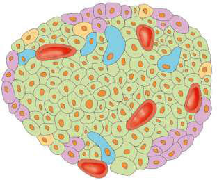

# Chapter 629: Diabetes Mellitus — Board-Style Self-Assessment MCQs
**Part XXIV: The Endocrine System** | [📖 Read Wiki Chapter](../chapters/629.md) | [🃏 Chapter Flashcards](../flashcards/629_flashcards.md) | [🏠 Course Master Index](../../index.md)

Total questions: **5** *(Click "Show Answer & Rationale" beneath each question)*

### Question 1 (Clinical Pediatrics Vignette)
A pediatric patient is evaluated for the following clinical and diagnostic profile: 1. Neonatal diabetes; a. Pathogenic variants leading to transient neonatal diabetes; (the causative gene, the causative gene, 6q24 overexpression, the causative gene, ZFP57,; SLC2A2 HNF1β); b. Pathogenic variants leading to permanent neonatal; diabet. Which of the following conditions or syndromes is the most likely diagnosis?

- **A.** E. Drug Or Chemical Induced
- **B.** D. Other Autoimmune Syndromes Associated With Diabetes
- **C.** Resistance Or Deficiency)
- **D.** A. Genetic Defects Of β-Cell Function (Monogenic Diabetes)

<b>Show Answer & Rationale</b>

**Correct Answer: D** — A. Genetic Defects Of β-Cell Function (Monogenic Diabetes)

**Rationale:** **A. Genetic Defects Of β-Cell Function (Monogenic Diabetes)** (associated with **`KCNJ11, ABCC8, GCK, INS`**) is characterized by: 1. Neonatal diabetes; a. Pathogenic variants leading to transient neonatal diabetes; (KCNJ11, ABCC8, 6q24 overexpression, INS, ZFP57,; SLC2A2 HNF1β); b. Pathogenic variants leading to permanent neonatal; diabetes (KCNJ11, ABCC8, INS, GATA6, EIF2AK3, GCK,.

**Why Other Options Are Incorrect:** **E. Drug Or Chemical Induced** is incorrect (characterized by 1. Antirejection—cyclosporine, sirolimus; 2. Glucocorticoids (with impaired insulin secretion; e.g.,). **D. Other Autoimmune Syndromes Associated With Diabetes** is incorrect (characterized by 1. IPEX (immunodysfunction, polyendocrinopathy, enteropathy,; X-linked); 2. Autoimmune polyendocrino). **Resistance Or Deficiency)** is incorrect (characterized by 1. Down syndrome; 2. Turner syndrome; 3. Klinefelter syndrome; 4. Prader-Willi syndrome; 5. Bardet-B).

### Question 2 (Clinical Pediatrics Vignette)
A pediatric patient is evaluated for the following clinical and diagnostic profile: 2. MODY (maturity-onset diabetes of the young) syndromes; a. MODY 1 chromosome 20, HNF4α; b. MODY 2 chromosome 7, the causative gene; c. MODY 3 chromosome 12q24.2, HNF1α, TCF-1; d. MODY 4 chromosome 13q12.1, IPF-1 (the causative gene); e. MODY 5 chro. Which of the following conditions or syndromes is the most likely diagnosis?

- **A.** NEUROD1, NEUROG3, NKX2-2, RFX5, IER3IP1, MNX1)
- **B.** Resistance Or Deficiency)
- **C.** A. Genetic Defects Of β-Cell Function (Monogenic Diabetes)
- **D.** E. Drug Or Chemical Induced

<b>Show Answer & Rationale</b>

**Correct Answer: A** — NEUROD1, NEUROG3, NKX2-2, RFX5, IER3IP1, MNX1)

**Rationale:** **NEUROD1, NEUROG3, NKX2-2, RFX5, IER3IP1, MNX1)** (associated with **`KCNJ11, PDX1, ABCC8, GCK, INS`**) is characterized by: 2. MODY (maturity-onset diabetes of the young) syndromes; a. MODY 1 chromosome 20, HNF4α; b. MODY 2 chromosome 7, GCK; c. MODY 3 chromosome 12q24.2, HNF1α, TCF-1; d. MODY 4 chromosome 13q12.1, IPF-1 (PDX1); e. MODY 5 chromosome 17, HNF1β, TCF-2; f. MODY 6 chromosome 2q32, NEUROD1; g. MODY 7 chromosome 2p25, KLF11; h. M.

**Why Other Options Are Incorrect:** **Resistance Or Deficiency)** is incorrect (characterized by 1. Down syndrome; 2. Turner syndrome; 3. Klinefelter syndrome; 4. Prader-Willi syndrome; 5. Bardet-B). **A. Genetic Defects Of β-Cell Function (Monogenic Diabetes)** is incorrect (characterized by 1. Neonatal diabetes; a. Pathogenic variants leading to transient neonatal diabetes; (KCNJ11, ABCC8,). **E. Drug Or Chemical Induced** is incorrect (characterized by 1. Antirejection—cyclosporine, sirolimus; 2. Glucocorticoids (with impaired insulin secretion; e.g.,).

### Question 3 (Pediatric Genetics & Molecular Etiology)
A child is diagnosed with **A. Genetic Defects Of β-Cell Function (Monogenic Diabetes)** after presenting with 1. Neonatal diabetes; a. Pathogenic variants leading to transient neonatal diabetes; (the causative gene, the causative gene, 6q24 overexpression, the causative gene, ZFP57,; SLC2A2 HNF1β); b. Pathogenic varian. Pathogenic variants in which of the following genes are most classically implicated?

- **A.** RECQL4
- **B.** SCN8A
- **C.** PFKM
- **D.** KCNJ11

<b>Show Answer & Rationale</b>

**Correct Answer: D** — KCNJ11

**Rationale:** Pathogenic variants in **`KCNJ11`** (The Endocrine System) are associated with **A. Genetic Defects Of β-Cell Function (Monogenic Diabetes)** (1. Neonatal diabetes; a. Pathogenic variants leading to transient neonatal diabetes; (KCNJ11, ABCC8, 6q24 overexpression, INS, ZFP57,; SLC2A2 HNF1β); b. Pathogenic variants leading to permanent neonatal; diabetes (KCNJ11, ABCC8, INS, GATA6, EIF2AK3, GCK,).

**Why Other Options Are Incorrect:** **SCN8A** is incorrect (associated with SCN8A, DEPDC5 (Conditions That Mimic Seizures)).

### Question 4 (Visual Diagnosis & Clinical Spotter)

A pediatric patient undergoes evaluation for **Diabetes Mellitus**, yielding the clinical or diagnostic finding shown below. Which of the following best characterizes the illustrated finding?

- **A.** TYPE 1 DIABETES MELLITUS Formerly called insulin-dependent diabetes mellitus (IDDM) or juvenile diabetes, T1DM is characterized by low or absent levels of endogenously produced insulin and b
- **B.** Diabetes mellitus (DM) is a common chronic metabolic disease characterized by hyperglycemia as a cardinal biochemical feature.
- **C.** The immunopathogenesis of type 1 diabetes. The de- velopment of type 1 diabetes is thought to be initiated by the pres- entation of β-cell peptides by antigen-presenting cells (APCs). APCs bearin
- **D.** T1DM is the most common endocrine metabolic disorder of childhood and adolescence, with important consequences for physical and emotional development.

<b>Show Answer & Rationale</b>

**Correct Answer: C** — The immunopathogenesis of type 1 diabetes. The de- velopment of type 1 diabetes is thought to be initiated by the pres- entation of β-cell peptides by antigen-presenting cells (APCs). APCs bearin

**Rationale:** **Fig. 629.4**: The immunopathogenesis of type 1 diabetes. The de- velopment of type 1 diabetes is thought to be initiated by the pres- entation of β-cell peptides by antigen-presenting cells (APCs). APCs bearing these autoantigens migrate to the pancreatic lymph nodes, where they interact with autoreactive CD4+ T lymphocytes, which in turn mediate the activation of autoreactive CD8+ T cells (A). These ac- tivated CD8+ T cells return to the islet and lyse β cells expressing im- munogenic self-antigens on major histocompatibility complex class I surface molecules (B). β-Cell destruction is further exacerbated by the release of proinflammatory cytokines and reactive oxygen species from innate immune cells (macrophages, natural killer cells, and neutrophils) (C). This entire process is amplified by defects in regulatory T lympho- cytes, which do not effectively suppress autoimmunity (D). Activated T cells within the pancreatic lymph node also stimulate B lymphocytes to produce autoantibodies against β-cell proteins. These autoantibodies can be measured in circulation and are considered a defining biomarker of type 1 diabetes (E). (From DiMeglio LA, Evans-Molina C, Oram RA. Type 1 di

### Question 5 (Pediatric Board Mastery (Diabetes Mellitus))
When formulating an evidence-based diagnostic and management plan for **Diabetes Mellitus** (*Part XXIV: The Endocrine System*), which of the following pediatric clinical statements is **ACCURATE**? (Item 1)

- **A.** Diagnostic confirmation relies solely on plain skull radiographs without biochemical, microbiologic, or clinical correlation.
- **B.** Inheritance is exclusively holandric (Y-linked) with 100% penetrance restricted to male neonates.
- **C.** Diabetes mellitus (DM) is a common chronic metabolic disease characterized by hyperglycemia as a cardinal biochemical feature.
- **D.** Systemic tetracyclines and fluoroquinolones are universally required as routine prophylaxis in all healthy newborns.

<b>Show Answer & Rationale</b>

**Correct Answer: C** — Diabetes mellitus (DM) is a common chronic metabolic disease characterized by hyperglycemia as a cardinal biochemical feature.

**Rationale:** **Pediatric Clinical Principle (Diabetes Mellitus):** Diabetes mellitus (DM) is a common chronic metabolic disease characterized by hyperglycemia as a cardinal biochemical feature.

