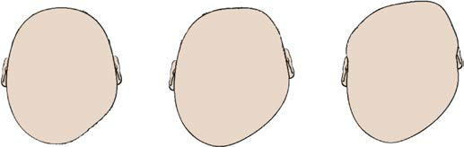

# Chapter 632: Deformational Plagiocephaly — Board-Style Self-Assessment MCQs
**Part XXV: The Nervous System** | [📖 Read Wiki Chapter](../chapters/632.md) | [🃏 Chapter Flashcards](../flashcards/632_flashcards.md) | [🏠 Course Master Index](../../index.md)

Total questions: **5** *(Click "Show Answer & Rationale" beneath each question)*

### Question 1 (Clinical Pediatrics Vignette)
A pediatric patient is evaluated for the following clinical and diagnostic profile: Birth history; Intrauterine compression; First-born child; Typically no complications; Head shape at birth; Typically normal; Can be irregular; Age at which shape irregularity first noticed; Usually in first few months of life; Can be at birth; How p. Which of the following conditions or syndromes is the most likely diagnosis?

- **A.** CRANIOSYNOSTOSIS (Deformational Plagiocephaly)
- **B.** CI: 0.82-0.9 (Deformational Plagiocephaly)
- **C.** SYNOSTOTIC (Deformational Plagiocephaly)
- **D.** CI: 0.9-1.0 (Deformational Plagiocephaly)

<b>Show Answer & Rationale</b>

**Correct Answer: C** — SYNOSTOTIC (Deformational Plagiocephaly)

**Rationale:** **SYNOSTOTIC (Deformational Plagiocephaly)** is characterized by: Birth history; Intrauterine compression; First-born child; Typically no complications; Head shape at birth; Typically normal; Can be irregular; Age at which shape irregularity first noticed; Usually in first few months of life; Can be at birth; How patient prefers to sleep; Same side, same position; Same even during na.

**Why Other Options Are Incorrect:** **CRANIOSYNOSTOSIS (Deformational Plagiocephaly)** is incorrect (characterized by Causes; External forces applied to the skull; Prenatal: uterine compression, intrauterine constraine). **CI: 0.82-0.9 (Deformational Plagiocephaly)** is incorrect (characterized by Central posterior deformity; (ping-pong ball; depression); Moderate; TDD 10-12 mm; Type II; Malposit). **CI: 0.9-1.0 (Deformational Plagiocephaly)** is incorrect (characterized by Central posterior deformity; and widening of; posterior skull; Type III; Forehead deformity; Severe;).

### Question 2 (Clinical Pediatrics Vignette)
A pediatric patient is evaluated for the following clinical and diagnostic profile: Causes; External forces applied to the skull; Prenatal: uterine compression, intrauterine constrained; Postnatal: congenital torticollis, sleeping position; Premature fusion of one or more cranial sutures; Common types; Lateral; Posterior; Bilateral . Which of the following conditions or syndromes is the most likely diagnosis?

- **A.** DETERMINING SEVERITY
- **B.** CRANIOSYNOSTOSIS (Deformational Plagiocephaly)
- **C.** CI: 0.82-0.9 (Deformational Plagiocephaly)
- **D.** CI: 0.9-1.0 (Deformational Plagiocephaly)

<b>Show Answer & Rationale</b>

**Correct Answer: B** — CRANIOSYNOSTOSIS (Deformational Plagiocephaly)

**Rationale:** **CRANIOSYNOSTOSIS (Deformational Plagiocephaly)** is characterized by: Causes; External forces applied to the skull; Prenatal: uterine compression, intrauterine constrained; Postnatal: congenital torticollis, sleeping position; Premature fusion of one or more cranial sutures; Common types; Lateral; Posterior; Bilateral coronal; Sagittal; Metopic; Common distinguishing; features; Normal ro.

**Why Other Options Are Incorrect:** **DETERMINING SEVERITY** is incorrect (characterized by Mild; TDD 3-10 mm; Type I; Flattening restricted; to back of the skull). **CI: 0.82-0.9 (Deformational Plagiocephaly)** is incorrect (characterized by Central posterior deformity; (ping-pong ball; depression); Moderate; TDD 10-12 mm; Type II; Malposit). **CI: 0.9-1.0 (Deformational Plagiocephaly)** is incorrect (characterized by Central posterior deformity; and widening of; posterior skull; Type III; Forehead deformity; Severe;).

### Question 3 (Visual Diagnosis & Clinical Spotter)

A pediatric patient undergoes evaluation for **Deformational Plagiocephaly**, yielding the clinical or diagnostic finding shown below. Which of the following best characterizes the illustrated finding?

- **A.** Management also requires accurate counseling about its cause and treatment.
- **B.** Types of deformational plagiocephaly. (From Looman WS, Flannery AB. Evidence-based care of the child with deformational pla giocephaly, part I: assessment and diagnosis. J Pediatr Health Care. 20
- **C.** Given that DP results from more time spent on one side of the head and that tor ticollis (and other neck muscle imbalances) are likely to lead to this disproportional partitioning of time, t
- **D.** It is especially important to be able to rule out craniosynostosis as a primary cause for cranial asymmetry in infants because management of this condition is quite different from that of DP

<b>Show Answer & Rationale</b>

**Correct Answer: B** — Types of deformational plagiocephaly. (From Looman WS, Flannery AB. Evidence-based care of the child with deformational pla giocephaly, part I: assessment and diagnosis. J Pediatr Health Care. 20

**Rationale:** **Fig. 632.3**: Types of deformational plagiocephaly. (From Looman WS, Flannery AB. Evidence-based care of the child with deformational pla giocephaly, part I: assessment and diagnosis. J Pediatr Health Care. 2012;26:242–250, Fig. 1.)

### Question 4 (Differential Diagnosis (Deformational Plagiocephaly))
During a pediatric consultation regarding **Deformational Plagiocephaly**, which clinical entity or concept is described by the following profile? "Infants cannot reposition their heads in the first few postnatal weeks and are unable to hold their heads up until about 4 months of age."

- **A.** Tummy time
- **B.** EPIDEMIOLOGY AND ETIOLOGY Risk Factors
- **C.** CI: 0.9-1.0 (Deformational Plagiocephaly)
- **D.** DETERMINING TYPE BASED ON CLINICAL FINDINGS

<b>Show Answer & Rationale</b>

**Correct Answer: B** — EPIDEMIOLOGY AND ETIOLOGY Risk Factors

**Rationale:** EPIDEMIOLOGY AND ETIOLOGY Risk Factors Infants cannot reposition their heads in the first few postnatal weeks and are unable to hold their heads up until about 4 months of age.

### Question 5 (Pediatric Board Mastery (Deformational Plagiocephaly))
When formulating an evidence-based diagnostic and management plan for **Deformational Plagiocephaly** (*Part XXV: The Nervous System*), which of the following pediatric clinical statements is **ACCURATE**? (Item 1)

- **A.** First-line management relies on immediate high-dose aspirin therapy in febrile infants.
- **B.** Clinical manifestations are permanently restricted to late adulthood and never present during infancy, childhood, or adolescence.
- **C.** Diagnostic confirmation relies solely on plain skull radiographs without biochemical, microbiologic, or clinical correlation.
- **D.** Given that DP results from more time spent on one side of the head and that tor ticollis (and other neck muscle imbalances) are likely to lead to this disproportional partitioning of time, they are most li

<b>Show Answer & Rationale</b>

**Correct Answer: D** — Given that DP results from more time spent on one side of the head and that tor ticollis (and other neck muscle imbalances) are likely to lead to this disproportional partitioning of time, they are most li

**Rationale:** **Pediatric Clinical Principle (Deformational Plagiocephaly):** Given that DP results from more time spent on one side of the head and that tor ticollis (and other neck muscle imbalances) are likely to lead to this disproportional partitioning of time, they are most likely causes, not effects, of DP.

