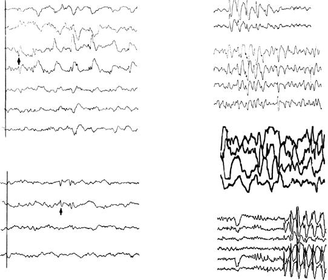

# Chapter 633: Seizures in Childhood — Board-Style Self-Assessment MCQs
**Part XXV: The Nervous System** | [📖 Read Wiki Chapter](../chapters/633.md) | [🃏 Chapter Flashcards](../flashcards/633_flashcards.md) | [🏠 Course Master Index](../../index.md)

Total questions: **5** *(Click "Show Answer & Rationale" beneath each question)*

### Question 1 (Clinical Pediatrics Vignette)
A pediatric patient is evaluated for the following clinical and diagnostic profile: Benign this pediatric condition seizures; Newborn; Newborn; Good. Which of the following conditions or syndromes is the most likely diagnosis?

- **A.** BZD, ZON, TPM (Seizures in Childhood)
- **B.** NEONATAL (Seizures in Childhood)
- **C.** INFANCY (Seizures in Childhood)
- **D.** LEV, TPM, PB (Seizures in Childhood)

<b>Show Answer & Rationale</b>

**Correct Answer: B** — NEONATAL (Seizures in Childhood)

**Rationale:** **NEONATAL (Seizures in Childhood)** is characterized by: Benign neonatal seizures; Newborn; Newborn; Good.

**Why Other Options Are Incorrect:** **BZD, ZON, TPM (Seizures in Childhood)** is incorrect (characterized by LEV, ketogenic; diet; No; Benign familial neonatal; convulsions; Newborn to; young infant; Newborn t). **INFANCY (Seizures in Childhood)** is incorrect (characterized by Benign infantile seizures; (nonfamilial); Infant; Infant; Good). **LEV, TPM, PB (Seizures in Childhood)** is incorrect (characterized by —; No; Early myoclonic; encephalopathy and; Ohtahara syndrome; Newborn infant; Poor, Ohtahara; syndr).

### Question 2 (Clinical Pediatrics Vignette)
A pediatric patient is evaluated for the following clinical and diagnostic profile: No; Early myoclonic; encephalopathy and; Ohtahara syndrome; Newborn infant; Poor, Ohtahara; syndrome; evolves into; West syndrome; Ominous; PB, steroids, VGB. Which of the following conditions or syndromes is the most likely diagnosis?

- **A.** LEV, TPM, PB (Seizures in Childhood)
- **B.** INFANCY (Seizures in Childhood)
- **C.** NEONATAL (Seizures in Childhood)
- **D.** CBZ, PB (Seizures in Childhood)

<b>Show Answer & Rationale</b>

**Correct Answer: A** — LEV, TPM, PB (Seizures in Childhood)

**Rationale:** **LEV, TPM, PB (Seizures in Childhood)** is characterized by: —; No; Early myoclonic; encephalopathy and; Ohtahara syndrome; Newborn infant; Poor, Ohtahara; syndrome; evolves into; West syndrome; Ominous; PB, steroids, VGB.

**Why Other Options Are Incorrect:** **INFANCY (Seizures in Childhood)** is incorrect (characterized by Benign infantile seizures; (nonfamilial); Infant; Infant; Good). **NEONATAL (Seizures in Childhood)** is incorrect (characterized by Benign neonatal seizures; Newborn; Newborn; Good). **CBZ, PB (Seizures in Childhood)** is incorrect (characterized by —; No; Epilepsy of infancy with; migrating focal seizures; Infant; No remission; Ominous).

### Question 3 (Visual Diagnosis & Clinical Spotter)

A pediatric patient undergoes evaluation for **Seizures in Childhood**, yielding the clinical or diagnostic finding shown below. Which of the following best characterizes the illustrated finding?

- **A.** These observations support current thinking that not only generalized but also focal epilepsy involves network-related pathophysiology.
- **B.** Epilepsy is a disorder of the brain characterized by an enduring pre disposition to generate seizures and by the neurobiologic, cognitive, psychologic, and social consequences of this condit
- **C.** The clinical diagnosis of epilepsy usually requires the occurrence of at least one unprovoked epileptic seizure with either a second such sei zure or enough EEG and clinical information to c
- **D.** These types of seizures can be caused by a variety of stimuli, including visual (flickering lights, patterns, reading), auditory (music), somatosensory, or proprioceptive stimuli; praxis; ea

<b>Show Answer & Rationale</b>

**Correct Answer: A** — These observations support current thinking that not only generalized but also focal epilepsy involves network-related pathophysiology.

**Rationale:** **Fig. 633.1**: These observations support current thinking that not only generalized but also focal epilepsy involves network-related pathophysiology.

### Question 4 (Differential Diagnosis (Seizures in Childhood))
During a pediatric consultation regarding **Seizures in Childhood**, which clinical entity or concept is described by the following profile? "or provoked seizures occur secondary to an acute prob lem affecting brain excitability, such as an electrolyte imbalance; most children with these types of seizures do well."

- **A.** photic stimulation
- **B.** Acute symptomatic
- **C.** Hypoglycemia
- **D.** syndrome of continuous spike waves in slow-wave sleep

<b>Show Answer & Rationale</b>

**Correct Answer: B** — Acute symptomatic

**Rationale:** Acute symptomatic or provoked seizures occur secondary to an acute prob lem affecting brain excitability, such as an electrolyte imbalance; most children with these types of seizures do well.

### Question 5 (Pediatric Board Mastery (Seizures in Childhood))
When formulating an evidence-based diagnostic and management plan for **Seizures in Childhood** (*Part XXV: The Nervous System*), which of the following pediatric clinical statements is **ACCURATE**? (Item 1)

- **A.** These types of seizures can be caused by a variety of stimuli, including visual (flickering lights, patterns, reading), auditory (music), somatosensory, or proprioceptive stimuli; praxis; eating; bathing i
- **B.** Inheritance is exclusively holandric (Y-linked) with 100% penetrance restricted to male neonates.
- **C.** Clinical manifestations are permanently restricted to late adulthood and never present during infancy, childhood, or adolescence.
- **D.** The condition is an entirely benign physiologic variant that never warrants laboratory or clinical evaluation.

<b>Show Answer & Rationale</b>

**Correct Answer: A** — These types of seizures can be caused by a variety of stimuli, including visual (flickering lights, patterns, reading), auditory (music), somatosensory, or proprioceptive stimuli; praxis; eating; bathing i

**Rationale:** **Pediatric Clinical Principle (Seizures in Childhood):** These types of seizures can be caused by a variety of stimuli, including visual (flickering lights, patterns, reading), auditory (music), somatosensory, or proprioceptive stimuli; praxis; eating; bathing in hot water; or being startled.

