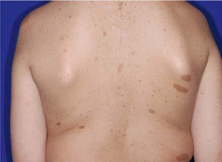

# Chapter 636: Neurocutaneous Syndromes — Board-Style Self-Assessment MCQs
**Part XXV: The Nervous System** | [📖 Read Wiki Chapter](../chapters/636.md) | [🃏 Chapter Flashcards](../flashcards/636_flashcards.md) | [🏠 Course Master Index](../../index.md)

Total questions: **5** *(Click "Show Answer & Rationale" beneath each question)*

### Question 1 (Clinical Pediatrics Vignette)
A pediatric patient is evaluated for the following clinical and diagnostic profile: Tuberous sclerosis; complex; the causative gene (tuberous sclerosis; 1; hamartin); the causative gene (tuberous sclerosis; 2; tuberin); Autosomal dominant; Angiofibromas, hypomelanotic macules, shagreen patches,; ungual fibromas, cortical dysplasias,. Which of the following conditions or syndromes is the most likely diagnosis?

- **A.** PHACE (Neurocutaneous Syndromes)
- **B.** SMARCB1 (Neurocutaneous Syndromes)
- **C.** CLINICAL FEATURES (Neurocutaneous Syndromes)
- **D.** NF2 (Neurocutaneous Syndromes)

<b>Show Answer & Rationale</b>

**Correct Answer: C** — CLINICAL FEATURES (Neurocutaneous Syndromes)

**Rationale:** **CLINICAL FEATURES (Neurocutaneous Syndromes)** (associated with **`TSC1, NF2, TSC2, NF1`**) is characterized by: Tuberous sclerosis; complex; TSC1 (tuberous sclerosis; 1; hamartin); TSC2 (tuberous sclerosis; 2; tuberin); Autosomal dominant; Angiofibromas, hypomelanotic macules, shagreen patches,; ungual fibromas, cortical dysplasias, subependymal giant; cell astrocytomas, subependymal nodules, intellectual; disability, epilepsy i.

**Why Other Options Are Incorrect:** **PHACE (Neurocutaneous Syndromes)** is incorrect (characterized by Unknown; Posterior fossa malformations, hemangiomas, arterial lesions (e.g.,; dysplasia of cerebral ). **SMARCB1 (Neurocutaneous Syndromes)** is incorrect (characterized by LZTR1-related; schwannomatosis). **NF2 (Neurocutaneous Syndromes)** is incorrect (characterized by Vestibular schwannoma, meningioma, ependymoma, schwannoma,; juvenile subcapsular or cortical catarac).

### Question 2 (Clinical Pediatrics Vignette)
A pediatric patient is evaluated for the following clinical and diagnostic profile: Vestibular schwannoma, meningioma, ependymoma, schwannoma,; juvenile subcapsular or cortical cataract, retinal hamartoma,; epiretinal membrane, affected parent, the causative gene pathogenic variant in; at least two distinct tumors; (formerly called . Which of the following conditions or syndromes is the most likely diagnosis?

- **A.** CLINICAL FEATURES (Neurocutaneous Syndromes)
- **B.** SMARCB1 (Neurocutaneous Syndromes)
- **C.** PHACE (Neurocutaneous Syndromes)
- **D.** NF2 (Neurocutaneous Syndromes)

<b>Show Answer & Rationale</b>

**Correct Answer: D** — NF2 (Neurocutaneous Syndromes)

**Rationale:** **NF2 (Neurocutaneous Syndromes)** (associated with **`NF2, SMARCB1`**) is characterized by: Vestibular schwannoma, meningioma, ependymoma, schwannoma,; juvenile subcapsular or cortical cataract, retinal hamartoma,; epiretinal membrane, affected parent, NF2 pathogenic variant in; at least two distinct tumors; (formerly called NF2); Non-NF2-related; schwannomatosis; Two or more schwannomas or hybrid nerve sheat.

**Why Other Options Are Incorrect:** **CLINICAL FEATURES (Neurocutaneous Syndromes)** is incorrect (characterized by Tuberous sclerosis; complex; TSC1 (tuberous sclerosis; 1; hamartin); TSC2 (tuberous sclerosis; 2; tu). **SMARCB1 (Neurocutaneous Syndromes)** is incorrect (characterized by LZTR1-related; schwannomatosis). **PHACE (Neurocutaneous Syndromes)** is incorrect (characterized by Unknown; Posterior fossa malformations, hemangiomas, arterial lesions (e.g.,; dysplasia of cerebral ).

### Question 3 (Pediatric Genetics & Molecular Etiology)
A child is diagnosed with **CLINICAL FEATURES (Neurocutaneous Syndromes)** after presenting with Tuberous sclerosis; complex; the causative gene (tuberous sclerosis; 1; hamartin); the causative gene (tuberous sclerosis; 2; tuberin); Autosomal dominant; Angiofibromas, hypomelanotic macules, shagreen patches. Pathogenic variants in which of the following genes are most classically implicated?

- **A.** EIF2B5
- **B.** TSC1
- **C.** EFNB1
- **D.** WT1

<b>Show Answer & Rationale</b>

**Correct Answer: B** — TSC1

**Rationale:** Pathogenic variants in **`TSC1`** (AD) are associated with **CLINICAL FEATURES (Neurocutaneous Syndromes)** (Tuberous sclerosis; complex; TSC1 (tuberous sclerosis; 1; hamartin); TSC2 (tuberous sclerosis; 2; tuberin); Autosomal dominant; Angiofibromas, hypomelanotic macules, shagreen patches,; ungual fibromas, cortical dysplasias, subependymal giant; cell astrocytomas, subependymal nodules, intellectual; disability, epilepsy i).

**Why Other Options Are Incorrect:** **WT1** is incorrect (associated with WT1-ASSOCIATED WILMS TUMOR PREDISPOSITION SYNDROMES).

### Question 4 (Visual Diagnosis & Clinical Spotter)

A pediatric patient undergoes evaluation for **Neurocutaneous Syndromes**, yielding the clinical or diagnostic finding shown below. Which of the following best characterizes the illustrated finding?

- **A.** The neurocutaneous syndromes include a heterogeneous group of dis orders characterized by abnormalities of both the integument and cen tral nervous system (CNS) of variable severity.
- **B.** This is to establish the diagnosis and ensure exclusion of secondary etiologies.
- **C.** Neurofibromatosis type 1 (NF1). The presence of six or more café-au-lait (CAL) spots larger than 0.5 cm in diameter in children and 1.5 cm in adolescents suggests the possibility of NF1, although
- **D.** Amitriptyline has the most evidence of effective prevention of TTH; biobehavioral intervention, including biofeedback-assisted relaxation training and coping skills, can be use ful as well.

<b>Show Answer & Rationale</b>

**Correct Answer: C** — Neurofibromatosis type 1 (NF1). The presence of six or more café-au-lait (CAL) spots larger than 0.5 cm in diameter in children and 1.5 cm in adolescents suggests the possibility of NF1, although

**Rationale:** **Fig. 636.1**: Neurofibromatosis type 1 (NF1). The presence of six or more café-au-lait (CAL) spots larger than 0.5 cm in diameter in children and 1.5 cm in adolescents suggests the possibility of NF1, although having CAL spots alone does not allow for definitive diagnosis. (From Paller AS, Mancini AJ. Hurwitz Clinical Pediatric Dermatology, 5th ed. Philadelphia: Elsevier; 2016, Fig. 11-44.)

### Question 5 (Pediatric Board Mastery (Neurocutaneous Syndromes))
When formulating an evidence-based diagnostic and management plan for **Neurocutaneous Syndromes** (*Part XXV: The Nervous System*), which of the following pediatric clinical statements is **ACCURATE**? (Item 1)

- **A.** The condition is an entirely benign physiologic variant that never warrants laboratory or clinical evaluation.
- **B.** Inheritance is exclusively holandric (Y-linked) with 100% penetrance restricted to male neonates.
- **C.** This is to establish the diagnosis and ensure exclusion of secondary etiologies.
- **D.** Systemic tetracyclines and fluoroquinolones are universally required as routine prophylaxis in all healthy newborns.

<b>Show Answer & Rationale</b>

**Correct Answer: C** — This is to establish the diagnosis and ensure exclusion of secondary etiologies.

**Rationale:** **Pediatric Clinical Principle (Neurocutaneous Syndromes):** This is to establish the diagnosis and ensure exclusion of secondary etiologies.

