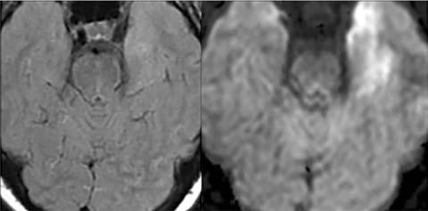

# Chapter 643: Central Nervous System Infections — Board-Style Self-Assessment MCQs
**Part XXV: The Nervous System** | [📖 Read Wiki Chapter](../chapters/643.md) | [🃏 Chapter Flashcards](../flashcards/643_flashcards.md) | [🏠 Course Master Index](../../index.md)

Total questions: **5** *(Click "Show Answer & Rationale" beneath each question)*

### Question 1 (Clinical Pediatrics Vignette)
A pediatric patient is evaluated for the following clinical and diagnostic profile: Normal; 50 (or 75% serum; glucose). Which of the following conditions or syndromes is the most likely diagnosis?

- **A.** UNCOMMON FORMS OF MENINGITIS
- **B.** COMMENTS (Central Nervous System Infections)
- **C.** COMMON FORMS OF MENINGITIS
- **D.** 5-200; CSF (Central Nervous System Infections)

<b>Show Answer & Rationale</b>

**Correct Answer: B** — COMMENTS (Central Nervous System Infections)

**Rationale:** **COMMENTS (Central Nervous System Infections)** is characterized by: Normal; 50 (or 75% serum; glucose).

**Why Other Options Are Incorrect:** **UNCOMMON FORMS OF MENINGITIS** is incorrect (characterized by Tuberculous meningitis; Usually elevated; 10-500; PMNs early,; but lymphocytes; predominate through;). **COMMON FORMS OF MENINGITIS** is incorrect (characterized by Acute bacterial; meningitis; Usually elevated; 100-10,000 or more;; usually 300-2,000;; PMNs predomi). **5-200; CSF (Central Nervous System Infections)** is incorrect (characterized by rarely acellular;; lymphocytes; predominate; if; abscess ruptures; into ventricle, PMNs; predominate).

### Question 2 (Clinical Pediatrics Vignette)
A pediatric patient is evaluated for the following clinical and diagnostic profile: Acute bacterial; meningitis; Usually elevated; 100-10,000 or more;; usually 300-2,000;; PMNs predominate; Usually 100-500; Decreased, usually; 1,000 cells.; Eastern equine; encephalitis; and lymphocytic; choriomeningitis may; have cell counts of; sev. Which of the following conditions or syndromes is the most likely diagnosis?

- **A.** 5-200; CSF (Central Nervous System Infections)
- **B.** COMMON FORMS OF MENINGITIS
- **C.** COMMENTS (Central Nervous System Infections)
- **D.** CSF. (Central Nervous System Infections)

<b>Show Answer & Rationale</b>

**Correct Answer: B** — COMMON FORMS OF MENINGITIS

**Rationale:** **COMMON FORMS OF MENINGITIS** is characterized by: Acute bacterial; meningitis; Usually elevated; 100-10,000 or more;; usually 300-2,000;; PMNs predominate; Usually 100-500; Decreased, usually; 1,000 cells.; Eastern equine; encephalitis; and lymphocytic; choriomeningitis may; have cell counts of; several thousand.; PMNs early, but; mononuclear cells; predominate throug.

**Why Other Options Are Incorrect:** **5-200; CSF (Central Nervous System Infections)** is incorrect (characterized by rarely acellular;; lymphocytes; predominate; if; abscess ruptures; into ventricle, PMNs; predominate). **COMMENTS (Central Nervous System Infections)** is incorrect (characterized by Normal; 50 (or 75% serum; glucose)). **CSF. (Central Nervous System Infections)** is incorrect (characterized by Fungal meningitis; Usually elevated; 5-500; PMNs early,; but mononuclear; cells predominate; for mos).

### Question 3 (Visual Diagnosis & Clinical Spotter)

A pediatric patient undergoes evaluation for **Central Nervous System Infections**, yielding the clinical or diagnostic finding shown below. Which of the following best characterizes the illustrated finding?

- **A.** However, the use of antibiotics and vaccines against the most common causes of bacterial meningitis has significantly altered the spectrum of disease.
- **B.** MRI findings in acute encephalitis. Representative images from infectious and autoimmune encephalitides are shown. A, Early herpes simplex encephalitis; left temporal lobe abnormalities are more
- **C.** Brain abscess is the most common example of a focal infection of the CNS.
- **D.** The diagnosis of CNS infection depends on a combination of imag ing of the brain, testing the cerebrospinal fluid (CSF) by culture, poly merase chain reaction (PCR), and serologic methods an

<b>Show Answer & Rationale</b>

**Correct Answer: B** — MRI findings in acute encephalitis. Representative images from infectious and autoimmune encephalitides are shown. A, Early herpes simplex encephalitis; left temporal lobe abnormalities are more

**Rationale:** **Fig. 643.1**: MRI findings in acute encephalitis. Representative images from infectious and autoimmune encephalitides are shown. A, Early herpes simplex encephalitis; left temporal lobe abnormalities are more clearly seen on diffusion-weighted imaging (DWI) (right) than fluid-attenuated inver sion recovery (FLAIR) (left). B, Autoimmune limbic encephalitis; bilateral mesial temporal lobe abnormalities seen on both DWI (right) and FLAIR (left)—note the symmetric nature of the lesions. C-E, Arboviral encephalitis; T2-weighted image of a patient with Japanese encephalitis shows hyperintensities in bilateral thalamus (C). The hyperintensities are better visualized in FLAIR image (D). T2-weighted image of patient with (E) East ern equine encephalitis shows increased signal intensity and swelling in the deep gray matter. F, Neuromyelitis optica; FLAIR image of a patient who presented with brainstem encephalitis and found to have antibodies to aquaporin-4. G, Listeria brainstem encephalitis; FLAIR (left) and post- gadolinium (right) images show T2 abnormalities similar to neuromyelitis optica (NMO) but also multiple rim-enhancing brainstem lesions typical of Listeria. H, In acute disse

### Question 4 (Differential Diagnosis (Central Nervous System Infections))
During a pediatric consultation regarding **Central Nervous System Infections**, which clinical entity or concept is described by the following profile? "nclude head ache, nausea, vomiting, anorexia, photophobia, restlessness, altered state of consciousness, and irritability."

- **A.** PROGNOSIS
- **B.** COMPLICATIONS
- **C.** Hypoglycor rhachia
- **D.** Common symptoms

<b>Show Answer & Rationale</b>

**Correct Answer: D** — Common symptoms

**Rationale:** Common symptoms include head ache, nausea, vomiting, anorexia, photophobia, restlessness, altered state of consciousness, and irritability.

### Question 5 (Pediatric Board Mastery (Central Nervous System Infections))
When formulating an evidence-based diagnostic and management plan for **Central Nervous System Infections** (*Part XXV: The Nervous System*), which of the following pediatric clinical statements is **ACCURATE**? (Item 1)

- **A.** The condition is an entirely benign physiologic variant that never warrants laboratory or clinical evaluation.
- **B.** Brain abscess is the most common example of a focal infection of the CNS.
- **C.** Diagnostic confirmation relies solely on plain skull radiographs without biochemical, microbiologic, or clinical correlation.
- **D.** Clinical manifestations are permanently restricted to late adulthood and never present during infancy, childhood, or adolescence.

<b>Show Answer & Rationale</b>

**Correct Answer: B** — Brain abscess is the most common example of a focal infection of the CNS.

**Rationale:** **Pediatric Clinical Principle (Central Nervous System Infections):** Brain abscess is the most common example of a focal infection of the CNS.

