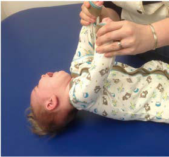

# Chapter 652: Disorders of Neuromuscular Transmission and of Motor Neurons* — Board-Style Self-Assessment MCQs
**Part XXVI: Neuromuscular Disorders** | [📖 Read Wiki Chapter](../chapters/652.md) | [🃏 Chapter Flashcards](../flashcards/652_flashcards.md) | [🏠 Course Master Index](../../index.md)

Total questions: **5** *(Click "Show Answer & Rationale" beneath each question)*

### Question 1 (Clinical Pediatrics Vignette)
A pediatric patient is evaluated for the following clinical and diagnostic profile: Postsynaptic CMS; Acetylcholine; receptor (AChR); deficiency; 50%3. Which of the following conditions or syndromes is the most likely diagnosis?

- **A.** CHRNE (Disorders of Neuromuscular Transmission and of Motor Neurons*)
- **B.** (FCCMS) (Disorders of Neuromuscular Transmission and of Motor Neurons*)
- **C.** INHIBITORS (Disorders of Neuromuscular Transmission and of Motor Neurons*)
- **D.** RAPSN (Disorders of Neuromuscular Transmission and of Motor Neurons*)

<b>Show Answer & Rationale</b>

**Correct Answer: C** — INHIBITORS (Disorders of Neuromuscular Transmission and of Motor Neurons*)

**Rationale:** **INHIBITORS (Disorders of Neuromuscular Transmission and of Motor Neurons*)** is characterized by: Postsynaptic CMS; Acetylcholine; receptor (AChR); deficiency; 50%3.

**Why Other Options Are Incorrect:** **CHRNE (Disorders of Neuromuscular Transmission and of Motor Neurons*)** is incorrect (characterized by AChR deficiency (AR); • Early onset; • Mild to severe; • Ptosis, EOP; bulbar, arm, leg weakness; Imp). **(FCCMS) (Disorders of Neuromuscular Transmission and of Motor Neurons*)** is incorrect (characterized by FCCMS (AR): Mild to severe; Improvement; Defect in AChR; clustering; pathway; 15–20%). **RAPSN (Disorders of Neuromuscular Transmission and of Motor Neurons*)** is incorrect (characterized by Early onset; • Hypotonia, respiratory failure at birth; • Episodic apnea; • Arthrogryposis multiplex).

### Question 2 (Clinical Pediatrics Vignette)
A pediatric patient is evaluated for the following clinical and diagnostic profile: AChR deficiency (the causative gene); • Early onset; • Mild to severe; • Ptosis, EOP; bulbar, arm, leg weakness; Improvement; Slow-channel CMS. Which of the following conditions or syndromes is the most likely diagnosis?

- **A.** DOK7 (Disorders of Neuromuscular Transmission and of Motor Neurons*)
- **B.** SCCMS (AD) (Disorders of Neuromuscular Transmission and of Motor Neurons*)
- **C.** RAPSN (Disorders of Neuromuscular Transmission and of Motor Neurons*)
- **D.** CHRNE (Disorders of Neuromuscular Transmission and of Motor Neurons*)

<b>Show Answer & Rationale</b>

**Correct Answer: D** — CHRNE (Disorders of Neuromuscular Transmission and of Motor Neurons*)

**Rationale:** **CHRNE (Disorders of Neuromuscular Transmission and of Motor Neurons*)** (associated with **`AR, CHRNE`**) is characterized by: AChR deficiency (AR); • Early onset; • Mild to severe; • Ptosis, EOP; bulbar, arm, leg weakness; Improvement; Slow-channel CMS.

**Why Other Options Are Incorrect:** **DOK7 (Disorders of Neuromuscular Transmission and of Motor Neurons*)** is incorrect (characterized by Limb-girdle pattern of predominantly proximal weakness, waddling gait, and ptosis; but no EOP; Deter). **SCCMS (AD) (Disorders of Neuromuscular Transmission and of Motor Neurons*)** is incorrect (characterized by • Selective severe neck, wrist, finger extensor weakness; • Childhood to adult onset; • Mild to seve). **RAPSN (Disorders of Neuromuscular Transmission and of Motor Neurons*)** is incorrect (characterized by Early onset; • Hypotonia, respiratory failure at birth; • Episodic apnea; • Arthrogryposis multiplex).

### Question 3 (Visual Diagnosis & Clinical Spotter)

A pediatric patient undergoes evaluation for **Disorders of Neuromuscular Transmission and of Motor Neurons***, yielding the clinical or diagnostic finding shown below. Which of the following best characterizes the illustrated finding?

- **A.** Some patients may also require pyridostigmine (acetylcholinesterase [AChE] inhibitor) management transiently.
- **B.** Type I spinal muscular atrophy (Werdnig-Hoffmann disease). Clinical manifestations of weakness of limb and axial musculature in a 4-mo-old infant with severe weakness and hypotonia. With vertical
- **C.** The most common genes associated with CMS include CHAT, CHRNE, DOK7, COLQ, GFPT, and RAPSN.
- **D.** CMS can be caused by pathogenic variants affecting proteins involved in ACh synthesis, vesicle fusion into the synaptic cleft, ACh breakdown in the synaptic cleft, and reuptake of choline, w

<b>Show Answer & Rationale</b>

**Correct Answer: B** — Type I spinal muscular atrophy (Werdnig-Hoffmann disease). Clinical manifestations of weakness of limb and axial musculature in a 4-mo-old infant with severe weakness and hypotonia. With vertical

**Rationale:** **Fig. 652.1**: Type I spinal muscular atrophy (Werdnig-Hoffmann disease). Clinical manifestations of weakness of limb and axial musculature in a 4-mo-old infant with severe weakness and hypotonia. With vertical suspension (A), note the dangling lower limbs with lack of hip flexion, tendency of the upper limbs to slip through the examiner’s hands, and lack of neck flexion with resulting head lag. When subject is supine, note the frog-leg positioning of the legs and the lack of traction response (B) and the lag of head (C), with attempts by the examiner to pull the infant to a sitting posi tion. (From Oskoui M, Darras BT, De Vivo DC. Spinal muscular atrophy: 125 years later and on the verge of a cure. In: Sumner CJ, Paushkin S, Ko C-P,

### Question 4 (Differential Diagnosis (652.1 Myasthenia Gravis Adnan Y. Manzur))
During a pediatric consultation regarding **Disorders of Neuromuscular Transmission and of Motor Neurons***, which clinical entity or concept is described by the following profile? "condary to placentally transferred anti- AChR antibodies, distinct from congenital myasthenic syndromes (Tables 652."

- **A.** Botulism
- **B.** Complications
- **C.** SCCMS (AD) (Disorders of Neuromuscular Transmission and of Motor Neurons*)
- **D.** transient neona tal myasthenic syndrome

<b>Show Answer & Rationale</b>

**Correct Answer: D** — transient neona tal myasthenic syndrome

**Rationale:** transient neona tal myasthenic syndrome secondary to placentally transferred anti- AChR antibodies, distinct from congenital myasthenic syndromes (Tables 652.

### Question 5 (Pediatric Board Mastery (Disorders of Neuromuscular Transmission and of Motor Neurons*))
When formulating an evidence-based diagnostic and management plan for **Disorders of Neuromuscular Transmission and of Motor Neurons*** (*Part XXVI: Neuromuscular Disorders*), which of the following pediatric clinical statements is **ACCURATE**? (Item 1)

- **A.** Diagnostic confirmation relies solely on plain skull radiographs without biochemical, microbiologic, or clinical correlation.
- **B.** Inheritance is exclusively holandric (Y-linked) with 100% penetrance restricted to male neonates.
- **C.** First-line management relies on immediate high-dose aspirin therapy in febrile infants.
- **D.** Some patients may also require pyridostigmine (acetylcholinesterase [AChE] inhibitor) management transiently.

<b>Show Answer & Rationale</b>

**Correct Answer: D** — Some patients may also require pyridostigmine (acetylcholinesterase [AChE] inhibitor) management transiently.

**Rationale:** **Pediatric Clinical Principle (Disorders of Neuromuscular Transmission and of Motor Neurons*):** Some patients may also require pyridostigmine (acetylcholinesterase [AChE] inhibitor) management transiently.

