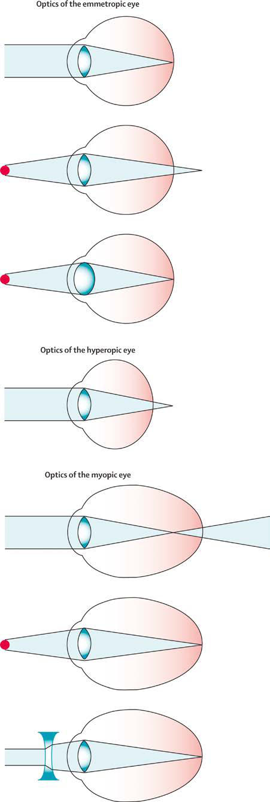

# Chapter 660: Abnormalities of Refraction and Accommodation — Board-Style Self-Assessment MCQs
**Part XXVII: Disorders of the Eye** | [📖 Read Wiki Chapter](../chapters/660.md) | [🃏 Chapter Flashcards](../flashcards/660_flashcards.md) | [🏠 Course Master Index](../../index.md)

Total questions: **5** *(Click "Show Answer & Rationale" beneath each question)*

### Question 1 (Clinical Pediatrics Vignette)
A pediatric patient is evaluated for the following clinical and diagnostic profile: Globally the prevalence of myopia appears to be increasing, leading to heightened interest in myopia prevention treatment.. Which of the following conditions or syndromes is the most likely diagnosis?

- **A.** Abnormalities of Refraction and Accommodation
- **B.** NOS (Human Papillomaviruses)
- **C.** Empyema (Pleurisy, Pleural Effusions, and Empyema)
- **D.** Syringomyelia (Spinal Cord Disorders)

<b>Show Answer & Rationale</b>

**Correct Answer: A** — Abnormalities of Refraction and Accommodation

**Rationale:** **Abnormalities of Refraction and Accommodation** (associated with **`RASGRF1, SLITRK6`**) is characterized by: Globally the prevalence of myopia appears to be increasing, leading to heightened interest in myopia prevention treatment..

**Why Other Options Are Incorrect:** **NOS (Human Papillomaviruses)** is incorrect (characterized by NOS, Not otherwise specified.). **Empyema (Pleurisy, Pleural Effusions, and Empyema)** is incorrect (characterized by DIFFERENTIAL DIAGNOSIS Pleurisy pain must be distinguished from other diseases, such as epi demic pl). **Syringomyelia (Spinal Cord Disorders)** is incorrect (characterized by The majority of adults with IIH continue to have headache after nor malization of ICP and hence requ).

### Question 2 (Pediatric Genetics & Molecular Etiology)
A child is diagnosed with **Abnormalities of Refraction and Accommodation** after presenting with Globally the prevalence of myopia appears to be increasing, leading to heightened interest in myopia prevention treatment.. Pathogenic variants in which of the following genes are most classically implicated?

- **A.** CCDC40
- **B.** RASGRF1
- **C.** TSC1
- **D.** GALC

<b>Show Answer & Rationale</b>

**Correct Answer: B** — RASGRF1

**Rationale:** Pathogenic variants in **`RASGRF1`** (Disorders of the Eye) are associated with **Abnormalities of Refraction and Accommodation** (Globally the prevalence of myopia appears to be increasing, leading to heightened interest in myopia prevention treatment.).

**Why Other Options Are Incorrect:** **TSC1** is incorrect (associated with ANKLE2, CIT, WDFY3).

### Question 3 (Visual Diagnosis & Clinical Spotter)

A pediatric patient undergoes evaluation for **Abnormalities of Refraction and Accommodation**, yielding the clinical or diagnostic finding shown below. Which of the following best characterizes the illustrated finding?

- **A.** Most cases are caused by irregularity in the curvature of the cor nea, although some astigmatism results from changes in the lens.
- **B.** Some children may have pathologic myopia, a rare condition caused by a pathologi cally abnormal axial length of the eye; this is usually associated with thinning of the sclera, choroid, and
- **C.** high degrees of hyperopia requiring greater accommodative effort, vision may be blurred, and the child may complain of eyestrain, head aches, or fatigue. Squinting, eye rubbing, and lack of inter
- **D.** Globally the prevalence of myopia appears to be increasing, leading to heightened interest in myopia prevention treatment.

<b>Show Answer & Rationale</b>

**Correct Answer: C** — high degrees of hyperopia requiring greater accommodative effort, vision may be blurred, and the child may complain of eyestrain, head aches, or fatigue. Squinting, eye rubbing, and lack of inter

**Rationale:** **Fig. 660.1**: high degrees of hyperopia requiring greater accommodative effort, vision may be blurred, and the child may complain of eyestrain, head aches, or fatigue. Squinting, eye rubbing, and lack of interest in reading are frequent manifestations. I

### Question 4 (Differential Diagnosis (Abnormalities of Refraction and Accommodation))
During a pediatric consultation regarding **Abnormalities of Refraction and Accommodation**, which clinical entity or concept is described by the following profile? "The slit-lamp exam provides a highly magnified view of the vari ous structures of the eye and an optical section through the media of the eye—the cornea, aqueous humor, lens, and vitreous."

- **A.** EFFECTIVE DOSE (mSv)
- **B.** BIOMICROSCOPY (SLIT-LAMP EXAMINATION)
- **C.** ANISOMETROPIA
- **D.** TONOMETRY

<b>Show Answer & Rationale</b>

**Correct Answer: B** — BIOMICROSCOPY (SLIT-LAMP EXAMINATION)

**Rationale:** BIOMICROSCOPY (SLIT-LAMP EXAMINATION) The slit-lamp exam provides a highly magnified view of the vari ous structures of the eye and an optical section through the media of the eye—the cornea, aqueous humor, lens, and vitreous.

### Question 5 (Pediatric Board Mastery (Abnormalities of Refraction and Accommodation))
When formulating an evidence-based diagnostic and management plan for **Abnormalities of Refraction and Accommodation** (*Part XXVII: Disorders of the Eye*), which of the following pediatric clinical statements is **ACCURATE**? (Item 1)

- **A.** First-line management relies on immediate high-dose aspirin therapy in febrile infants.
- **B.** Clinical manifestations are permanently restricted to late adulthood and never present during infancy, childhood, or adolescence.
- **C.** Globally the prevalence of myopia appears to be increasing, leading to heightened interest in myopia prevention treatment.
- **D.** The condition is an entirely benign physiologic variant that never warrants laboratory or clinical evaluation.

<b>Show Answer & Rationale</b>

**Correct Answer: C** — Globally the prevalence of myopia appears to be increasing, leading to heightened interest in myopia prevention treatment.

**Rationale:** **Pediatric Clinical Principle (Abnormalities of Refraction and Accommodation):** Globally the prevalence of myopia appears to be increasing, leading to heightened interest in myopia prevention treatment.

