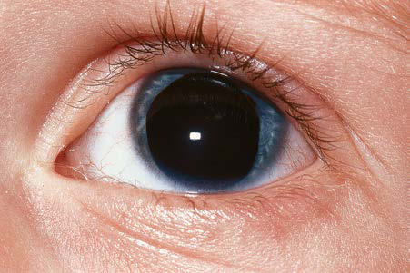

# Chapter 662: Abnormalities of Pupil and Iris — Board-Style Self-Assessment MCQs
**Part XXVII: Disorders of the Eye** | [📖 Read Wiki Chapter](../chapters/662.md) | [🃏 Chapter Flashcards](../flashcards/662_flashcards.md) | [🏠 Course Master Index](../../index.md)

Total questions: **5** *(Click "Show Answer & Rationale" beneath each question)*

### Question 1 (Clinical Pediatrics Vignette)
A pediatric patient is evaluated for the following clinical and diagnostic profile: Coloboma with agenesis of corpus callosum; Congenital colobomatous microphthalmia iris coloboma and anal atresia; Congenital disorder of glycosylation type IV; Deletion 4p, 7p, 13q, 2q31.1, 14q24.3, 15q24; Glotz; Goldenhar; Jacobsen; Joubert; Klippel. Which of the following conditions or syndromes is the most likely diagnosis?

- **A.** CENTRAL (FIRST-ORDER NEURON)
- **B.** POSTGANGLIONIC (THIRD-ORDER NEURON)
- **C.** COACH (Abnormalities of Pupil and Iris)
- **D.** PREGANGLIONIC (SECOND-ORDER NEURON)

<b>Show Answer & Rationale</b>

**Correct Answer: C** — COACH (Abnormalities of Pupil and Iris)

**Rationale:** **COACH (Abnormalities of Pupil and Iris)** is characterized by: Coloboma with agenesis of corpus callosum; Congenital colobomatous microphthalmia iris coloboma and anal atresia; Congenital disorder of glycosylation type IV; Deletion 4p, 7p, 13q, 2q31.1, 14q24.3, 15q24; Glotz; Goldenhar; Jacobsen; Joubert; Klippel Feil 1,3; Meckel Gruber; Morning glory anomaly; Noonan; Renpenning; R.

**Why Other Options Are Incorrect:** **CENTRAL (FIRST-ORDER NEURON)** is incorrect (characterized by Brainstem disease – commonly stroke (e.g. lateral medullary; infarction), but also tumor, demyelinat). **POSTGANGLIONIC (THIRD-ORDER NEURON)** is incorrect (characterized by Internal carotid artery dissection; Nasopharyngeal tumour; Cavernous sinus mass; Otitis media). **PREGANGLIONIC (SECOND-ORDER NEURON)** is incorrect (characterized by Pancoast tumor; Carotid and aortic aneurysm and dissection; Thoracic spinal cord lesion; Miscellaneo).

### Question 2 (Clinical Pediatrics Vignette)
A pediatric patient is evaluated for the following clinical and diagnostic profile: Brainstem disease – commonly stroke (e.g. lateral medullary; infarction), but also tumor, demyelination; Syringomyelia; Lateral medullary (Wallenberg) syndrome; Cervical spinal cord lesion; Diabetic autonomic neuropathy. Which of the following conditions or syndromes is the most likely diagnosis?

- **A.** CENTRAL (FIRST-ORDER NEURON)
- **B.** POSTGANGLIONIC (THIRD-ORDER NEURON)
- **C.** PREGANGLIONIC (SECOND-ORDER NEURON)
- **D.** CLUSTER HEADACHE (MIGRAINOUS NEURALGIA)

<b>Show Answer & Rationale</b>

**Correct Answer: A** — CENTRAL (FIRST-ORDER NEURON)

**Rationale:** **CENTRAL (FIRST-ORDER NEURON)** is characterized by: Brainstem disease – commonly stroke (e.g. lateral medullary; infarction), but also tumor, demyelination; Syringomyelia; Lateral medullary (Wallenberg) syndrome; Cervical spinal cord lesion; Diabetic autonomic neuropathy.

**Why Other Options Are Incorrect:** **POSTGANGLIONIC (THIRD-ORDER NEURON)** is incorrect (characterized by Internal carotid artery dissection; Nasopharyngeal tumour; Cavernous sinus mass; Otitis media). **PREGANGLIONIC (SECOND-ORDER NEURON)** is incorrect (characterized by Pancoast tumor; Carotid and aortic aneurysm and dissection; Thoracic spinal cord lesion; Miscellaneo). **CLUSTER HEADACHE (MIGRAINOUS NEURALGIA)** is incorrect (characterized by From Salman JF: Kanski’s Clinical Ophthalmology, 9th ed. London: Elsevier, 2020. Table 19.4).

### Question 3 (Visual Diagnosis & Clinical Spotter)

A pediatric patient undergoes evaluation for **Abnormalities of Pupil and Iris**, yielding the clinical or diagnostic finding shown below. Which of the following best characterizes the illustrated finding?

- **A.** The usual manifestation is a report of reduced visual acuity in one or both eyes.
- **B.** Another common manifestation is constriction of the visual field.
- **C.** Important clues to the diagnosis are inappropriate affect, excessive grimacing, inconsistency in performance, and suggestibility.
- **D.** Partial aniridia in a member of an autosomal dominant pedigree. (From Hoyt CS, Taylor D, eds. Pediatric Ophthalmology and strabismus. 4th ed. Elsevier; 2013; Fig. 32.22, p. 304.)

<b>Show Answer & Rationale</b>

**Correct Answer: D** — Partial aniridia in a member of an autosomal dominant pedigree. (From Hoyt CS, Taylor D, eds. Pediatric Ophthalmology and strabismus. 4th ed. Elsevier; 2013; Fig. 32.22, p. 304.)

**Rationale:** **Fig. 662.1**: Partial aniridia in a member of an autosomal dominant pedigree. (From Hoyt CS, Taylor D, eds. Pediatric Ophthalmology and strabismus. 4th ed. Elsevier; 2013; Fig. 32.22, p. 304.)

### Question 4 (Differential Diagnosis (Abnormalities of Pupil and Iris))
During a pediatric consultation regarding **Abnormalities of Pupil and Iris**, which clinical entity or concept is described by the following profile? "Vision problems of psychogenic origin are common in school-age chil dren."

- **A.** HEADACHE (Altitude-Associated Illness in Children)
- **B.** HETEROCHROMIA
- **C.** PREGANGLIONIC (SECOND-ORDER NEURON)
- **D.** PSYCHOGENIC DISTURBANCES

<b>Show Answer & Rationale</b>

**Correct Answer: D** — PSYCHOGENIC DISTURBANCES

**Rationale:** PSYCHOGENIC DISTURBANCES Vision problems of psychogenic origin are common in school-age chil dren.

### Question 5 (Pediatric Board Mastery (Abnormalities of Pupil and Iris))
When formulating an evidence-based diagnostic and management plan for **Abnormalities of Pupil and Iris** (*Part XXVII: Disorders of the Eye*), which of the following pediatric clinical statements is **ACCURATE**? (Item 1)

- **A.** Inheritance is exclusively holandric (Y-linked) with 100% penetrance restricted to male neonates.
- **B.** First-line management relies on immediate high-dose aspirin therapy in febrile infants.
- **C.** The usual manifestation is a report of reduced visual acuity in one or both eyes.
- **D.** Systemic tetracyclines and fluoroquinolones are universally required as routine prophylaxis in all healthy newborns.

<b>Show Answer & Rationale</b>

**Correct Answer: C** — The usual manifestation is a report of reduced visual acuity in one or both eyes.

**Rationale:** **Pediatric Clinical Principle (Abnormalities of Pupil and Iris):** The usual manifestation is a report of reduced visual acuity in one or both eyes.

