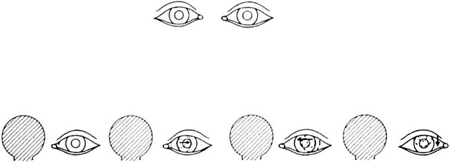

# Chapter 663: Disorders of Eye Movement and Alignment — Board-Style Self-Assessment MCQs
**Part XXVII: Disorders of the Eye** | [📖 Read Wiki Chapter](../chapters/663.md) | [🃏 Chapter Flashcards](../flashcards/663_flashcards.md) | [🏠 Course Master Index](../../index.md)

Total questions: **5** *(Click "Show Answer & Rationale" beneath each question)*

### Question 1 (Clinical Pediatrics Vignette)
A pediatric patient is evaluated for the following clinical and diagnostic profile: phoria: development of abnormality only during certain conditions; (fatigue, illness, cover test); tropia: abnormality present during normal conditions; deviation may; be constant or intermittent. Which of the following conditions or syndromes is the most likely diagnosis?

- **A.** NEUROMUSCULAR DYSFUNCTION
- **B.** LATENCY (Disorders of Eye Movement and Alignment)
- **C.** ASSOCIATED CONDITIONS
- **D.** EQUALITY OF DEVIATION

<b>Show Answer & Rationale</b>

**Correct Answer: B** — LATENCY (Disorders of Eye Movement and Alignment)

**Rationale:** **LATENCY (Disorders of Eye Movement and Alignment)** is characterized by: phoria: development of abnormality only during certain conditions; (fatigue, illness, cover test); tropia: abnormality present during normal conditions; deviation may; be constant or intermittent.

**Why Other Options Are Incorrect:** **NEUROMUSCULAR DYSFUNCTION** is incorrect (characterized by Paralytic: misalignment secondary to a cranial nerve palsy, muscle; weakness, or mechanical restrict). **ASSOCIATED CONDITIONS** is incorrect (characterized by Latent nystagmus; Conjugate jerk nystagmus toward viewing eye; Congenital vision defects, occurs wit). **EQUALITY OF DEVIATION** is incorrect (characterized by Concomitant: misalignment is equal in all positions of gaze; Noncomitant: misalignment varies signif).

### Question 2 (Clinical Pediatrics Vignette)
A pediatric patient is evaluated for the following clinical and diagnostic profile: Eso-: inward, horizontal deviation (“crossing”); Exo-: outward, horizontal deviation (“wall eye”); Hyper-: upward, vertical deviation; Hypo-: downward, vertical deviation; Incyclo-: nasal torsional deviation of the superior pole of the cornea; Excycl. Which of the following conditions or syndromes is the most likely diagnosis?

- **A.** LATENCY (Disorders of Eye Movement and Alignment)
- **B.** NEUROMUSCULAR DYSFUNCTION
- **C.** DIRECTION OF DEVIATION
- **D.** ASSOCIATED CONDITIONS

<b>Show Answer & Rationale</b>

**Correct Answer: C** — DIRECTION OF DEVIATION

**Rationale:** **DIRECTION OF DEVIATION** is characterized by: Eso-: inward, horizontal deviation (“crossing”); Exo-: outward, horizontal deviation (“wall eye”); Hyper-: upward, vertical deviation; Hypo-: downward, vertical deviation; Incyclo-: nasal torsional deviation of the superior pole of the cornea; Excyclo-: temporal torsional deviation of the superior pole of the; cornea.

**Why Other Options Are Incorrect:** **LATENCY (Disorders of Eye Movement and Alignment)** is incorrect (characterized by phoria: development of abnormality only during certain conditions; (fatigue, illness, cover test); t). **NEUROMUSCULAR DYSFUNCTION** is incorrect (characterized by Paralytic: misalignment secondary to a cranial nerve palsy, muscle; weakness, or mechanical restrict). **ASSOCIATED CONDITIONS** is incorrect (characterized by Latent nystagmus; Conjugate jerk nystagmus toward viewing eye; Congenital vision defects, occurs wit).

### Question 3 (Visual Diagnosis & Clinical Spotter)

A pediatric patient undergoes evaluation for **Disorders of Eye Movement and Alignment**, yielding the clinical or diagnostic finding shown below. Which of the following best characterizes the illustrated finding?

- **A.** Pseudostrabismus is one of the most common reasons a pediat ric ophthalmologist is asked to evaluate an infant.
- **B.** Comitant Strabismus Comitant strabismus is the most common type of strabismus.
- **C.** is large or if the amount of convergence that occurs in response to each unit of accommodative effort is great, esotropia may develop.
- **D.** Diagnosis Many techniques are used to assess ocular alignment and movement of the eyes to aid in diagnosing strabismic disorders.

<b>Show Answer & Rationale</b>

**Correct Answer: C** — is large or if the amount of convergence that occurs in response to each unit of accommodative effort is great, esotropia may develop.

**Rationale:** **Fig. 663.1**: is large or if the amount of convergence that occurs in response to each unit of accommodative effort is great, esotropia may develop.

### Question 4 (Differential Diagnosis (Disorders of Eye Movement and Alignment))
During a pediatric consultation regarding **Disorders of Eye Movement and Alignment**, which clinical entity or concept is described by the following profile? "the ideal condition of exact ocular balance."

- **A.** Orthophoria
- **B.** Heterotropia
- **C.** treatment
- **D.** Monocular Elevation Deficiency

<b>Show Answer & Rationale</b>

**Correct Answer: A** — Orthophoria

**Rationale:** Orthophoria is the ideal condition of exact ocular balance.

### Question 5 (Pediatric Board Mastery (Disorders of Eye Movement and Alignment))
When formulating an evidence-based diagnostic and management plan for **Disorders of Eye Movement and Alignment** (*Part XXVII: Disorders of the Eye*), which of the following pediatric clinical statements is **ACCURATE**? (Item 1)

- **A.** Inheritance is exclusively holandric (Y-linked) with 100% penetrance restricted to male neonates.
- **B.** First-line management relies on immediate high-dose aspirin therapy in febrile infants.
- **C.** The condition is an entirely benign physiologic variant that never warrants laboratory or clinical evaluation.
- **D.** Diagnosis Many techniques are used to assess ocular alignment and movement of the eyes to aid in diagnosing strabismic disorders.

<b>Show Answer & Rationale</b>

**Correct Answer: D** — Diagnosis Many techniques are used to assess ocular alignment and movement of the eyes to aid in diagnosing strabismic disorders.

**Rationale:** **Pediatric Clinical Principle (Disorders of Eye Movement and Alignment):** Diagnosis Many techniques are used to assess ocular alignment and movement of the eyes to aid in diagnosing strabismic disorders.

