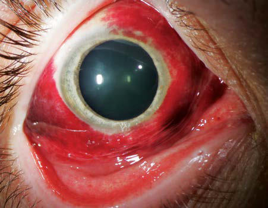

# Chapter 666: Disorders of the Conjunctiva — Board-Style Self-Assessment MCQs
**Part XXVII: Disorders of the Eye** | [📖 Read Wiki Chapter](../chapters/666.md) | [🃏 Chapter Flashcards](../flashcards/666_flashcards.md) | [🏠 Course Master Index](../../index.md)

Total questions: **5** *(Click "Show Answer & Rationale" beneath each question)*

### Question 1 (Clinical Pediatrics Vignette)
A pediatric patient is evaluated for the following clinical and diagnostic profile: Ophthalmia Neonatorum This form of conjunctivitis, occurring in infants younger than 4 weeks of age, is the most common eye disease of newborns.. Which of the following conditions or syndromes is the most likely diagnosis?

- **A.** Disorders of the Conjunctiva
- **B.** RENAL DISORDERS (Idiopathic Intracranial Hypertension (Pseudotumor Cerebri))
- **C.** COVID-19 (Feeding Healthy Infants, Children, and Adolescents)
- **D.** (%) (Tularemia (Francisella tularensis))

<b>Show Answer & Rationale</b>

**Correct Answer: A** — Disorders of the Conjunctiva

**Rationale:** **Disorders of the Conjunctiva** (associated with **`AR`**) is characterized by: Ophthalmia Neonatorum This form of conjunctivitis, occurring in infants younger than 4 weeks of age, is the most common eye disease of newborns..

**Why Other Options Are Incorrect:** **RENAL DISORDERS (Idiopathic Intracranial Hypertension (Pseudotumor Cerebri))** is incorrect (characterized by Nephrotic syndrome; Chronic renal insufficiency; Post–renal transplantation; Peritoneal dialysis). **COVID-19 (Feeding Healthy Infants, Children, and Adolescents)** is incorrect (characterized by Maternal infection is not a contraindication for; breastfeeding or feeding expressed milk.; Ebola; C). **(%) (Tularemia (Francisella tularensis))** is incorrect (characterized by Lymphadenopathy; 90; Fever (>38.3°C [100.9°F]); 85; Ulcer/eschar/papule; 45; Pharyngitis; 40; Myalgi).

### Question 2 (Pediatric Genetics & Molecular Etiology)
A child is diagnosed with **Disorders of the Conjunctiva** after presenting with Ophthalmia Neonatorum This form of conjunctivitis, occurring in infants younger than 4 weeks of age, is the most common eye disease of newborns.. Pathogenic variants in which of the following genes are most classically implicated?

- **A.** GLUD1
- **B.** AR
- **C.** CCDC39
- **D.** MPZ

<b>Show Answer & Rationale</b>

**Correct Answer: B** — AR

**Rationale:** Pathogenic variants in **`AR`** (Disorders of the Eye) are associated with **Disorders of the Conjunctiva** (Ophthalmia Neonatorum This form of conjunctivitis, occurring in infants younger than 4 weeks of age, is the most common eye disease of newborns.).

**Why Other Options Are Incorrect:** **MPZ** is incorrect (associated with MPZ (P0 ) (Hereditary Motor-Sensory Neuropathies)).

### Question 3 (Visual Diagnosis & Clinical Spotter)

A pediatric patient undergoes evaluation for **Disorders of the Conjunctiva**, yielding the clinical or diagnostic finding shown below. Which of the following best characterizes the illustrated finding?

- **A.** Acute hemorrhagic conjunctivitis (AHC) is a highly conta gious conjunctivitis that presents with symptoms of pain, redness, and tearing. Ocular findings include extensive subconjunctival hemorrha
- **B.** Ophthalmia Neonatorum This form of conjunctivitis, occurring in infants younger than 4 weeks of age, is the most common eye disease of newborns.
- **C.** In comparison, Chlamydia trachomatis is the most common organism causing ophthalmia neona torum in the United States, with an incidence of 8.2/1,000 births.
- **D.** Clinical Manifestations The clinical manifestations of the various forms of ophthalmia neona torum are not specific enough to allow an accurate diagnosis.

<b>Show Answer & Rationale</b>

**Correct Answer: A** — Acute hemorrhagic conjunctivitis (AHC) is a highly conta gious conjunctivitis that presents with symptoms of pain, redness, and tearing. Ocular findings include extensive subconjunctival hemorrha

**Rationale:** **Fig. 666.1**: Acute hemorrhagic conjunctivitis (AHC) is a highly conta gious conjunctivitis that presents with symptoms of pain, redness, and tearing. Ocular findings include extensive subconjunctival hemorrhag es, follicles, and chemosis. Causative agents include coxsackie group A24 (CA24) and enterovirus E70 (EV70). (From Krachmer JH, Palay DA. Cornea Atlas. 3rd ed. London: Elsevier, 2014: Fig 7-23))

### Question 4 (Differential Diagnosis (Disorders of the Conjunctiva))
During a pediatric consultation regarding **Disorders of the Conjunctiva**, which clinical entity or concept is described by the following profile? "This form of conjunctivitis, occurring in infants younger than 4 weeks of age, is the most common eye disease of newborns."

- **A.** Prognosis and Prevention
- **B.** Disorders of the Conjunctiva
- **C.** Ophthalmia Neonatorum
- **D.** Membranous and Pseudomembranous Conjunctivitis

<b>Show Answer & Rationale</b>

**Correct Answer: C** — Ophthalmia Neonatorum

**Rationale:** Ophthalmia Neonatorum This form of conjunctivitis, occurring in infants younger than 4 weeks of age, is the most common eye disease of newborns.

### Question 5 (Pediatric Board Mastery (Disorders of the Conjunctiva))
When formulating an evidence-based diagnostic and management plan for **Disorders of the Conjunctiva** (*Part XXVII: Disorders of the Eye*), which of the following pediatric clinical statements is **ACCURATE**? (Item 1)

- **A.** The condition is an entirely benign physiologic variant that never warrants laboratory or clinical evaluation.
- **B.** Ophthalmia Neonatorum This form of conjunctivitis, occurring in infants younger than 4 weeks of age, is the most common eye disease of newborns.
- **C.** Clinical manifestations are permanently restricted to late adulthood and never present during infancy, childhood, or adolescence.
- **D.** Inheritance is exclusively holandric (Y-linked) with 100% penetrance restricted to male neonates.

<b>Show Answer & Rationale</b>

**Correct Answer: B** — Ophthalmia Neonatorum This form of conjunctivitis, occurring in infants younger than 4 weeks of age, is the most common eye disease of newborns.

**Rationale:** **Pediatric Clinical Principle (Disorders of the Conjunctiva):** Ophthalmia Neonatorum This form of conjunctivitis, occurring in infants younger than 4 weeks of age, is the most common eye disease of newborns.

