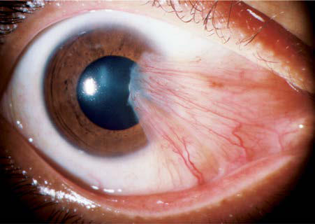

# Chapter 667: Abnormalities of the Cornea — Board-Style Self-Assessment MCQs
**Part XXVII: Disorders of the Eye** | [📖 Read Wiki Chapter](../chapters/667.md) | [🃏 Chapter Flashcards](../flashcards/667_flashcards.md) | [🏠 Course Master Index](../../index.md)

Total questions: **5** *(Click "Show Answer & Rationale" beneath each question)*

### Question 1 (Clinical Pediatrics Vignette)
A pediatric patient is evaluated for the following clinical and diagnostic profile: Unilateral or; bilateral; Vascularized, blends with; sclera, clearer centrally; Normal (or; elevated); Cornea plana; Nonprogressive; Sporadic. Which of the following conditions or syndromes is the most likely diagnosis?

- **A.** E—Endothelial dystrophy
- **B.** S—Sclerocornea (Abnormalities of the Cornea)
- **C.** U—Ulcers (Abnormalities of the Cornea)
- **D.** P—Posterior corneal defect

<b>Show Answer & Rationale</b>

**Correct Answer: B** — S—Sclerocornea (Abnormalities of the Cornea)

**Rationale:** **S—Sclerocornea (Abnormalities of the Cornea)** is characterized by: Unilateral or; bilateral; Vascularized, blends with; sclera, clearer centrally; Normal (or; elevated); Cornea plana; Nonprogressive; Sporadic.

**Why Other Options Are Incorrect:** **E—Endothelial dystrophy** is incorrect (characterized by Congenital hereditary; endothelial dystrophy; Bilateral; Diffuse corneal edema,; marked corneal; thi). **U—Ulcers (Abnormalities of the Cornea)** is incorrect (characterized by Herpes simplex keratitis; Unilateral; Diffuse with geographic; epithelial defect; Normal; None; Prog). **P—Posterior corneal defect** is incorrect (characterized by Unilateral or; bilateral; Central, diffuse haze or; vascularized leukoma; Normal or; elevated; Anter).

### Question 2 (Clinical Pediatrics Vignette)
A pediatric patient is evaluated for the following clinical and diagnostic profile: Descemet’s membrane; Birth trauma; Unilateral; Diffuse edema; Normal; Possible hyphema,; periorbital; ecchymoses; Spontaneous; improvement in; 1 mo; Sporadic; Infantile glaucoma; Bilateral; Diffuse edema; Elevated; Megalocornea,; photophobia and; tea. Which of the following conditions or syndromes is the most likely diagnosis?

- **A.** S—Sclerocornea (Abnormalities of the Cornea)
- **B.** U—Ulcers (Abnormalities of the Cornea)
- **C.** M—Metabolic (rarely
- **D.** T—Tears in endothelium and

<b>Show Answer & Rationale</b>

**Correct Answer: D** — T—Tears in endothelium and

**Rationale:** **T—Tears in endothelium and** is characterized by: Descemet’s membrane; Birth trauma; Unilateral; Diffuse edema; Normal; Possible hyphema,; periorbital; ecchymoses; Spontaneous; improvement in; 1 mo; Sporadic; Infantile glaucoma; Bilateral; Diffuse edema; Elevated; Megalocornea,; photophobia and; tearing, abnormal; angle; Progressive; unless treated; Autosomal; recessi.

**Why Other Options Are Incorrect:** **S—Sclerocornea (Abnormalities of the Cornea)** is incorrect (characterized by Unilateral or; bilateral; Vascularized, blends with; sclera, clearer centrally; Normal (or; elevated). **U—Ulcers (Abnormalities of the Cornea)** is incorrect (characterized by Herpes simplex keratitis; Unilateral; Diffuse with geographic; epithelial defect; Normal; None; Prog). **M—Metabolic (rarely** is incorrect (characterized by present at birth); (mucopolysaccharidoses IH,; IS; mucolipidosis type IV)*; Bilateral; Diffuse haze,).

### Question 3 (Visual Diagnosis & Clinical Spotter)

A pediatric patient undergoes evaluation for **Abnormalities of the Cornea**, yielding the clinical or diagnostic finding shown below. Which of the following best characterizes the illustrated finding?

- **A.** MEGALOCORNEA This is a nonprogressive symmetric condition characterized by an enlarged cornea (>12 mm in diameter) and an anterior segment in which there is no evidence of previous or concur
- **B.** Pterygium. These lesions are found in the horizontal meridian, most common nasally. (From Palay DA, Krachmer JH. Primary Care Ophthal mology. 2nd ed. Philadelphia: Elsevier Mosby; 2005: Fig. 3.50
- **C.** It is a serious complication of Stevens-Johnson syndrome.
- **D.** These lesions are found in the horizontal meridian, most common nasally. (From Palay DA, Krachmer JH.

<b>Show Answer & Rationale</b>

**Correct Answer: B** — Pterygium. These lesions are found in the horizontal meridian, most common nasally. (From Palay DA, Krachmer JH. Primary Care Ophthal mology. 2nd ed. Philadelphia: Elsevier Mosby; 2005: Fig. 3.50

**Rationale:** **Fig. 666.5**: Pterygium. These lesions are found in the horizontal meridian, most common nasally. (From Palay DA, Krachmer JH. Primary Care Ophthal mology. 2nd ed. Philadelphia: Elsevier Mosby; 2005: Fig. 3.50, p 62.)

### Question 4 (Differential Diagnosis (Abnormalities of the Cornea))
During a pediatric consultation regarding **Abnormalities of the Cornea**, which clinical entity or concept is described by the following profile? "cyst and dermolipoma are benign lesions, clinically sim ilar in appearance."

- **A.** CORNEAL ULCERS
- **B.** MEGALOCORNEA
- **C.** Dermoid
- **D.** CORNEAL DYSTROPHIES

<b>Show Answer & Rationale</b>

**Correct Answer: C** — Dermoid

**Rationale:** Dermoid cyst and dermolipoma are benign lesions, clinically sim ilar in appearance.

### Question 5 (Pediatric Board Mastery (Abnormalities of the Cornea))
When formulating an evidence-based diagnostic and management plan for **Abnormalities of the Cornea** (*Part XXVII: Disorders of the Eye*), which of the following pediatric clinical statements is **ACCURATE**? (Item 1)

- **A.** Diagnostic confirmation relies solely on plain skull radiographs without biochemical, microbiologic, or clinical correlation.
- **B.** It is a serious complication of Stevens-Johnson syndrome.
- **C.** The condition is an entirely benign physiologic variant that never warrants laboratory or clinical evaluation.
- **D.** First-line management relies on immediate high-dose aspirin therapy in febrile infants.

<b>Show Answer & Rationale</b>

**Correct Answer: B** — It is a serious complication of Stevens-Johnson syndrome.

**Rationale:** **Pediatric Clinical Principle (Abnormalities of the Cornea):** It is a serious complication of Stevens-Johnson syndrome.

