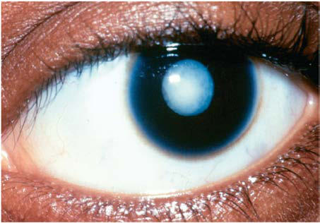

# Chapter 668: Abnormalities of the Lens — Board-Style Self-Assessment MCQs
**Part XXVII: Disorders of the Eye** | [📖 Read Wiki Chapter](../chapters/668.md) | [🃏 Chapter Flashcards](../flashcards/668_flashcards.md) | [🏠 Course Master Index](../../index.md)

Total questions: **5** *(Click "Show Answer & Rationale" beneath each question)*

### Question 1 (Clinical Pediatrics Vignette)
A pediatric patient is evaluated for the following clinical and diagnostic profile: Prematurity (Y-suture vacuoles) with or without retinopathy of; prematurity; Mittendorf dot (remnant of hyaloid artery); Persistent pupillary membrane (remnant of embryonic lens vasculature). Which of the following conditions or syndromes is the most likely diagnosis?

- **A.** Multisystem Syndromic Disorders
- **B.** ENDOCRINOPATHIES (Abnormalities of the Lens)
- **C.** Simple Mendelian Inheritance
- **D.** DEVELOPMENTAL VARIANTS

<b>Show Answer & Rationale</b>

**Correct Answer: D** — DEVELOPMENTAL VARIANTS

**Rationale:** **DEVELOPMENTAL VARIANTS** is characterized by: Prematurity (Y-suture vacuoles) with or without retinopathy of; prematurity; Mittendorf dot (remnant of hyaloid artery); Persistent pupillary membrane (remnant of embryonic lens vasculature).

**Why Other Options Are Incorrect:** **Multisystem Syndromic Disorders** is incorrect (characterized by Alport syndrome (hearing loss, renal disease); Alström syndrome (nerve deafness, diabetes mellitus);). **ENDOCRINOPATHIES (Abnormalities of the Lens)** is incorrect (characterized by Albright hereditary osteodystrophy; Hypocalcemia (hypoparathyroidism); Hypoglycemia; Diabetes mellit). **Simple Mendelian Inheritance** is incorrect (characterized by Autosomal dominant (most common); Autosomal recessive; X-linked).

### Question 2 (Clinical Pediatrics Vignette)
A pediatric patient is evaluated for the following clinical and diagnostic profile: Autosomal dominant (most common); Autosomal recessive; X-linked. Which of the following conditions or syndromes is the most likely diagnosis?

- **A.** Simple Mendelian Inheritance
- **B.** INBORN ERRORS OF METABOLISM
- **C.** Multisystem Syndromic Disorders
- **D.** DEVELOPMENTAL VARIANTS

<b>Show Answer & Rationale</b>

**Correct Answer: A** — Simple Mendelian Inheritance

**Rationale:** **Simple Mendelian Inheritance** is characterized by: Autosomal dominant (most common); Autosomal recessive; X-linked.

**Why Other Options Are Incorrect:** **INBORN ERRORS OF METABOLISM** is incorrect (characterized by Abetalipoproteinemia (absent chylomicrons, retinal degeneration); Fabry disease (α-galactosidase A d). **Multisystem Syndromic Disorders** is incorrect (characterized by Alport syndrome (hearing loss, renal disease); Alström syndrome (nerve deafness, diabetes mellitus);). **DEVELOPMENTAL VARIANTS** is incorrect (characterized by Prematurity (Y-suture vacuoles) with or without retinopathy of; prematurity; Mittendorf dot (remnant).

### Question 3 (Visual Diagnosis & Clinical Spotter)

A pediatric patient undergoes evaluation for **Abnormalities of the Lens**, yielding the clinical or diagnostic finding shown below. Which of the following best characterizes the illustrated finding?

- **A.** Differential Diagnosis The differential diagnosis of cataracts in infants and children includes a wide range of developmental disorders, infectious and inflammatory processes, metabolic dise
- **B.** Twelve crystallin gene pathologic variants are the most frequently identified genetic etiologies for both autosomal dominant and reces sive inheritance patterns.
- **C.** Leukocoria secondary to cataract.
- **D.** Metabolic Disorders Cataracts are a prominent manifestation of many metabolic dis eases, particularly certain disorders of carbohydrate, amino acid, calcium, and copper metabolism.

<b>Show Answer & Rationale</b>

**Correct Answer: C** — Leukocoria secondary to cataract.

**Rationale:** **Fig. 668.1**: Leukocoria secondary to cataract.

### Question 4 (Differential Diagnosis (Abnormalities of the Lens))
During a pediatric consultation regarding **Abnormalities of the Lens**, which clinical entity or concept is described by the following profile? "The this pediatric condition of cataracts in infants and children includes a wide range of developmental disorders, infectious and inflammatory processes, metabolic diseases, and toxic and trau matic insults (Table 668."

- **A.** Major Chromosomal Defects
- **B.** Congenital Infection Syndrome
- **C.** Prematurity
- **D.** Differential Diagnosis

<b>Show Answer & Rationale</b>

**Correct Answer: D** — Differential Diagnosis

**Rationale:** Differential Diagnosis The differential diagnosis of cataracts in infants and children includes a wide range of developmental disorders, infectious and inflammatory processes, metabolic diseases, and toxic and trau matic insults (Table 668.

### Question 5 (Pediatric Board Mastery (Abnormalities of the Lens))
When formulating an evidence-based diagnostic and management plan for **Abnormalities of the Lens** (*Part XXVII: Disorders of the Eye*), which of the following pediatric clinical statements is **ACCURATE**? (Item 1)

- **A.** Inheritance is exclusively holandric (Y-linked) with 100% penetrance restricted to male neonates.
- **B.** Differential Diagnosis The differential diagnosis of cataracts in infants and children includes a wide range of developmental disorders, infectious and inflammatory processes, metabolic diseases, and toxic
- **C.** The condition is an entirely benign physiologic variant that never warrants laboratory or clinical evaluation.
- **D.** Systemic tetracyclines and fluoroquinolones are universally required as routine prophylaxis in all healthy newborns.

<b>Show Answer & Rationale</b>

**Correct Answer: B** — Differential Diagnosis The differential diagnosis of cataracts in infants and children includes a wide range of developmental disorders, infectious and inflammatory processes, metabolic diseases, and toxic

**Rationale:** **Pediatric Clinical Principle (Abnormalities of the Lens):** Differential Diagnosis The differential diagnosis of cataracts in infants and children includes a wide range of developmental disorders, infectious and inflammatory processes, metabolic diseases, and toxic and trau matic insults.

