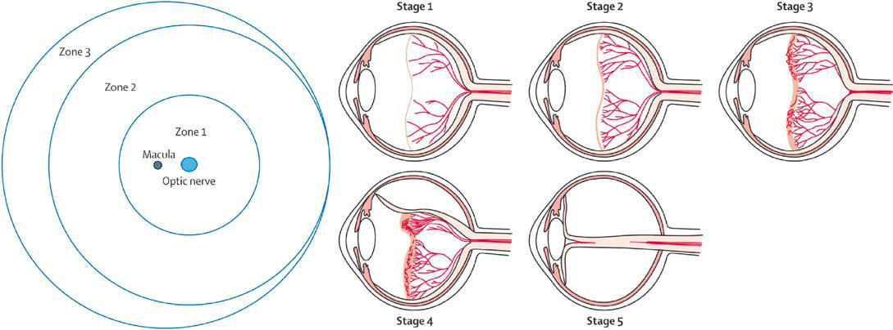

# Chapter 670: Disorders of the Retina and Vitreous — Board-Style Self-Assessment MCQs
**Part XXVII: Disorders of the Eye** | [📖 Read Wiki Chapter](../chapters/670.md) | [🃏 Chapter Flashcards](../flashcards/670_flashcards.md) | [🏠 Course Master Index](../../index.md)

Total questions: **5** *(Click "Show Answer & Rationale" beneath each question)*

### Question 1 (Clinical Pediatrics Vignette)
A pediatric patient is evaluated for the following clinical and diagnostic profile: 22; 31; 9; 23; 31; 8; 24; 31; 7; 25; 31; 6; 26; 31; 5; 27; 31; 4; 28; 32; 4; 29; 33; 4; 30; 34; 4; 31; 35; 4; 32; 36; 4. Which of the following conditions or syndromes is the most likely diagnosis?

- **A.** INFECTIOUS (Sarcoidosis)
- **B.** PAIN SYNDROMES (Musculoskeletal Pain Syndromes)
- **C.** Disorders of the Retina and Vitreous
- **D.** CHRONOLOGICAL (Disorders of the Retina and Vitreous)

<b>Show Answer & Rationale</b>

**Correct Answer: D** — CHRONOLOGICAL (Disorders of the Retina and Vitreous)

**Rationale:** **CHRONOLOGICAL (Disorders of the Retina and Vitreous)** is characterized by: 22; 31; 9; 23; 31; 8; 24; 31; 7; 25; 31; 6; 26; 31; 5; 27; 31; 4; 28; 32; 4; 29; 33; 4; 30; 34; 4; 31; 35; 4; 32; 36; 4.

**Why Other Options Are Incorrect:** **INFECTIOUS (Sarcoidosis)** is incorrect (characterized by Tuberculosis; Cat-scratch fever; Syphilis; Leprosy; Fungal (blastomycosis, histoplasmosis); Actinomy). **PAIN SYNDROMES (Musculoskeletal Pain Syndromes)** is incorrect (characterized by Shoulder; Impingement syndrome; Elbow; “Little League elbow”; Avulsion fractures; Osteochondritis di). **Disorders of the Retina and Vitreous** is incorrect (characterized by Stage 1 is characterized by a demarcation line that separates vas cularized from avascular retina.).

### Question 2 (Clinical Pediatrics Vignette)
A pediatric patient is evaluated for the following clinical and diagnostic profile: Stage 1 is characterized by a demarcation line that separates vas cularized from avascular retina.. Which of the following conditions or syndromes is the most likely diagnosis?

- **A.** CHRONOLOGICAL (Disorders of the Retina and Vitreous)
- **B.** FACILITATORS (Health and Wellness for Children with Disabilities)
- **C.** Disorders of the Retina and Vitreous
- **D.** SPAST (Encephalopathies)

<b>Show Answer & Rationale</b>

**Correct Answer: C** — Disorders of the Retina and Vitreous

**Rationale:** **Disorders of the Retina and Vitreous** (associated with **`ABCA4, CTC1, ELOVL4, FZD4, LRP5`**) is characterized by: Stage 1 is characterized by a demarcation line that separates vas cularized from avascular retina..

**Why Other Options Are Incorrect:** **CHRONOLOGICAL (Disorders of the Retina and Vitreous)** is incorrect (characterized by 22; 31; 9; 23; 31; 8; 24; 31; 7; 25; 31; 6; 26; 31; 5; 27; 31; 4; 28; 32; 4; 29; 33; 4; 30; 34; 4; 3). **FACILITATORS (Health and Wellness for Children with Disabilities)** is incorrect (characterized by 1. Education or knowledge; about heathy behaviors; 2. Engaging child in; discussions and; decisions;). **SPAST (Encephalopathies)** is incorrect (characterized by ++; None; Leukoencephalopathy,; thin corpus callosum; Pure).

### Question 3 (Visual Diagnosis & Clinical Spotter)

A pediatric patient undergoes evaluation for **Disorders of the Retina and Vitreous**, yielding the clinical or diagnostic finding shown below. Which of the following best characterizes the illustrated finding?

- **A.** Retinopathy of prematurity (ROP). A, In stage 3, there is a ridge and extraretinal vascular tissue. B, Retinal vessels are dilated and tortu ous in active zone I ROP with plus disease. C, Zone I
- **B.** Stage 2 is characterized by a ridge; the demarcation line has grown, acquir ing height, width, and volume and extending up and out of the plane of the retina.
- **C.** Stage 1 is characterized by a demarcation line that separates vas cularized from avascular retina.
- **D.** Stage 3 is characterized by the presence of a ridge and the development of extraretinal fibrovascular tissue.

<b>Show Answer & Rationale</b>

**Correct Answer: A** — Retinopathy of prematurity (ROP). A, In stage 3, there is a ridge and extraretinal vascular tissue. B, Retinal vessels are dilated and tortu ous in active zone I ROP with plus disease. C, Zone I

**Rationale:** **Fig. 670.2**: Retinopathy of prematurity (ROP). A, In stage 3, there is a ridge and extraretinal vascular tissue. B, Retinal vessels are dilated and tortu ous in active zone I ROP with plus disease. C, Zone I ROP with plus disease.

### Question 4 (Differential Diagnosis (Disorders of the Retina and Vitreous))
During a pediatric consultation regarding **Disorders of the Retina and Vitreous**, which clinical entity or concept is described by the following profile? "Beginning at 16 weeks of gestation, retinal angiogenesis normally pro ceeds from the optic disc to the periphery, reaching the outer rim of the retina (ora serrata) nasally at about 36 weeks and extending tempo rally by approximately 40 weeks."

- **A.** Gene replacement
- **B.** RETINOSCHISIS
- **C.** Pathogenesis
- **D.** INHERITED RETINAL DYSTROPHIES

<b>Show Answer & Rationale</b>

**Correct Answer: C** — Pathogenesis

**Rationale:** Pathogenesis Beginning at 16 weeks of gestation, retinal angiogenesis normally pro ceeds from the optic disc to the periphery, reaching the outer rim of the retina (ora serrata) nasally at about 36 weeks and extending tempo rally by approximately 40 weeks.

### Question 5 (Pediatric Board Mastery (Disorders of the Retina and Vitreous))
When formulating an evidence-based diagnostic and management plan for **Disorders of the Retina and Vitreous** (*Part XXVII: Disorders of the Eye*), which of the following pediatric clinical statements is **ACCURATE**? (Item 1)

- **A.** First-line management relies on immediate high-dose aspirin therapy in febrile infants.
- **B.** Stage 1 is characterized by a demarcation line that separates vas cularized from avascular retina.
- **C.** Diagnostic confirmation relies solely on plain skull radiographs without biochemical, microbiologic, or clinical correlation.
- **D.** Clinical manifestations are permanently restricted to late adulthood and never present during infancy, childhood, or adolescence.

<b>Show Answer & Rationale</b>

**Correct Answer: B** — Stage 1 is characterized by a demarcation line that separates vas cularized from avascular retina.

**Rationale:** **Pediatric Clinical Principle (Disorders of the Retina and Vitreous):** Stage 1 is characterized by a demarcation line that separates vas cularized from avascular retina.

