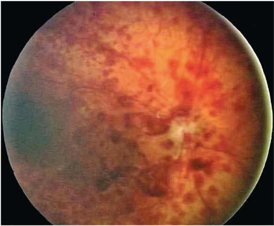

# Chapter 671: Abnormalities of the Optic Nerve — Board-Style Self-Assessment MCQs
**Part XXVII: Disorders of the Eye** | [📖 Read Wiki Chapter](../chapters/671.md) | [🃏 Chapter Flashcards](../flashcards/671_flashcards.md) | [🏠 Course Master Index](../../index.md)

Total questions: **5** *(Click "Show Answer & Rationale" beneath each question)*

### Question 1 (Clinical Pediatrics Vignette)
A pediatric patient is evaluated for the following clinical and diagnostic profile: Inheritance; Autosomal dominant; Maternal; Autosomal dominant; Autosomal recessive; Autosomal dominant; Age of onset; Childhood; Young adult, male >; female; Late childhood; Childhood; Childhood to adult; Ophthalmologic; features; Slowly progressive,. Which of the following conditions or syndromes is the most likely diagnosis?

- **A.** B12) (Abnormalities of the Optic Nerve)
- **B.** Autoimmune Hepatitis Type 2 (AIH-2)
- **C.** WFS1 (Abnormalities of the Optic Nerve)
- **D.** DEFICIENCIES (Abnormalities of the Optic Nerve)

<b>Show Answer & Rationale</b>

**Correct Answer: C** — WFS1 (Abnormalities of the Optic Nerve)

**Rationale:** **WFS1 (Abnormalities of the Optic Nerve)** (associated with **`ND4, WFS1`**) is characterized by: Inheritance; Autosomal dominant; Maternal; Autosomal dominant; Autosomal recessive; Autosomal dominant; Age of onset; Childhood; Young adult, male >; female; Late childhood; Childhood; Childhood to adult; Ophthalmologic; features; Slowly progressive,; tritanomaly; Sudden visual; loss. Frequently; beginning unilateral; .

**Why Other Options Are Incorrect:** **B12) (Abnormalities of the Optic Nerve)** is incorrect (characterized by Ethanol; Isoniazid; Tobacco; Chloramphenicol; Arsenics; Linezolid; Cobalt; Erythromycin; Thallium; S). **Autoimmune Hepatitis Type 2 (AIH-2)** is incorrect (characterized by Younger children/infants; anti-LKM-1+ (anti-CYP2D6) and/or anti-LC-1+; higher risk of acute liver fa). **DEFICIENCIES (Abnormalities of the Optic Nerve)** is incorrect (characterized by Methanol; Ethambutol; Thiamine (Vitamin B1); Riboflavin (Vitamin B2); Pyridoxine (Vitamin B6); Folic).

### Question 2 (Clinical Pediatrics Vignette)
A pediatric patient is evaluated for the following clinical and diagnostic profile: Methanol; Ethambutol; Thiamine (Vitamin B1); Riboflavin (Vitamin B2); Pyridoxine (Vitamin B6); Folic Acid (Vitamin B9); Cobalamin (Vitamin. Which of the following conditions or syndromes is the most likely diagnosis?

- **A.** DEFICIENCIES (Abnormalities of the Optic Nerve)
- **B.** (12-20 YR) (Developmental and Behavioral Theories)
- **C.** B12) (Abnormalities of the Optic Nerve)
- **D.** ANOMALOUS AORTIC ORIGIN

<b>Show Answer & Rationale</b>

**Correct Answer: A** — DEFICIENCIES (Abnormalities of the Optic Nerve)

**Rationale:** **DEFICIENCIES (Abnormalities of the Optic Nerve)** is characterized by: Methanol; Ethambutol; Thiamine (Vitamin B1); Riboflavin (Vitamin B2); Pyridoxine (Vitamin B6); Folic Acid (Vitamin B9); Cobalamin (Vitamin.

**Why Other Options Are Incorrect:** **(12-20 YR) (Developmental and Behavioral Theories)** is incorrect (characterized by Freud:; psychosexual; Oral; Anal; Phallic/oedipal; Latency; Genital; Erikson:; psychosocial; Basic t). **B12) (Abnormalities of the Optic Nerve)** is incorrect (characterized by Ethanol; Isoniazid; Tobacco; Chloramphenicol; Arsenics; Linezolid; Cobalt; Erythromycin; Thallium; S). **ANOMALOUS AORTIC ORIGIN** is incorrect (characterized by • Eccentric ostium within an aortic sinus; • Ectopic ostium above an aortic sinus; • Conus artery fr).

### Question 3 (Pediatric Genetics & Molecular Etiology)
A child is diagnosed with **WFS1 (Abnormalities of the Optic Nerve)** after presenting with Inheritance; Autosomal dominant; Maternal; Autosomal dominant; Autosomal recessive; Autosomal dominant; Age of onset; Childhood; Young adult, male >; female; Late childhood; Childhood; Childhood to adult; Ophth. Pathogenic variants in which of the following genes are most classically implicated?

- **A.** BSND
- **B.** GBE1
- **C.** ND4
- **D.** UGT1A1

<b>Show Answer & Rationale</b>

**Correct Answer: C** — ND4

**Rationale:** Pathogenic variants in **`ND4`** (AR) are associated with **WFS1 (Abnormalities of the Optic Nerve)** (Inheritance; Autosomal dominant; Maternal; Autosomal dominant; Autosomal recessive; Autosomal dominant; Age of onset; Childhood; Young adult, male >; female; Late childhood; Childhood; Childhood to adult; Ophthalmologic; features; Slowly progressive,; tritanomaly; Sudden visual; loss. Frequently; beginning unilateral; ).

**Why Other Options Are Incorrect:** **UGT1A1** is incorrect (associated with Crigler-Najjar Type 1 vs Type 2 (UGT1A1)).

### Question 4 (Visual Diagnosis & Clinical Spotter)

A pediatric patient undergoes evaluation for **Abnormalities of the Optic Nerve**, yielding the clinical or diagnostic finding shown below. Which of the following best characterizes the illustrated finding?

- **A.** Because the macula is generally unaffected, the visual prognosis is good.
- **B.** Isolated colobomatous anomalies are commonly inherited in an autosomal dominant manner with highly variable penetrance and expressivity.
- **C.** OPTIC NERVE HYPOPLASIA Hypoplasia of the optic nerve is a nonprogressive, idiopathic condition characterized by a subnormal number of optic nerve axons with nor mal mesodermal elements and g
- **D.** Shaken baby syndrome (inflicted neurotrauma). Retinal hemorrhages in multiple layers too numerous to count into the far periphery.

<b>Show Answer & Rationale</b>

**Correct Answer: D** — Shaken baby syndrome (inflicted neurotrauma). Retinal hemorrhages in multiple layers too numerous to count into the far periphery.

**Rationale:** **Fig. 670.13**: Shaken baby syndrome (inflicted neurotrauma). Retinal hemorrhages in multiple layers too numerous to count into the far periphery.

### Question 5 (Pediatric Board Mastery (Abnormalities of the Optic Nerve))
When formulating an evidence-based diagnostic and management plan for **Abnormalities of the Optic Nerve** (*Part XXVII: Disorders of the Eye*), which of the following pediatric clinical statements is **ACCURATE**? (Item 1)

- **A.** Diagnostic confirmation relies solely on plain skull radiographs without biochemical, microbiologic, or clinical correlation.
- **B.** The condition is an entirely benign physiologic variant that never warrants laboratory or clinical evaluation.
- **C.** Systemic tetracyclines and fluoroquinolones are universally required as routine prophylaxis in all healthy newborns.
- **D.** Because the macula is generally unaffected, the visual prognosis is good.

<b>Show Answer & Rationale</b>

**Correct Answer: D** — Because the macula is generally unaffected, the visual prognosis is good.

**Rationale:** **Pediatric Clinical Principle (Abnormalities of the Optic Nerve):** Because the macula is generally unaffected, the visual prognosis is good.

