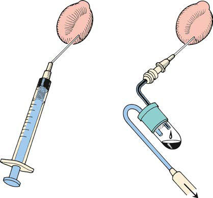

# Chapter 677: Hearing Loss — Board-Style Self-Assessment MCQs
**Part XXVIII: The Ear** | [📖 Read Wiki Chapter](../chapters/677.md) | [🃏 Chapter Flashcards](../flashcards/677_flashcards.md) | [🏠 Course Master Index](../../index.md)

Total questions: **5** *(Click "Show Answer & Rationale" beneath each question)*

### Question 1 (Clinical Pediatrics Vignette)
A pediatric patient is evaluated for the following clinical and diagnostic profile: • Family history of hereditary childhood sensorineural hearing loss; • In utero infection, such as cytomegalovirus, rubella, syphilis,; herpes simplex, or toxoplasmosis; • Craniofacial anomalies, including those with morphologic; abnormalities of the. Which of the following conditions or syndromes is the most likely diagnosis?

- **A.** Available (Hearing Loss)
- **B.** Conditions Develop that Require Rescreening
- **C.** CONGENITAL INFECTIONS
- **D.** INDICATORS ASSOCIATED WITH CONDUCTIVE HEARING LOSS

<b>Show Answer & Rationale</b>

**Correct Answer: A** — Available (Hearing Loss)

**Rationale:** **Available (Hearing Loss)** is characterized by: • Family history of hereditary childhood sensorineural hearing loss; • In utero infection, such as cytomegalovirus, rubella, syphilis,; herpes simplex, or toxoplasmosis; • Craniofacial anomalies, including those with morphologic; abnormalities of the pinna, ear canal, ear tags, ear pits, and; temporal bone anomalies; •.

**Why Other Options Are Incorrect:** **Conditions Develop that Require Rescreening** is incorrect (characterized by • Parent or caregiver concern regarding hearing, speech, language,; and/or developmental delay; • Ba). **CONGENITAL INFECTIONS** is incorrect (characterized by Cytomegalovirus; Lymphocytic choriomeningitis virus; Rubella virus; Toxoplasma gondii; Treponema pal). **INDICATORS ASSOCIATED WITH CONDUCTIVE HEARING LOSS** is incorrect (characterized by • Recurrent or persistent otitis media with effusion; • Anatomic deformities and other disorders tha).

### Question 2 (Clinical Pediatrics Vignette)
A pediatric patient is evaluated for the following clinical and diagnostic profile: • Parent or caregiver concern regarding hearing, speech, language,; and/or developmental delay; • Bacterial meningitis and other infections associated with; sensorineural hearing loss; • Head trauma associated with loss of consciousness or skull frac. Which of the following conditions or syndromes is the most likely diagnosis?

- **A.** Conditions Develop that Require Rescreening
- **B.** CONGENITAL INFECTIONS
- **C.** Available (Hearing Loss)
- **D.** INDICATORS ASSOCIATED WITH CONDUCTIVE HEARING LOSS

<b>Show Answer & Rationale</b>

**Correct Answer: A** — Conditions Develop that Require Rescreening

**Rationale:** **Conditions Develop that Require Rescreening** is characterized by: • Parent or caregiver concern regarding hearing, speech, language,; and/or developmental delay; • Bacterial meningitis and other infections associated with; sensorineural hearing loss; • Head trauma associated with loss of consciousness or skull fracture; • Stigmata or other findings associated with a syndrome known; t.

**Why Other Options Are Incorrect:** **CONGENITAL INFECTIONS** is incorrect (characterized by Cytomegalovirus; Lymphocytic choriomeningitis virus; Rubella virus; Toxoplasma gondii; Treponema pal). **Available (Hearing Loss)** is incorrect (characterized by • Family history of hereditary childhood sensorineural hearing loss; • In utero infection, such as c). **INDICATORS ASSOCIATED WITH CONDUCTIVE HEARING LOSS** is incorrect (characterized by • Recurrent or persistent otitis media with effusion; • Anatomic deformities and other disorders tha).

### Question 3 (Visual Diagnosis & Clinical Spotter)

A pediatric patient undergoes evaluation for **Hearing Loss**, yielding the clinical or diagnostic finding shown below. Which of the following best characterizes the illustrated finding?

- **A.** Sensorineural hearing loss (SNHL) is caused by damage to or maldevelopment of structures of the inner ear, including hair cell destruction, cochlear malformation; perilymphatic fistula of th
- **B.** Conductive hearing loss (CHL) is the most common type of hearing loss in children and occurs when sound transmission is physically impeded in the exter nal and/or middle ear, most commonly b
- **C.** ETIOLOGY Most CHL is acquired, with middle-ear fluid the most common cause.
- **D.** A–F, Common conditions of the middle ear, as assessed with the otoscope. (From Bluestone CD, Klein JO. Otitis Media in Infants and Children, 3rd ed. Philadelphia: Saunders; 2001:131.)

<b>Show Answer & Rationale</b>

**Correct Answer: D** — A–F, Common conditions of the middle ear, as assessed with the otoscope. (From Bluestone CD, Klein JO. Otitis Media in Infants and Children, 3rd ed. Philadelphia: Saunders; 2001:131.)

**Rationale:** **Fig. 676.1**: A–F, Common conditions of the middle ear, as assessed with the otoscope. (From Bluestone CD, Klein JO. Otitis Media in Infants and Children, 3rd ed. Philadelphia: Saunders; 2001:131.)

### Question 4 (Differential Diagnosis (Hearing Loss))
During a pediatric consultation regarding **Hearing Loss**, which clinical entity or concept is described by the following profile? "Bilateral neural hearing loss is categorized as mild (20-30 dB hearing level [HL]), moderate (30-50 dB HL), moderately severe (50-70 dB HL), severe (75-85 dB HL), or profound (>85 dB)."

- **A.** INCIDENCE AND PREVALENCE
- **B.** ETIOLOGY
- **C.** Infectious Causes
- **D.** Total communication

<b>Show Answer & Rationale</b>

**Correct Answer: A** — INCIDENCE AND PREVALENCE

**Rationale:** INCIDENCE AND PREVALENCE Bilateral neural hearing loss is categorized as mild (20-30 dB hearing level [HL]), moderate (30-50 dB HL), moderately severe (50-70 dB HL), severe (75-85 dB HL), or profound (>85 dB).

### Question 5 (Pediatric Board Mastery (Hearing Loss))
When formulating an evidence-based diagnostic and management plan for **Hearing Loss** (*Part XXVIII: The Ear*), which of the following pediatric clinical statements is **ACCURATE**? (Item 1)

- **A.** Diagnostic confirmation relies solely on plain skull radiographs without biochemical, microbiologic, or clinical correlation.
- **B.** The condition is an entirely benign physiologic variant that never warrants laboratory or clinical evaluation.
- **C.** Systemic tetracyclines and fluoroquinolones are universally required as routine prophylaxis in all healthy newborns.
- **D.** Conductive hearing loss (CHL) is the most common type of hearing loss in children and occurs when sound transmission is physically impeded in the exter nal and/or middle ear, most commonly by otitis media

<b>Show Answer & Rationale</b>

**Correct Answer: D** — Conductive hearing loss (CHL) is the most common type of hearing loss in children and occurs when sound transmission is physically impeded in the exter nal and/or middle ear, most commonly by otitis media

**Rationale:** **Pediatric Clinical Principle (Hearing Loss):** Conductive hearing loss (CHL) is the most common type of hearing loss in children and occurs when sound transmission is physically impeded in the exter nal and/or middle ear, most commonly by otitis media (OM) with effusion.

