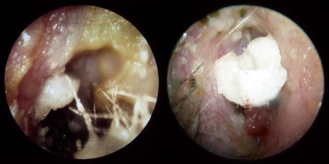

# Chapter 679: External Otitis (Otitis Externa) — Board-Style Self-Assessment MCQs
**Part XXVIII: The Ear** | [📖 Read Wiki Chapter](../chapters/679.md) | [🃏 Chapter Flashcards](../flashcards/679_flashcards.md) | [🏠 Course Master Index](../../index.md)

Total questions: **5** *(Click "Show Answer & Rationale" beneath each question)*

### Question 1 (Clinical Pediatrics Vignette)
A pediatric patient is evaluated for the following clinical and diagnostic profile: Acute otitis externa; Diffuse redness, swelling, and pain of the canal with greenish to whitish exudate; often very tender pinna; Necrotizing (malignant); otitis externa (± skull base; osteomyelitis); Rapidly progressive, severe swelling and redness . Which of the following conditions or syndromes is the most likely diagnosis?

- **A.** CLINICAL FEATURES (External Otitis (Otitis Externa))
- **B.** DETECTION (Arthropod Bites and Infestations)
- **C.** LANGUAGE TO USE (Procedural Sedation)
- **D.** Natural Killer Cells

<b>Show Answer & Rationale</b>

**Correct Answer: A** — CLINICAL FEATURES (External Otitis (Otitis Externa))

**Rationale:** **CLINICAL FEATURES (External Otitis (Otitis Externa))** is characterized by: Acute otitis externa; Diffuse redness, swelling, and pain of the canal with greenish to whitish exudate; often very tender pinna; Necrotizing (malignant); otitis externa (± skull base; osteomyelitis); Rapidly progressive, severe swelling and redness of pinna; pinna may be laterally displaced; risk factors; include diab.

**Why Other Options Are Incorrect:** **DETECTION (Arthropod Bites and Infestations)** is incorrect (characterized by • Look for brown insects no bigger than apple seeds on the; mattress, sofa, and curtains and in dark). **LANGUAGE TO USE (Procedural Sedation)** is incorrect (characterized by You will be fine; there is nothing to worry about. (reassurance); What did you do in school today? (). **Natural Killer Cells** is incorrect (characterized by GATA2 Pathogenic variants in GATA2 (GATA-binding protein-2), inherited in an autosomal dominant mann).

### Question 2 (Clinical Pediatrics Vignette)
A pediatric patient is evaluated for the following clinical and diagnostic profile: this pediatric condition results from chronic irritation and maceration from excessive moisture in the canal.. Which of the following conditions or syndromes is the most likely diagnosis?

- **A.** SOCIAL (The Newborn Infant)
- **B.** CLINICAL FEATURES (External Otitis (Otitis Externa))
- **C.** Hyperphosphatasia
- **D.** External Otitis (Otitis Externa)

<b>Show Answer & Rationale</b>

**Correct Answer: D** — External Otitis (Otitis Externa)

**Rationale:** **External Otitis (Otitis Externa)** is characterized by: External otitis results from chronic irritation and maceration from excessive moisture in the canal..

**Why Other Options Are Incorrect:** **SOCIAL (The Newborn Infant)** is incorrect (characterized by Evidence of parental knowledge, ability, and confidence to care for; the baby at home:; Feeding; Nor). **CLINICAL FEATURES (External Otitis (Otitis Externa))** is incorrect (characterized by Acute otitis externa; Diffuse redness, swelling, and pain of the canal with greenish to whitish exud). **Hyperphosphatasia** is incorrect (characterized by Diagnosis is confirmed by a careful clinical history plus laboratory assessments of calcium, phospho).

### Question 3 (Visual Diagnosis & Clinical Spotter)

A pediatric patient undergoes evaluation for **External Otitis (Otitis Externa)**, yielding the clinical or diagnostic finding shown below. Which of the following best characterizes the illustrated finding?

- **A.** Acute otitis externa. A, Erythema, edema, and copious purulent debris. B, In some cases an edem atous canal with granulation tissue necessitates the placement of an ear wick to assist with topica
- **B.** DIAGNOSIS Diffuse external otitis may be confused with furunculosis, otitis media (OM), and mastoiditis.
- **C.** External otitis results from chronic irritation and maceration from excessive moisture in the canal.
- **D.** A fungal infection of the external auditory canal, or oto mycosis, is characterized by fluffy white debris, sometimes with black spores seen; treatment includes cleaning and application of a

<b>Show Answer & Rationale</b>

**Correct Answer: A** — Acute otitis externa. A, Erythema, edema, and copious purulent debris. B, In some cases an edem atous canal with granulation tissue necessitates the placement of an ear wick to assist with topica

**Rationale:** **Fig. 679.1**: Acute otitis externa. A, Erythema, edema, and copious purulent debris. B, In some cases an edem atous canal with granulation tissue necessitates the placement of an ear wick to assist with topical drug de livery in the acute setting. (Courtesy Dr. John W. House, Los Angeles.)

### Question 4 (Differential Diagnosis (External Otitis (Otitis Externa)))
During a pediatric consultation regarding **External Otitis (Otitis Externa)**, which clinical entity or concept is described by the following profile? "External otitis (swimmer’s ear, although it can occur without swim ming) is caused most by *P."

- **A.** Dermatoses
- **B.** Atopic dermatitis
- **C.** Acute Cellulitis
- **D.** ETIOLOGY

<b>Show Answer & Rationale</b>

**Correct Answer: D** — ETIOLOGY

**Rationale:** ETIOLOGY External otitis (swimmer’s ear, although it can occur without swim ming) is caused most by *P.

### Question 5 (Pediatric Board Mastery (External Otitis (Otitis Externa)))
When formulating an evidence-based diagnostic and management plan for **External Otitis (Otitis Externa)** (*Part XXVIII: The Ear*), which of the following pediatric clinical statements is **ACCURATE**? (Item 1)

- **A.** Diagnostic confirmation relies solely on plain skull radiographs without biochemical, microbiologic, or clinical correlation.
- **B.** Inheritance is exclusively holandric (Y-linked) with 100% penetrance restricted to male neonates.
- **C.** External otitis results from chronic irritation and maceration from excessive moisture in the canal.
- **D.** First-line management relies on immediate high-dose aspirin therapy in febrile infants.

<b>Show Answer & Rationale</b>

**Correct Answer: C** — External otitis results from chronic irritation and maceration from excessive moisture in the canal.

**Rationale:** **Pediatric Clinical Principle (External Otitis (Otitis Externa)):** External otitis results from chronic irritation and maceration from excessive moisture in the canal.

