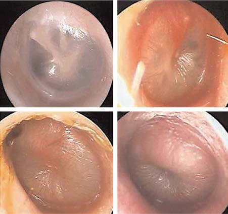

# Chapter 680: Otitis Media — Board-Style Self-Assessment MCQs
**Part XXVIII: The Ear** | [📖 Read Wiki Chapter](../chapters/680.md) | [🃏 Chapter Flashcards](../flashcards/680_flashcards.md) | [🏠 Course Master Index](../../index.md)

Total questions: **5** *(Click "Show Answer & Rationale" beneath each question)*

### Question 1 (Clinical Pediatrics Vignette)
A pediatric patient is evaluated for the following clinical and diagnostic profile: Acetaminophen, ibuprofen; Preferred therapy; Benzocaine, antipyrine (topical); Brief, benefit over; acetaminophen in patients; older than 5 yr; Topical antibiotics; (fluoroquinolones) with or; without steroids for chronic; suppurative otitis (perfora. Which of the following conditions or syndromes is the most likely diagnosis?

- **A.** ACUTE (Otitis Media)
- **B.** RECOMMENDATIONS (Otitis Media)
- **C.** WITHOUT OTORRHEA (Otitis Media)
- **D.** ANTIBIOTIC DOSAGE (Otitis Media)

<b>Show Answer & Rationale</b>

**Correct Answer: B** — RECOMMENDATIONS (Otitis Media)

**Rationale:** **RECOMMENDATIONS (Otitis Media)** is characterized by: Acetaminophen, ibuprofen; Preferred therapy; Benzocaine, antipyrine (topical); Brief, benefit over; acetaminophen in patients; older than 5 yr; Topical antibiotics; (fluoroquinolones) with or; without steroids for chronic; suppurative otitis (perforated; tympanic membrane); Preferred treatment with ear; canal cleaning;.

**Why Other Options Are Incorrect:** **ACUTE (Otitis Media)** is incorrect (characterized by Perforation with otorrhea; Immobile tympanic membrane secondary to visible perforation, exudate in e). **WITHOUT OTORRHEA (Otitis Media)** is incorrect (characterized by 6 mo to 2 yr; Antibiotic therapy; Antibiotic therapy; Antibiotic therapy; Antibiotic therapy or; add). **ANTIBIOTIC DOSAGE (Otitis Media)** is incorrect (characterized by • Amoxicillin 80-90 mg/kg/day bid for 10 days; • Amoxicillin-clavulanate (ratio 14:1) 80-90 mg/kg/da).

### Question 2 (Clinical Pediatrics Vignette)
A pediatric patient is evaluated for the following clinical and diagnostic profile: 6 mo to 2 yr; Antibiotic therapy; Antibiotic therapy; Antibiotic therapy; Antibiotic therapy or; additional observation; additional observation; Antibiotic therapy or; additional observation‡; *Applies only to children with well-documented AOM with h. Which of the following conditions or syndromes is the most likely diagnosis?

- **A.** ANTIBIOTIC DOSAGE (Otitis Media)
- **B.** WITHOUT OTORRHEA (Otitis Media)
- **C.** NONACUTE (Otitis Media)
- **D.** RECOMMENDATIONS (Otitis Media)

<b>Show Answer & Rationale</b>

**Correct Answer: B** — WITHOUT OTORRHEA (Otitis Media)

**Rationale:** **WITHOUT OTORRHEA (Otitis Media)** is characterized by: 6 mo to 2 yr; Antibiotic therapy; Antibiotic therapy; Antibiotic therapy; Antibiotic therapy or; additional observation; additional observation; Antibiotic therapy or; additional observation‡; *Applies only to children with well-documented AOM with high certainty of diagnosis.; †A toxic-appearing child, persistent otal.

**Why Other Options Are Incorrect:** **ANTIBIOTIC DOSAGE (Otitis Media)** is incorrect (characterized by • Amoxicillin 80-90 mg/kg/day bid for 10 days; • Amoxicillin-clavulanate (ratio 14:1) 80-90 mg/kg/da). **NONACUTE (Otitis Media)** is incorrect (characterized by Chronic perforation; Immobile tympanic membrane secondary to perforation; Otitis media with effusion). **RECOMMENDATIONS (Otitis Media)** is incorrect (characterized by Acetaminophen, ibuprofen; Preferred therapy; Benzocaine, antipyrine (topical); Brief, benefit over; ).

### Question 3 (Visual Diagnosis & Clinical Spotter)

A pediatric patient undergoes evaluation for **Otitis Media**, yielding the clinical or diagnostic finding shown below. Which of the following best characterizes the illustrated finding?

- **A.** Accounting for >10% of pediatric primary care encounters, OM is a leading reason for pedi atric visits and use of antibiotics and figures importantly in the dif ferential diagnosis of fever.
- **B.** OM is also the most common cause of acquired hearing loss in children.
- **C.** Accurate diagnosis of AOM in infants and young children may be difficult.
- **D.** Examples of normal tympanic membrane (A) and of mild bulging (B), moderate bulging (C), and severe bulging (D) of the tym panic membrane from middle-ear effusion. (Courtesy Alejandro Hober man, M

<b>Show Answer & Rationale</b>

**Correct Answer: D** — Examples of normal tympanic membrane (A) and of mild bulging (B), moderate bulging (C), and severe bulging (D) of the tym panic membrane from middle-ear effusion. (Courtesy Alejandro Hober man, M

**Rationale:** **Fig. 680.2**: Examples of normal tympanic membrane (A) and of mild bulging (B), moderate bulging (C), and severe bulging (D) of the tym panic membrane from middle-ear effusion. (Courtesy Alejandro Hober man, MD.)

### Question 4 (Differential Diagnosis (Otitis Media))
During a pediatric consultation regarding **Otitis Media**, which clinical entity or concept is described by the following profile? "Epidemiologic data suggest an incidence of OM greater in males than in females, although some studies have found no this pediatric condition-related differ ences in the occurrence of OM."

- **A.** Viral Pathogens
- **B.** Gender
- **C.** Exposure to Tobacco Smoke
- **D.** Season

<b>Show Answer & Rationale</b>

**Correct Answer: B** — Gender

**Rationale:** Gender Epidemiologic data suggest an incidence of OM greater in males than in females, although some studies have found no gender-related differ ences in the occurrence of OM.

### Question 5 (Pediatric Board Mastery (Otitis Media))
When formulating an evidence-based diagnostic and management plan for **Otitis Media** (*Part XXVIII: The Ear*), which of the following pediatric clinical statements is **ACCURATE**? (Item 1)

- **A.** Systemic tetracyclines and fluoroquinolones are universally required as routine prophylaxis in all healthy newborns.
- **B.** Accounting for >10% of pediatric primary care encounters, OM is a leading reason for pedi atric visits and use of antibiotics and figures importantly in the dif ferential diagnosis of fever.
- **C.** The condition is an entirely benign physiologic variant that never warrants laboratory or clinical evaluation.
- **D.** Inheritance is exclusively holandric (Y-linked) with 100% penetrance restricted to male neonates.

<b>Show Answer & Rationale</b>

**Correct Answer: B** — Accounting for >10% of pediatric primary care encounters, OM is a leading reason for pedi atric visits and use of antibiotics and figures importantly in the dif ferential diagnosis of fever.

**Rationale:** **Pediatric Clinical Principle (Otitis Media):** Accounting for >10% of pediatric primary care encounters, OM is a leading reason for pedi atric visits and use of antibiotics and figures importantly in the dif ferential diagnosis of fever.

