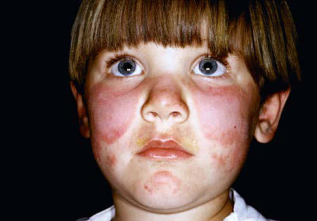

# Chapter 686: Dermatologic Evaluation of the Patient — Board-Style Self-Assessment MCQs
**Part XXIX: The Skin** | [📖 Read Wiki Chapter](../chapters/686.md) | [🃏 Chapter Flashcards](../flashcards/686_flashcards.md) | [🏠 Course Master Index](../../index.md)

Total questions: **5** *(Click "Show Answer & Rationale" beneath each question)*

### Question 1 (Clinical Pediatrics Vignette)
A pediatric patient is evaluated for the following clinical and diagnostic profile: Dermatitis herpetiformis; Negative; Positive; Granular IgA ± C in; papillary dermis; None; IgA antiendomysial; and transglutaminase; this pediatric condition; Bullous pemphigoid; Positive; Positive; Linear IgG and C; band in BMZ,; occasionally IgM,; . Which of the following conditions or syndromes is the most likely diagnosis?

- **A.** ANTIBODIES (Dermatologic Evaluation of the Patient)
- **B.** DIAGNOSIS (Dermatologic Evaluation of the Patient)
- **C.** (SSB) (Dermatologic Evaluation of the Patient)
- **D.** ANA (Dermatologic Evaluation of the Patient)

<b>Show Answer & Rationale</b>

**Correct Answer: A** — ANTIBODIES (Dermatologic Evaluation of the Patient)

**Rationale:** **ANTIBODIES (Dermatologic Evaluation of the Patient)** is characterized by: Dermatitis herpetiformis; Negative; Positive; Granular IgA ± C in; papillary dermis; None; IgA antiendomysial; and transglutaminase; antibodies; Bullous pemphigoid; Positive; Positive; Linear IgG and C; band in BMZ,; occasionally IgM,; IgA, IgE; IgG to BMZ; IgG anti-BP180 and; anti-BP230; Pemphigus (all variants); Posi.

**Why Other Options Are Incorrect:** **DIAGNOSIS (Dermatologic Evaluation of the Patient)** is incorrect (characterized by Systemic lupus; erythematosus; Any; Erythematous; patches and; plaques; palpable; purpura; livedo; r). **(SSB) (Dermatologic Evaluation of the Patient)** is incorrect (characterized by Anti-RNP; Anti-dsDNA; Anti-Sm; IgA vasculitis (Henoch-; Schönlein purpura); Positive; Positive; IgA ). **ANA (Dermatologic Evaluation of the Patient)** is incorrect (characterized by Anti-Ro (SSA), anti-La).

### Question 2 (Visual Diagnosis & Clinical Spotter)

A pediatric patient undergoes evaluation for **Dermatologic Evaluation of the Patient**, yielding the clinical or diagnostic finding shown below. Which of the following best characterizes the illustrated finding?

- **A.** Lichenification is a thickening of skin with accentuation of normal skin lines that is caused by chronic irritation (rubbing, scratching) or inflammation.
- **B.** Malar rash of systemic lupus erythematosus.
- **C.** BIOPSY OF SKIN Biopsy of skin is occasionally required for diagnosis.
- **D.** If the diagnosis is not clear after a thorough examination, one or more diagnostic procedures may be indicated.

<b>Show Answer & Rationale</b>

**Correct Answer: B** — Malar rash of systemic lupus erythematosus.

**Rationale:** **Fig. 686.1**: Malar rash of systemic lupus erythematosus.

### Question 3 (Differential Diagnosis (Dermatologic Evaluation of the Patient))
During a pediatric consultation regarding **Dermatologic Evaluation of the Patient**, which clinical entity or concept is described by the following profile? "presents an alteration in skin color but cannot be felt."

- **A.** mac ule
- **B.** Crite rion 1
- **C.** Systemic Sclerosis
- **D.** Erosions

<b>Show Answer & Rationale</b>

**Correct Answer: A** — mac ule

**Rationale:** mac ule represents an alteration in skin color but cannot be felt.

### Question 4 (Differential Diagnosis (Dermatologic Evaluation of the Patient))
During a pediatric consultation regarding **Dermatologic Evaluation of the Patient**, which clinical entity or concept is described by the following profile? "palpable lesions >1 cm in size and have a flat surface."

- **A.** Chronic GVHD
- **B.** Cysts
- **C.** Sweet Syndrome
- **D.** Plaques

<b>Show Answer & Rationale</b>

**Correct Answer: D** — Plaques

**Rationale:** Plaques are palpable lesions >1 cm in size and have a flat surface.

### Question 5 (Pediatric Board Mastery (Dermatologic Evaluation of the Patient))
When formulating an evidence-based diagnostic and management plan for **Dermatologic Evaluation of the Patient** (*Part XXIX: The Skin*), which of the following pediatric clinical statements is **ACCURATE**? (Item 1)

- **A.** Inheritance is exclusively holandric (Y-linked) with 100% penetrance restricted to male neonates.
- **B.** Lichenification is a thickening of skin with accentuation of normal skin lines that is caused by chronic irritation (rubbing, scratching) or inflammation.
- **C.** The condition is an entirely benign physiologic variant that never warrants laboratory or clinical evaluation.
- **D.** Clinical manifestations are permanently restricted to late adulthood and never present during infancy, childhood, or adolescence.

<b>Show Answer & Rationale</b>

**Correct Answer: B** — Lichenification is a thickening of skin with accentuation of normal skin lines that is caused by chronic irritation (rubbing, scratching) or inflammation.

**Rationale:** **Pediatric Clinical Principle (Dermatologic Evaluation of the Patient):** Lichenification is a thickening of skin with accentuation of normal skin lines that is caused by chronic irritation (rubbing, scratching) or inflammation.

