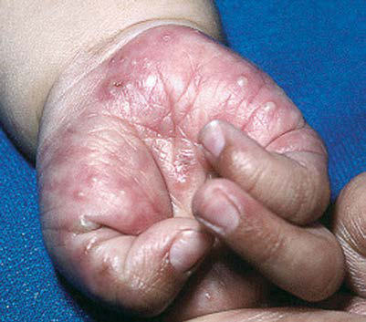

# Chapter 689: Cutaneous Defects — Board-Style Self-Assessment MCQs
**Part XXIX: The Skin** | [📖 Read Wiki Chapter](../chapters/689.md) | [🃏 Chapter Flashcards](../flashcards/689_flashcards.md) | [🏠 Course Master Index](../../index.md)

Total questions: **5** *(Click "Show Answer & Rationale" beneath each question)*

### Question 1 (Clinical Pediatrics Vignette)
A pediatric patient is evaluated for the following clinical and diagnostic profile: The differential diagnosis in neonates includes transient neonatal pustular melanosis, erythema toxicum, milia, cutaneous candidiasis, and staphylococcal pustulosis.. Which of the following conditions or syndromes is the most likely diagnosis?

- **A.** Eye Response (Neurologic Emergencies and Stabilization)
- **B.** Cutaneous Defects
- **C.** EXPERIENCED IN PUBERTAL INDUCTION
- **D.** VASCULAR (Intestinal Transplantation in Children with Intestinal Failure)

<b>Show Answer & Rationale</b>

**Correct Answer: B** — Cutaneous Defects

**Rationale:** **Cutaneous Defects** (associated with **`AR, BMS1`**) is characterized by: The differential diagnosis in neonates includes transient neonatal pustular melanosis, erythema toxicum, milia, cutaneous candidiasis, and staphylococcal pustulosis..

**Why Other Options Are Incorrect:** **Eye Response (Neurologic Emergencies and Stabilization)** is incorrect (characterized by 4 = eyelids open or opened, tracking, or blinking to command; 3 = eyelids open but not tracking; 2 =). **EXPERIENCED IN PUBERTAL INDUCTION** is incorrect (characterized by • Agrees with the indication for sex hormone treatment; • Has confirmed that there are no medical co). **VASCULAR (Intestinal Transplantation in Children with Intestinal Failure)** is incorrect (characterized by • Acute diffuse intestinal infarction with hepatic failure; MMIHS, megacystis microcolon intestinal ).

### Question 2 (Pediatric Genetics & Molecular Etiology)
A child is diagnosed with **Cutaneous Defects** after presenting with The differential diagnosis in neonates includes transient neonatal pustular melanosis, erythema toxicum, milia, cutaneous candidiasis, and staphylococcal pustulosis.. Pathogenic variants in which of the following genes are most classically implicated?

- **A.** AR
- **B.** PKD1
- **C.** TERT
- **D.** MAP2K1

<b>Show Answer & Rationale</b>

**Correct Answer: A** — AR

**Rationale:** Pathogenic variants in **`AR`** (The Skin) are associated with **Cutaneous Defects** (The differential diagnosis in neonates includes transient neonatal pustular melanosis, erythema toxicum, milia, cutaneous candidiasis, and staphylococcal pustulosis.).

**Why Other Options Are Incorrect:** **PKD1** is incorrect (associated with PKD1 (Anatomic Abnormalities Associated with Hematuria)). **MAP2K1** is incorrect (associated with BRAF, MAP2K1/2 (AD)).

### Question 3 (Visual Diagnosis & Clinical Spotter)

A pediatric patient undergoes evaluation for **Cutaneous Defects**, yielding the clinical or diagnostic finding shown below. Which of the following best characterizes the illustrated finding?

- **A.** The differential diagnosis in neonates includes transient neonatal pustular melanosis, erythema toxicum, milia, cutaneous candidiasis, and staphylococcal pustulosis.
- **B.** Constrictive tissue bands are caused by primary amniotic rupture, with subsequent entanglement of fetal parts, particularly limbs, in shriveled fibrotic amniotic strands.
- **C.** Acropustulosis of infancy. Multiple tense erythematous papules and pustules on the palm of this 4-mo-old girl. (From Kliegman RM, Lye PS, Bordini BJ, Toth H, Basel D, eds. Nelson Pediatric Sympto
- **D.** The differential diagnosis includes erythema toxicum neonatorum, infantile acropus tulosis, localized pustular psoriasis, pustular folliculitis, and transient neonatal pustular melanosis.

<b>Show Answer & Rationale</b>

**Correct Answer: C** — Acropustulosis of infancy. Multiple tense erythematous papules and pustules on the palm of this 4-mo-old girl. (From Kliegman RM, Lye PS, Bordini BJ, Toth H, Basel D, eds. Nelson Pediatric Sympto

**Rationale:** **Fig. 688.6**: Acropustulosis of infancy. Multiple tense erythematous papules and pustules on the palm of this 4-mo-old girl. (From Kliegman RM, Lye PS, Bordini BJ, Toth H, Basel D, eds. Nelson Pediatric Symptom- Based Diagnosis. Philadelphia: Elsevier; 2017: Fig. 47.3, p. 854.)

### Question 4 (Differential Diagnosis (Cutaneous Defects))
During a pediatric consultation regarding **Cutaneous Defects**, which clinical entity or concept is described by the following profile? "this pediatric condition is defined as recurrent crops of pru ritic, coalescing, follicular papulopustules on the face, trunk, and extremities."

- **A.** Thyroglossal cysts
- **B.** BRANCHIAL CLEFT AND THYROGLOSSAL CYSTS AND SINUSES
- **C.** APLASIA CUTIS CONGENITA (CONGENITAL ABSENCE OF SKIN)
- **D.** EOSINOPHILIC PUSTULAR FOLLICULITIS

<b>Show Answer & Rationale</b>

**Correct Answer: D** — EOSINOPHILIC PUSTULAR FOLLICULITIS

**Rationale:** EOSINOPHILIC PUSTULAR FOLLICULITIS Eosinophilic pustular folliculitis is defined as recurrent crops of pru ritic, coalescing, follicular papulopustules on the face, trunk, and extremities.

### Question 5 (Pediatric Board Mastery (Cutaneous Defects))
When formulating an evidence-based diagnostic and management plan for **Cutaneous Defects** (*Part XXIX: The Skin*), which of the following pediatric clinical statements is **ACCURATE**? (Item 1)

- **A.** Inheritance is exclusively holandric (Y-linked) with 100% penetrance restricted to male neonates.
- **B.** Systemic tetracyclines and fluoroquinolones are universally required as routine prophylaxis in all healthy newborns.
- **C.** The differential diagnosis in neonates includes transient neonatal pustular melanosis, erythema toxicum, milia, cutaneous candidiasis, and staphylococcal pustulosis.
- **D.** Clinical manifestations are permanently restricted to late adulthood and never present during infancy, childhood, or adolescence.

<b>Show Answer & Rationale</b>

**Correct Answer: C** — The differential diagnosis in neonates includes transient neonatal pustular melanosis, erythema toxicum, milia, cutaneous candidiasis, and staphylococcal pustulosis.

**Rationale:** **Pediatric Clinical Principle (Cutaneous Defects):** The differential diagnosis in neonates includes transient neonatal pustular melanosis, erythema toxicum, milia, cutaneous candidiasis, and staphylococcal pustulosis.

