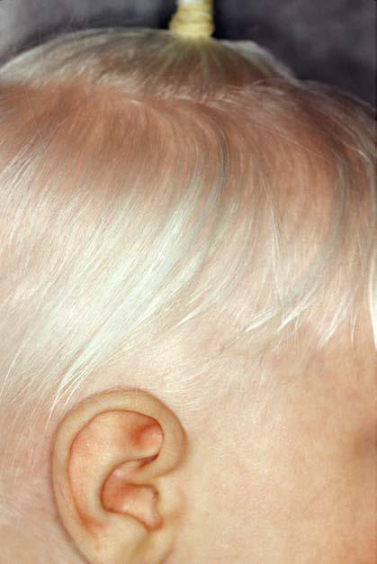

# Chapter 694: Hypopigmented Lesions — Board-Style Self-Assessment MCQs
**Part XXIX: The Skin** | [📖 Read Wiki Chapter](../chapters/694.md) | [🃏 Chapter Flashcards](../flashcards/694_flashcards.md) | [🏠 Course Master Index](../../index.md)

Total questions: **5** *(Click "Show Answer & Rationale" beneath each question)*

### Question 1 (Clinical Pediatrics Vignette)
A pediatric patient is evaluated for the following clinical and diagnostic profile: the causative gene (82% of HPS in Puerto; Ricans; 37% in non–Puerto; Ricans). Which of the following conditions or syndromes is the most likely diagnosis?

- **A.** HPS-4 (Hypopigmented Lesions)
- **B.** HPS-10 (Hypopigmented Lesions)
- **C.** PAX3 (Hypopigmented Lesions)
- **D.** BLOC1S6/PLDN (Hypopigmented Lesions)

<b>Show Answer & Rationale</b>

**Correct Answer: A** — HPS-4 (Hypopigmented Lesions)

**Rationale:** **HPS-4 (Hypopigmented Lesions)** (associated with **`HPS1`**) is characterized by: HPS1 (82% of HPS in Puerto; Ricans; 37% in non–Puerto; Ricans).

**Why Other Options Are Incorrect:** **HPS-10 (Hypopigmented Lesions)** is incorrect (characterized by AP3B1 (∼10% of non–Puerto; Ricans) and AP3D1 (rare); AP-3 deficiency: AP3B1 and APSD1 encode; subuni). **PAX3 (Hypopigmented Lesions)** is incorrect (characterized by Most common form; dystopia canthorum). **BLOC1S6/PLDN (Hypopigmented Lesions)** is incorrect (characterized by BLOC-1 deficiency: Dysbindin, BLOC1S3, and; BLOC1S6 are subunits of BLOC-1 and also; involved in ski).

### Question 2 (Clinical Pediatrics Vignette)
A pediatric patient is evaluated for the following clinical and diagnostic profile: BLOC-3 deficiency: the causative gene and this pediatric condition associate; in a complex (BLOC-3) that regulates; biogenesis of melanosomes, platelet-dense; bodies, and the lung lamellar body; Nystagmus, decreased visual acuity; prolonged; bleeding. Which of the following conditions or syndromes is the most likely diagnosis?

- **A.** HPS4 (Hypopigmented Lesions)
- **B.** HPS-6 (Hypopigmented Lesions)
- **C.** HPS-4 (Hypopigmented Lesions)
- **D.** BLOC1S6/PLDN (Hypopigmented Lesions)

<b>Show Answer & Rationale</b>

**Correct Answer: A** — HPS4 (Hypopigmented Lesions)

**Rationale:** **HPS4 (Hypopigmented Lesions)** (associated with **`HPS4, HPS1`**) is characterized by: BLOC-3 deficiency: HPS1 and HPS4 associate; in a complex (BLOC-3) that regulates; biogenesis of melanosomes, platelet-dense; bodies, and the lung lamellar body; Nystagmus, decreased visual acuity; prolonged; bleeding; pulmonary fibrosis (typical onset in; young adults); granulomatous colitis (up to; one third of patien.

**Why Other Options Are Incorrect:** **HPS-6 (Hypopigmented Lesions)** is incorrect (characterized by HPS3 (∼20% in Puerto Ricans and; BLOC-2 deficiency: HPS3, HPS5, and HPS6; are associated in a comple). **HPS-4 (Hypopigmented Lesions)** is incorrect (characterized by HPS1 (82% of HPS in Puerto; Ricans; 37% in non–Puerto; Ricans)). **BLOC1S6/PLDN (Hypopigmented Lesions)** is incorrect (characterized by BLOC-1 deficiency: Dysbindin, BLOC1S3, and; BLOC1S6 are subunits of BLOC-1 and also; involved in ski).

### Question 3 (Pediatric Genetics & Molecular Etiology)
A child is diagnosed with **HPS-4 (Hypopigmented Lesions)** after presenting with the causative gene (82% of HPS in Puerto; Ricans; 37% in non–Puerto; Ricans). Pathogenic variants in which of the following genes are most classically implicated?

- **A.** NF1
- **B.** HPS1
- **C.** PYGL
- **D.** LAMA3

<b>Show Answer & Rationale</b>

**Correct Answer: B** — HPS1

**Rationale:** Pathogenic variants in **`HPS1`** (The Skin) are associated with **HPS-4 (Hypopigmented Lesions)** (HPS1 (82% of HPS in Puerto; Ricans; 37% in non–Puerto; Ricans)).

**Why Other Options Are Incorrect:** **NF1** is incorrect (associated with Tumors of the Digestive Tract).

### Question 4 (Visual Diagnosis & Clinical Spotter)

A pediatric patient undergoes evaluation for **Hypopigmented Lesions**, yielding the clinical or diagnostic finding shown below. Which of the following best characterizes the illustrated finding?

- **A.** This is the most common form of albinism seen worldwide.
- **B.** These disorders are autosomal recessive in inheri tance and result from pathogenic variants in genes related to mela nin synthesis or the transport and storage of melanin within cells.
- **C.** Oculocutaneous Albinism with Abnormal Melanin Production Oculocutaneous albinism type 1 (OCA1) is characterized by great reduction in or absence of tyrosinase activity caused by pathogenic g
- **D.** White hair and skin in oculocutaneous albinism type 1

<b>Show Answer & Rationale</b>

**Correct Answer: D** — White hair and skin in oculocutaneous albinism type 1

**Rationale:** **Fig. 694.1**: White hair and skin in oculocutaneous albinism type 1

### Question 5 (Pediatric Board Mastery (Hypopigmented Lesions))
When formulating an evidence-based diagnostic and management plan for **Hypopigmented Lesions** (*Part XXIX: The Skin*), which of the following pediatric clinical statements is **ACCURATE**? (Item 1)

- **A.** Diagnostic confirmation relies solely on plain skull radiographs without biochemical, microbiologic, or clinical correlation.
- **B.** Clinical manifestations are permanently restricted to late adulthood and never present during infancy, childhood, or adolescence.
- **C.** These disorders are autosomal recessive in inheri tance and result from pathogenic variants in genes related to mela nin synthesis or the transport and storage of melanin within cells.
- **D.** Systemic tetracyclines and fluoroquinolones are universally required as routine prophylaxis in all healthy newborns.

<b>Show Answer & Rationale</b>

**Correct Answer: C** — These disorders are autosomal recessive in inheri tance and result from pathogenic variants in genes related to mela nin synthesis or the transport and storage of melanin within cells.

**Rationale:** **Pediatric Clinical Principle (Hypopigmented Lesions):** These disorders are autosomal recessive in inheri tance and result from pathogenic variants in genes related to mela nin synthesis or the transport and storage of melanin within cells.

