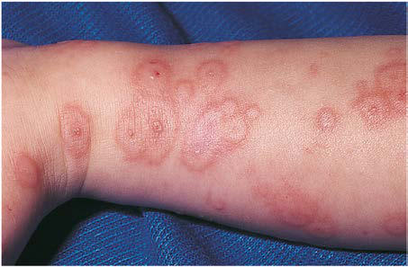

# Chapter 695: Vesiculobullous Disorders — Board-Style Self-Assessment MCQs
**Part XXIX: The Skin** | [📖 Read Wiki Chapter](../chapters/695.md) | [🃏 Chapter Flashcards](../flashcards/695_flashcards.md) | [🏠 Course Master Index](../../index.md)

Total questions: **5** *(Click "Show Answer & Rationale" beneath each question)*

### Question 1 (Clinical Pediatrics Vignette)
A pediatric patient is evaluated for the following clinical and diagnostic profile: Smear for eosinophils; Incontinentia pigmenti. Which of the following conditions or syndromes is the most likely diagnosis?

- **A.** DIAGNOSTIC STUDIES
- **B.** SC, IE (Vesiculobullous Disorders)
- **C.** OCULAR (Vesiculobullous Disorders)
- **D.** ORAL (Vesiculobullous Disorders)

<b>Show Answer & Rationale</b>

**Correct Answer: B** — SC, IE (Vesiculobullous Disorders)

**Rationale:** **SC, IE (Vesiculobullous Disorders)** is characterized by: Smear for eosinophils; Incontinentia pigmenti.

**Why Other Options Are Incorrect:** **DIAGNOSTIC STUDIES** is incorrect (characterized by Acrodermatitis enteropathica). **OCULAR (Vesiculobullous Disorders)** is incorrect (characterized by Conjunctival injection; Conjunctivitis; Photophobia; Eyelid edema; Lid margin ulceration; Conjunctiv). **ORAL (Vesiculobullous Disorders)** is incorrect (characterized by Erosions; Ulcers; Vesiculobullae; Denudation; Hemorrhagic crusting).

### Question 2 (Visual Diagnosis & Clinical Spotter)

A pediatric patient undergoes evaluation for **Vesiculobullous Disorders**, yielding the clinical or diagnostic finding shown below. Which of the following best characterizes the illustrated finding?

- **A.** Early fixed papules with a central dusky zone on the dor sum of the hand of a child with erythema multiforme caused by herpes simplex virus. (From Weston WL, Lane AT, Morelli J. Color Textbook of
- **B.** The differential diagnosis in drug-related EM should include severe cutaneous adverse reactions such as Stevens-Johnson syndrome and drug hypersensitivity syndrome (sometimes called drug rea
- **C.** EM is characterized by an abrupt, symmetric cutaneous eruption, most commonly on the extensor upper extremities; lesions are rela tively sparse on the face, trunk, and legs.
- **D.** ETIOLOGY Among the numerous factors implicated in the etiology of erythema multiforme (EM), infection with herpes simplex virus (HSV) is the most common.

<b>Show Answer & Rationale</b>

**Correct Answer: A** — Early fixed papules with a central dusky zone on the dor sum of the hand of a child with erythema multiforme caused by herpes simplex virus. (From Weston WL, Lane AT, Morelli J. Color Textbook of

**Rationale:** **Fig. 695.1**: Early fixed papules with a central dusky zone on the dor sum of the hand of a child with erythema multiforme caused by herpes simplex virus. (From Weston WL, Lane AT, Morelli J. Color Textbook of Pediatric Dermatology, 3rd ed. St. Louis: Mosby; 2002:156.)

### Question 3 (Differential Diagnosis (695.1 Erythema Multiforme Joel C. Joyce))
During a pediatric consultation regarding **Vesiculobullous Disorders**, which clinical entity or concept is described by the following profile? "Among the numerous factors implicated in the this pediatric condition of erythema multiforme (EM), infection with herpes simplex virus (HSV) is the most common."

- **A.** IE, SE (Vesiculobullous Disorders)
- **B.** ETIOLOGY
- **C.** Clinical Manifestations
- **D.** EPIDEMIOLOGY AND ETIOLOGY

<b>Show Answer & Rationale</b>

**Correct Answer: B** — ETIOLOGY

**Rationale:** ETIOLOGY Among the numerous factors implicated in the etiology of erythema multiforme (EM), infection with herpes simplex virus (HSV) is the most common.

### Question 4 (Differential Diagnosis (695.1 Erythema Multiforme Joel C. Joyce))
During a pediatric consultation regarding **Vesiculobullous Disorders**, which clinical entity or concept is described by the following profile? "EM has numerous morphologic manifestations on the skin, varying from erythematous macules, papules, vesicles, bullae, or urticarial plaques to patches of confluent erythema."

- **A.** OCULAR (Vesiculobullous Disorders)
- **B.** CLINICAL MANIFESTATIONS
- **C.** TREATMENT
- **D.** Localized EBS

<b>Show Answer & Rationale</b>

**Correct Answer: B** — CLINICAL MANIFESTATIONS

**Rationale:** CLINICAL MANIFESTATIONS EM has numerous morphologic manifestations on the skin, varying from erythematous macules, papules, vesicles, bullae, or urticarial plaques to patches of confluent erythema.

### Question 5 (Pediatric Board Mastery (Vesiculobullous Disorders))
When formulating an evidence-based diagnostic and management plan for **Vesiculobullous Disorders** (*Part XXIX: The Skin*), which of the following pediatric clinical statements is **ACCURATE**? (Item 1)

- **A.** Inheritance is exclusively holandric (Y-linked) with 100% penetrance restricted to male neonates.
- **B.** Clinical manifestations are permanently restricted to late adulthood and never present during infancy, childhood, or adolescence.
- **C.** ETIOLOGY Among the numerous factors implicated in the etiology of erythema multiforme (EM), infection with herpes simplex virus (HSV) is the most common.
- **D.** First-line management relies on immediate high-dose aspirin therapy in febrile infants.

<b>Show Answer & Rationale</b>

**Correct Answer: C** — ETIOLOGY Among the numerous factors implicated in the etiology of erythema multiforme (EM), infection with herpes simplex virus (HSV) is the most common.

**Rationale:** **Pediatric Clinical Principle (Vesiculobullous Disorders):** ETIOLOGY Among the numerous factors implicated in the etiology of erythema multiforme (EM), infection with herpes simplex virus (HSV) is the most common.

