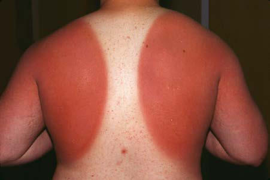

# Chapter 697: Photosensitivity — Board-Style Self-Assessment MCQs
**Part XXIX: The Skin** | [📖 Read Wiki Chapter](../chapters/697.md) | [🃏 Chapter Flashcards](../flashcards/697_flashcards.md) | [🏠 Course Master Index](../../index.md)

Total questions: **5** *(Click "Show Answer & Rationale" beneath each question)*

### Question 1 (Clinical Pediatrics Vignette)
A pediatric patient is evaluated for the following clinical and diagnostic profile: • Systemic drugs include tetracyclines, psoralens, chlorothiazides,; sulfonamides, barbiturates, griseofulvin, thiazides, quinidine,; phenothiazines; • Topical agents include coal tar derivatives, psoralens,; halogenated salicylanilides (soaps), perf. Which of the following conditions or syndromes is the most likely diagnosis?

- **A.** Photoallergic Drug Eruptions
- **B.** Phytophotodermatosis
- **C.** Genetic Disorders with Photosensitivity
- **D.** Phototoxic Drug Eruptions

<b>Show Answer & Rationale</b>

**Correct Answer: A** — Photoallergic Drug Eruptions

**Rationale:** **Photoallergic Drug Eruptions** is characterized by: • Systemic drugs include tetracyclines, psoralens, chlorothiazides,; sulfonamides, barbiturates, griseofulvin, thiazides, quinidine,; phenothiazines; • Topical agents include coal tar derivatives, psoralens,; halogenated salicylanilides (soaps), perfume oils (e.g., oil of; bergamot), sunscreens (e.g., PABA, cinnamates,.

**Why Other Options Are Incorrect:** **Phytophotodermatosis** is incorrect (characterized by • Furocoumarin-containing plants: fig tree leaves and sap, limes,; celery, fennel, carrots, parsley,). **Genetic Disorders with Photosensitivity** is incorrect (characterized by • Xeroderma pigmentosum; • Bloom syndrome; • Cockayne syndrome; • Rothmund-Thomson syndrome; • Trich). **Phototoxic Drug Eruptions** is incorrect (characterized by • Systemic agents include nalidixic acid, furosemide, nonsteroidal; antiinflammatory agents (naproxe).

### Question 2 (Visual Diagnosis & Clinical Spotter)

A pediatric patient undergoes evaluation for **Photosensitivity**, yielding the clinical or diagnostic finding shown below. Which of the following best characterizes the illustrated finding?

- **A.** ACUTE SUNBURN REACTION The most common photosensitive reaction seen in children is acute sunburn, which is caused mainly by UVB radiation.
- **B.** Sunburn. Well-demarcated, severe erythema.
- **C.** The most common photoallergens are chemicals present in sunscreens.
- **D.** Immediate pigment darkening is caused by UVA radiation– induced photo-oxidative darkening of existing melanin and its trans fer from melanocytes to keratinocytes.

<b>Show Answer & Rationale</b>

**Correct Answer: B** — Sunburn. Well-demarcated, severe erythema.

**Rationale:** **Fig. 697.1**: Sunburn. Well-demarcated, severe erythema.

### Question 3 (Differential Diagnosis (Photosensitivity))
During a pediatric consultation regarding **Photosensitivity**, which clinical entity or concept is described by the following profile? "The most common photosensitive reaction seen in children is acute sunburn, which is caused mainly by UVB radiation."

- **A.** EV D68) (Polioviruses)
- **B.** Photoallergic reactions
- **C.** XERODERMA PIGMENTOSUM
- **D.** ACUTE SUNBURN REACTION

<b>Show Answer & Rationale</b>

**Correct Answer: D** — ACUTE SUNBURN REACTION

**Rationale:** ACUTE SUNBURN REACTION The most common photosensitive reaction seen in children is acute sunburn, which is caused mainly by UVB radiation.

### Question 4 (Differential Diagnosis (Photosensitivity))
During a pediatric consultation regarding **Photosensitivity**, which clinical entity or concept is described by the following profile? "best achieved by sun avoidance, which includes minimizing time in the midday sun (10 am to 4 pm), staying in the shade, and wearing protective clothing including wide-brimmed hats."

- **A.** POLYMORPHOUS LIGHT ERUPTION
- **B.** COLLOID MILIUM
- **C.** Sun protection
- **D.** Phototoxic reactions

<b>Show Answer & Rationale</b>

**Correct Answer: C** — Sun protection

**Rationale:** Sun protection is best achieved by sun avoidance, which includes minimizing time in the midday sun (10 am to 4 pm), staying in the shade, and wearing protective clothing including wide-brimmed hats.

### Question 5 (Pediatric Board Mastery (Photosensitivity))
When formulating an evidence-based diagnostic and management plan for **Photosensitivity** (*Part XXIX: The Skin*), which of the following pediatric clinical statements is **ACCURATE**? (Item 1)

- **A.** ACUTE SUNBURN REACTION The most common photosensitive reaction seen in children is acute sunburn, which is caused mainly by UVB radiation.
- **B.** Clinical manifestations are permanently restricted to late adulthood and never present during infancy, childhood, or adolescence.
- **C.** First-line management relies on immediate high-dose aspirin therapy in febrile infants.
- **D.** Inheritance is exclusively holandric (Y-linked) with 100% penetrance restricted to male neonates.

<b>Show Answer & Rationale</b>

**Correct Answer: A** — ACUTE SUNBURN REACTION The most common photosensitive reaction seen in children is acute sunburn, which is caused mainly by UVB radiation.

**Rationale:** **Pediatric Clinical Principle (Photosensitivity):** ACUTE SUNBURN REACTION The most common photosensitive reaction seen in children is acute sunburn, which is caused mainly by UVB radiation.

