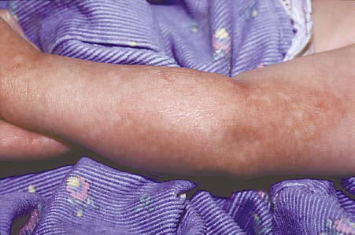

# Chapter 698: Diseases of the Epidermis — Board-Style Self-Assessment MCQs
**Part XXIX: The Skin** | [📖 Read Wiki Chapter](../chapters/698.md) | [🃏 Chapter Flashcards](../flashcards/698_flashcards.md) | [🏠 Course Master Index](../../index.md)

Total questions: **5** *(Click "Show Answer & Rationale" beneath each question)*

### Question 1 (Clinical Pediatrics Vignette)
A pediatric patient is evaluated for the following clinical and diagnostic profile: Topical corticosteroids are recommended for the treatment of pediatric psoriasis as an off-label; therapy. Which of the following conditions or syndromes is the most likely diagnosis?

- **A.** EVIDENCE (Diseases of the Epidermis)
- **B.** I, III (Diseases of the Epidermis)
- **C.** I-III (Diseases of the Epidermis)
- **D.** III (Diseases of the Epidermis)

<b>Show Answer & Rationale</b>

**Correct Answer: A** — EVIDENCE (Diseases of the Epidermis)

**Rationale:** **EVIDENCE (Diseases of the Epidermis)** is characterized by: Topical corticosteroids are recommended for the treatment of pediatric psoriasis as an off-label; therapy.

**Why Other Options Are Incorrect:** **I, III (Diseases of the Epidermis)** is incorrect (characterized by Adalimumab is recommended for off-label use as an effective therapy in children and adolescents; wit). **I-III (Diseases of the Epidermis)** is incorrect (characterized by Etanercept dosing is typically once weekly and is dosed subcutaneously at 0.8 mg/kg with a; maximum ). **III (Diseases of the Epidermis)** is incorrect (characterized by Monitoring of vitamin D metabolites may be considered during calcipotriene/calcipotriol therapy; whe).

### Question 2 (Clinical Pediatrics Vignette)
A pediatric patient is evaluated for the following clinical and diagnostic profile: Calcipotriene/calcipotriol is recommended as a treatment option for childhood plaque psoriasis. Which of the following conditions or syndromes is the most likely diagnosis?

- **A.** I, III (Diseases of the Epidermis)
- **B.** I-II (Diseases of the Epidermis)
- **C.** II-III (Diseases of the Epidermis)
- **D.** I-III (Diseases of the Epidermis)

<b>Show Answer & Rationale</b>

**Correct Answer: C** — II-III (Diseases of the Epidermis)

**Rationale:** **II-III (Diseases of the Epidermis)** is characterized by: Calcipotriene/calcipotriol is recommended as a treatment option for childhood plaque psoriasis.

**Why Other Options Are Incorrect:** **I, III (Diseases of the Epidermis)** is incorrect (characterized by Adalimumab is recommended for off-label use as an effective therapy in children and adolescents; wit). **I-II (Diseases of the Epidermis)** is incorrect (characterized by The combination of calcipotriol/betamethasone dipropionate ointment applied once daily for up; to 4 ). **I-III (Diseases of the Epidermis)** is incorrect (characterized by Etanercept dosing is typically once weekly and is dosed subcutaneously at 0.8 mg/kg with a; maximum ).

### Question 3 (Visual Diagnosis & Clinical Spotter)

A pediatric patient undergoes evaluation for **Diseases of the Epidermis**, yielding the clinical or diagnostic finding shown below. Which of the following best characterizes the illustrated finding?

- **A.** This results in deficiency of nicotinamide synthesis and causes a photo-induced pellagra-like syndrome.
- **B.** Poikiloderma on the arm of an infant with Rothmund- Thomson syndrome.
- **C.** Plaque psoriasis, the most common (>80%) subtype, is characterized by erythematous papules that coalesce to form plaques with sharply demarcated, irregular borders.
- **D.** ETIOLOGY/PATHOGENESIS Psoriasis is an inflammatory autoimmune-related disease characterized by inflammation and keratinocyte proliferation.

<b>Show Answer & Rationale</b>

**Correct Answer: B** — Poikiloderma on the arm of an infant with Rothmund- Thomson syndrome.

**Rationale:** **Fig. 697.9**: Poikiloderma on the arm of an infant with Rothmund- Thomson syndrome.

### Question 4 (Differential Diagnosis (698.1 Psoriasis Julie M. Dhossche and Yvonne E. Chiu))
During a pediatric consultation regarding **Diseases of the Epidermis**, which clinical entity or concept is described by the following profile? "Psoriasis is an inflammatory autoimmune-related disease characterized by inflammation and keratinocyte proliferation (Fig."

- **A.** PLEVA
- **B.** DIFFERENTIAL DIAGNOSIS
- **C.** PROGNOSIS
- **D.** ETIOLOGY/PATHOGENESIS

<b>Show Answer & Rationale</b>

**Correct Answer: D** — ETIOLOGY/PATHOGENESIS

**Rationale:** ETIOLOGY/PATHOGENESIS Psoriasis is an inflammatory autoimmune-related disease characterized by inflammation and keratinocyte proliferation (Fig.

### Question 5 (Pediatric Board Mastery (Diseases of the Epidermis))
When formulating an evidence-based diagnostic and management plan for **Diseases of the Epidermis** (*Part XXIX: The Skin*), which of the following pediatric clinical statements is **ACCURATE**? (Item 1)

- **A.** First-line management relies on immediate high-dose aspirin therapy in febrile infants.
- **B.** The condition is an entirely benign physiologic variant that never warrants laboratory or clinical evaluation.
- **C.** This results in deficiency of nicotinamide synthesis and causes a photo-induced pellagra-like syndrome.
- **D.** Clinical manifestations are permanently restricted to late adulthood and never present during infancy, childhood, or adolescence.

<b>Show Answer & Rationale</b>

**Correct Answer: C** — This results in deficiency of nicotinamide synthesis and causes a photo-induced pellagra-like syndrome.

**Rationale:** **Pediatric Clinical Principle (Diseases of the Epidermis):** This results in deficiency of nicotinamide synthesis and causes a photo-induced pellagra-like syndrome.

