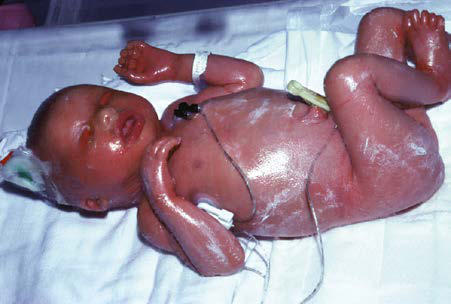

# Chapter 699: Disorders of Keratinization — Board-Style Self-Assessment MCQs
**Part XXIX: The Skin** | [📖 Read Wiki Chapter](../chapters/699.md) | [🃏 Chapter Flashcards](../flashcards/699_flashcards.md) | [🏠 Course Master Index](../../index.md)

Total questions: **5** *(Click "Show Answer & Rationale" beneath each question)*

### Question 1 (Clinical Pediatrics Vignette)
A pediatric patient is evaluated for the following clinical and diagnostic profile: RXLI (recessive X-linked; ichthyosis) syndromic; presentation; 308100. Which of the following conditions or syndromes is the most likely diagnosis?

- **A.** X-LINKED ICHTHYOSIS SYNDROMES
- **B.** (CDPX2) (Disorders of Keratinization)
- **C.** EBP (Disorders of Keratinization)
- **D.** MBTPS2 (Disorders of Keratinization)

<b>Show Answer & Rationale</b>

**Correct Answer: A** — X-LINKED ICHTHYOSIS SYNDROMES

**Rationale:** **X-LINKED ICHTHYOSIS SYNDROMES** is characterized by: RXLI (recessive X-linked; ichthyosis) syndromic; presentation; 308100.

**Why Other Options Are Incorrect:** **(CDPX2) (Disorders of Keratinization)** is incorrect (characterized by X-linked; chondrodysplasia; punctata (Conradi-; Hünermann; syndrome); 302960). **EBP (Disorders of Keratinization)** is incorrect (characterized by Emopamil-binding; protein; CHILD syndrome; 308050). **MBTPS2 (Disorders of Keratinization)** is incorrect (characterized by Membrane-bound; transcription; factor peptidase,; site 2; Conradi-Hünermann-; Happle syndrome).

### Question 2 (Clinical Pediatrics Vignette)
A pediatric patient is evaluated for the following clinical and diagnostic profile: Larger deletions with; contiguous gene; defects; Steroid sulfatase; IFAP syndrome; (ichthyosis-follicularis-; atrichia-photophobia); 398205. Which of the following conditions or syndromes is the most likely diagnosis?

- **A.** (CDPX2) (Disorders of Keratinization)
- **B.** NSDHL (Disorders of Keratinization)
- **C.** STS (Disorders of Keratinization)
- **D.** EBP (Disorders of Keratinization)

<b>Show Answer & Rationale</b>

**Correct Answer: C** — STS (Disorders of Keratinization)

**Rationale:** **STS (Disorders of Keratinization)** (associated with **`STS`**) is characterized by: Larger deletions with; contiguous gene; defects; Steroid sulfatase; IFAP syndrome; (ichthyosis-follicularis-; atrichia-photophobia); 398205.

**Why Other Options Are Incorrect:** **(CDPX2) (Disorders of Keratinization)** is incorrect (characterized by X-linked; chondrodysplasia; punctata (Conradi-; Hünermann; syndrome); 302960). **NSDHL (Disorders of Keratinization)** is incorrect (characterized by 3-β-hydroxysteroid-; Δ8,Δ7-isomerase). **EBP (Disorders of Keratinization)** is incorrect (characterized by Emopamil-binding; protein; CHILD syndrome; 308050).

### Question 3 (Visual Diagnosis & Clinical Spotter)

A pediatric patient undergoes evaluation for **Disorders of Keratinization**, yielding the clinical or diagnostic finding shown below. Which of the following best characterizes the illustrated finding?

- **A.** Clinical Manifestations Ichthyosis vulgaris is the most common of the disorders of keratiniza tion, with an incidence of 1/250 live births.
- **B.** The outcome is uncertain, and accurate prognosis depends on identification of the underlying ichthyosis.
- **C.** NONSYNDROMIC ICHTHYOSES Ichthyosis Vulgaris Etiology/Pathogenesis Autosomal dominant or recessive pathogenic variants in the filaggrin gene cause ichthyosis vulgaris.
- **D.** Typical appearance of a collodion baby.

<b>Show Answer & Rationale</b>

**Correct Answer: D** — Typical appearance of a collodion baby.

**Rationale:** **Fig. 699.1**: Typical appearance of a collodion baby.

### Question 4 (Differential Diagnosis (Disorders of Keratinization))
During a pediatric consultation regarding **Disorders of Keratinization**, which clinical entity or concept is described by the following profile? "this pediatric condition is not a single entity, but a newborn phenotype that is most often seen in babies who eventually demonstrate lamellar ichthy osis or congenital ichthyosiform erythroderma (CIE)."

- **A.** X-Linked Ichthyosis Etiology/Pathogenesis
- **B.** Clinical Manifestations
- **C.** COLLODION BABY
- **D.** Treatment

<b>Show Answer & Rationale</b>

**Correct Answer: C** — COLLODION BABY

**Rationale:** COLLODION BABY Collodion baby is not a single entity, but a newborn phenotype that is most often seen in babies who eventually demonstrate lamellar ichthy osis or congenital ichthyosiform erythroderma (CIE).

### Question 5 (Pediatric Board Mastery (Disorders of Keratinization))
When formulating an evidence-based diagnostic and management plan for **Disorders of Keratinization** (*Part XXIX: The Skin*), which of the following pediatric clinical statements is **ACCURATE**? (Item 1)

- **A.** The outcome is uncertain, and accurate prognosis depends on identification of the underlying ichthyosis.
- **B.** Systemic tetracyclines and fluoroquinolones are universally required as routine prophylaxis in all healthy newborns.
- **C.** Diagnostic confirmation relies solely on plain skull radiographs without biochemical, microbiologic, or clinical correlation.
- **D.** Clinical manifestations are permanently restricted to late adulthood and never present during infancy, childhood, or adolescence.

<b>Show Answer & Rationale</b>

**Correct Answer: A** — The outcome is uncertain, and accurate prognosis depends on identification of the underlying ichthyosis.

**Rationale:** **Pediatric Clinical Principle (Disorders of Keratinization):** The outcome is uncertain, and accurate prognosis depends on identification of the underlying ichthyosis.

