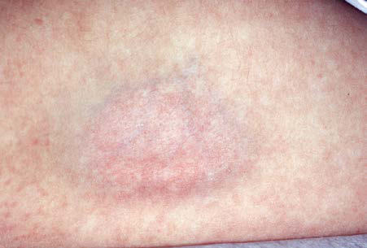

# Chapter 701: Diseases of Subcutaneous Tissue — Board-Style Self-Assessment MCQs
**Part XXIX: The Skin** | [📖 Read Wiki Chapter](../chapters/701.md) | [🃏 Chapter Flashcards](../flashcards/701_flashcards.md) | [🏠 Course Master Index](../../index.md)

Total questions: **5** *(Click "Show Answer & Rationale" beneath each question)*

### Question 1 (Clinical Pediatrics Vignette)
A pediatric patient is evaluated for the following clinical and diagnostic profile: Epstein-Barr, hepatitis B, mumps. Which of the following conditions or syndromes is the most likely diagnosis?

- **A.** FUNGI (Diseases of Subcutaneous Tissue)
- **B.** MYC::IGH (Molecular and Cellular Biology of Cancer)
- **C.** VIRUSES (Diseases of Subcutaneous Tissue)
- **D.** MOCOS (Disorders of Purine and Pyrimidine Metabolism)

<b>Show Answer & Rationale</b>

**Correct Answer: C** — VIRUSES (Diseases of Subcutaneous Tissue)

**Rationale:** **VIRUSES (Diseases of Subcutaneous Tissue)** is characterized by: Epstein-Barr, hepatitis B, mumps.

**Why Other Options Are Incorrect:** **FUNGI (Diseases of Subcutaneous Tissue)** is incorrect (characterized by Coccidioidomycosis, histoplasmosis, blastomycosis, sporotrichosis,; Trichophyton mentagrophytes). **MYC::IGH (Molecular and Cellular Biology of Cancer)** is incorrect (characterized by Transcription factor; Burkitt lymphoma; t(15;17)). **MOCOS (Disorders of Purine and Pyrimidine Metabolism)** is incorrect (characterized by XOR inhibitor; Prevents renal stones and renal failure; Molybdenum cofactor deficiencies).

### Question 2 (Clinical Pediatrics Vignette)
A pediatric patient is evaluated for the following clinical and diagnostic profile: Coccidioidomycosis, histoplasmosis, blastomycosis, sporotrichosis,; Trichophyton mentagrophytes. Which of the following conditions or syndromes is the most likely diagnosis?

- **A.** BACTERIA AND OTHER INFECTIOUS AGENTS
- **B.** FUNGI (Diseases of Subcutaneous Tissue)
- **C.** INTRUSIVE GRIEF THOUGHTS SCALE (IGTS)
- **D.** INFANCY (Seizures in Childhood)

<b>Show Answer & Rationale</b>

**Correct Answer: B** — FUNGI (Diseases of Subcutaneous Tissue)

**Rationale:** **FUNGI (Diseases of Subcutaneous Tissue)** is characterized by: Coccidioidomycosis, histoplasmosis, blastomycosis, sporotrichosis,; Trichophyton mentagrophytes.

**Why Other Options Are Incorrect:** **BACTERIA AND OTHER INFECTIOUS AGENTS** is incorrect (characterized by Group A streptococcus, tuberculosis, Yersinia, Shigella, Escherichia; coli, cat-scratch disease, lep). **INTRUSIVE GRIEF THOUGHTS SCALE (IGTS)** is incorrect (characterized by (During the past 4 wk) How often did you think about the death of; your loved one?; How often did yo). **INFANCY (Seizures in Childhood)** is incorrect (characterized by Benign infantile seizures; (nonfamilial); Infant; Infant; Good).

### Question 3 (Visual Diagnosis & Clinical Spotter)

A pediatric patient undergoes evaluation for **Diseases of Subcutaneous Tissue**, yielding the clinical or diagnostic finding shown below. Which of the following best characterizes the illustrated finding?

- **A.** The most common etiology in children is group A β-hemolytic streptococcal infection.
- **B.** Localized fat atrophy with overlying erythema after steroid injection.
- **C.** RAYNAUD PHENOMENON An exaggerated vascular response to cold temperatures or emotional stress, Raynaud phenomenon is characterized by sudden-onset, sharply demarcated, transient color changes
- **D.** It is thought to be caused by abnormal vasoconstriction of the digital blood vessels.

<b>Show Answer & Rationale</b>

**Correct Answer: B** — Localized fat atrophy with overlying erythema after steroid injection.

**Rationale:** **Fig. 701.1**: Localized fat atrophy with overlying erythema after steroid injection.

### Question 4 (Differential Diagnosis (Diseases of Subcutaneous Tissue))
During a pediatric consultation regarding **Diseases of Subcutaneous Tissue**, which clinical entity or concept is described by the following profile? "Intradermal or subcutaneous injection of a corticosteroid can produce deep atrophy accompanied by surface pigmentary changes and telangi ectasia (Fig."

- **A.** CORTICOSTEROID-INDUCED ATROPHY
- **B.** BACTERIA AND OTHER INFECTIOUS AGENTS
- **C.** Treatment
- **D.** Clinical Manifestations

<b>Show Answer & Rationale</b>

**Correct Answer: A** — CORTICOSTEROID-INDUCED ATROPHY

**Rationale:** CORTICOSTEROID-INDUCED ATROPHY Intradermal or subcutaneous injection of a corticosteroid can produce deep atrophy accompanied by surface pigmentary changes and telangi ectasia (Fig.

### Question 5 (Pediatric Board Mastery (Diseases of Subcutaneous Tissue))
When formulating an evidence-based diagnostic and management plan for **Diseases of Subcutaneous Tissue** (*Part XXIX: The Skin*), which of the following pediatric clinical statements is **ACCURATE**? (Item 1)

- **A.** RAYNAUD PHENOMENON An exaggerated vascular response to cold temperatures or emotional stress, Raynaud phenomenon is characterized by sudden-onset, sharply demarcated, transient color changes of the skin of
- **B.** Diagnostic confirmation relies solely on plain skull radiographs without biochemical, microbiologic, or clinical correlation.
- **C.** Inheritance is exclusively holandric (Y-linked) with 100% penetrance restricted to male neonates.
- **D.** The condition is an entirely benign physiologic variant that never warrants laboratory or clinical evaluation.

<b>Show Answer & Rationale</b>

**Correct Answer: A** — RAYNAUD PHENOMENON An exaggerated vascular response to cold temperatures or emotional stress, Raynaud phenomenon is characterized by sudden-onset, sharply demarcated, transient color changes of the skin of

**Rationale:** **Pediatric Clinical Principle (Diseases of Subcutaneous Tissue):** RAYNAUD PHENOMENON An exaggerated vascular response to cold temperatures or emotional stress, Raynaud phenomenon is characterized by sudden-onset, sharply demarcated, transient color changes of the skin of the digits.

