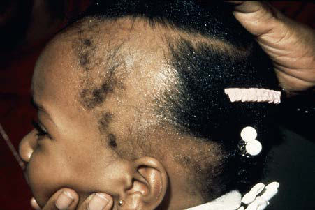

# Chapter 703: Disorders of Hair — Board-Style Self-Assessment MCQs
**Part XXIX: The Skin** | [📖 Read Wiki Chapter](../chapters/703.md) | [🃏 Chapter Flashcards](../flashcards/703_flashcards.md) | [🏠 Course Master Index](../../index.md)

Total questions: **5** *(Click "Show Answer & Rationale" beneath each question)*

### Question 1 (Clinical Pediatrics Vignette)
A pediatric patient is evaluated for the following clinical and diagnostic profile: Racial and familial forms such as hairy ears, hairy elbows,; intraphalangeal hair, or generalized hirsutism. Which of the following conditions or syndromes is the most likely diagnosis?

- **A.** INTRINSIC FACTORS (Disorders of Hair)
- **B.** ENDOCRINE DISORDERS
- **C.** (ABCC9, KCNJ8) (Disorders of Hair)
- **D.** GLO1, IGHG3, HP) (Disorders of Hair)

<b>Show Answer & Rationale</b>

**Correct Answer: A** — INTRINSIC FACTORS (Disorders of Hair)

**Rationale:** **INTRINSIC FACTORS (Disorders of Hair)** is characterized by: Racial and familial forms such as hairy ears, hairy elbows,; intraphalangeal hair, or generalized hirsutism.

**Why Other Options Are Incorrect:** **ENDOCRINE DISORDERS** is incorrect (characterized by Primary congenital hypothyroidism; Congenital adrenal hyperplasia). **(ABCC9, KCNJ8) (Disorders of Hair)** is incorrect (characterized by Coffin-Siris syndrome (BAF complex genes); Cornelia de Lange (Brachmann-de Lange) syndrome (NIPBL, S). **GLO1, IGHG3, HP) (Disorders of Hair)** is incorrect (characterized by Barber-Say syndrome (KMT2A); Cantú syndrome (hypertrichosis with osteochondrodysplasia)).

### Question 2 (Clinical Pediatrics Vignette)
A pediatric patient is evaluated for the following clinical and diagnostic profile: Local trauma; Malnutrition; Anorexia nervosa; Long-standing inflammatory dermatoses; Drugs: Diazoxide, phenytoin, corticosteroids, Cortisporin,; cyclosporine, androgens, anabolic agents, hexachlorobenzene,; minoxidil, psoralens, penicillamine, strept. Which of the following conditions or syndromes is the most likely diagnosis?

- **A.** INTRINSIC FACTORS (Disorders of Hair)
- **B.** EXTRINSIC FACTORS (Disorders of Hair)
- **C.** (ABCC9, KCNJ8) (Disorders of Hair)
- **D.** ENDOCRINE DISORDERS

<b>Show Answer & Rationale</b>

**Correct Answer: B** — EXTRINSIC FACTORS (Disorders of Hair)

**Rationale:** **EXTRINSIC FACTORS (Disorders of Hair)** is characterized by: Local trauma; Malnutrition; Anorexia nervosa; Long-standing inflammatory dermatoses; Drugs: Diazoxide, phenytoin, corticosteroids, Cortisporin,; cyclosporine, androgens, anabolic agents, hexachlorobenzene,; minoxidil, psoralens, penicillamine, streptomycin, danazol,; omeprazole, valproic acid.

**Why Other Options Are Incorrect:** **INTRINSIC FACTORS (Disorders of Hair)** is incorrect (characterized by Racial and familial forms such as hairy ears, hairy elbows,; intraphalangeal hair, or generalized hi). **(ABCC9, KCNJ8) (Disorders of Hair)** is incorrect (characterized by Coffin-Siris syndrome (BAF complex genes); Cornelia de Lange (Brachmann-de Lange) syndrome (NIPBL, S). **ENDOCRINE DISORDERS** is incorrect (characterized by Primary congenital hypothyroidism; Congenital adrenal hyperplasia).

### Question 3 (Visual Diagnosis & Clinical Spotter)

A pediatric patient undergoes evaluation for **Disorders of Hair**, yielding the clinical or diagnostic finding shown below. Which of the following best characterizes the illustrated finding?

- **A.** Acquired localized hair loss is the most common type of hair loss in childhood.
- **B.** It is caused by trauma to the hair fol licles from tight braids or ponytails, headbands, rubber bands, curlers, weaves, or rollers.
- **C.** Acute reactional hair pulling, tinea capitis, and alopecia areata must be considered in the differential diagnosis of trichotillomania.
- **D.** Traction alopecia.

<b>Show Answer & Rationale</b>

**Correct Answer: D** — Traction alopecia.

**Rationale:** **Fig. 703.1**: Traction alopecia.

### Question 4 (Differential Diagnosis (Disorders of Hair))
During a pediatric consultation regarding **Disorders of Hair**, which clinical entity or concept is described by the following profile? "this pediatric condition is rare in children and may be localized or generalized and permanent or transient."

- **A.** Treatment
- **B.** TCIRG1 (Other Inherited Disorders of Skeletal Development)
- **C.** Structural Defects of Hair
- **D.** HYPERTRICHOSIS

<b>Show Answer & Rationale</b>

**Correct Answer: D** — HYPERTRICHOSIS

**Rationale:** HYPERTRICHOSIS Hypertrichosis is rare in children and may be localized or generalized and permanent or transient.

### Question 5 (Pediatric Board Mastery (Disorders of Hair))
When formulating an evidence-based diagnostic and management plan for **Disorders of Hair** (*Part XXIX: The Skin*), which of the following pediatric clinical statements is **ACCURATE**? (Item 1)

- **A.** First-line management relies on immediate high-dose aspirin therapy in febrile infants.
- **B.** Acquired localized hair loss is the most common type of hair loss in childhood.
- **C.** The condition is an entirely benign physiologic variant that never warrants laboratory or clinical evaluation.
- **D.** Diagnostic confirmation relies solely on plain skull radiographs without biochemical, microbiologic, or clinical correlation.

<b>Show Answer & Rationale</b>

**Correct Answer: B** — Acquired localized hair loss is the most common type of hair loss in childhood.

**Rationale:** **Pediatric Clinical Principle (Disorders of Hair):** Acquired localized hair loss is the most common type of hair loss in childhood.

