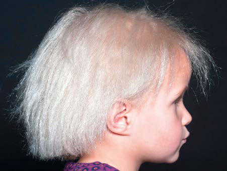

# Chapter 704: Disorders of the Nails — Board-Style Self-Assessment MCQs
**Part XXIX: The Skin** | [📖 Read Wiki Chapter](../chapters/704.md) | [🃏 Chapter Flashcards](../flashcards/704_flashcards.md) | [🏠 Course Master Index](../../index.md)

Total questions: **5** *(Click "Show Answer & Rationale" beneath each question)*

### Question 1 (Clinical Pediatrics Vignette)
A pediatric patient is evaluated for the following clinical and diagnostic profile: Generalized; Pulmonary; Cystic fibrosis; Bronchiectasis; Tuberculosis, aspergillosis; Asthma complicated by lung; infections; Sarcoidosis; Pulmonary fibrosis; Tumors; Cardiovascular; Cyanotic congenital heart; disease; Subacute bacterial; endocarditi. Which of the following conditions or syndromes is the most likely diagnosis?

- **A.** ACQUIRED (Disorders of the Nails)
- **B.** INFLAMMATORY DISORDERS
- **C.** CHEMICAL IRRITANTS
- **D.** INFECTIOUS DISORDERS

<b>Show Answer & Rationale</b>

**Correct Answer: A** — ACQUIRED (Disorders of the Nails)

**Rationale:** **ACQUIRED (Disorders of the Nails)** is characterized by: Generalized; Pulmonary; Cystic fibrosis; Bronchiectasis; Tuberculosis, aspergillosis; Asthma complicated by lung; infections; Sarcoidosis; Pulmonary fibrosis; Tumors; Cardiovascular; Cyanotic congenital heart; disease; Subacute bacterial; endocarditis; Myxomas; Gastrointestinal; Inflammatory bowel disease; Gardner’s sy.

**Why Other Options Are Incorrect:** **INFLAMMATORY DISORDERS** is incorrect (characterized by Alopecia areata; Atopic dermatitis; Contact dermatitis; Lichen planus; Psoriasis). **CHEMICAL IRRITANTS** is incorrect (characterized by Cosmetics, especially with formaldehyde; Depilatories; Detergents; Nail polish removers; Organic sol). **INFECTIOUS DISORDERS** is incorrect (characterized by Bacterial paronychia; Candidiasis; Herpes simplex (whitlow); Onychomycosis; Verrucae).

### Question 2 (Visual Diagnosis & Clinical Spotter)

A pediatric patient undergoes evaluation for **Disorders of the Nails**, yielding the clinical or diagnostic finding shown below. Which of the following best characterizes the illustrated finding?

- **A.** Congenital nail dysplasia, an autosomal dominant disorder, mani fests at birth as longitudinal streaks and thinning of the nail plate.
- **B.** Complicated combing. Blond, frizzy, and glistening hair in uncombable hair syndrome. (From Drivenes JL, Betz RC, Bygum A. A girl with unruly locks: molecular genetics makes a diagnosis of uncomb
- **C.** A girl with unruly locks: molecular genetics makes a diagnosis of uncomb able hair syndrome.
- **D.** Koilonychia occurs as an autosomal dominant trait or in association with iron-deficiency anemia, Plummer-Vinson syndrome, hemochromatosis, various genodermatoses, and occupa tional trauma.

<b>Show Answer & Rationale</b>

**Correct Answer: B** — Complicated combing. Blond, frizzy, and glistening hair in uncombable hair syndrome. (From Drivenes JL, Betz RC, Bygum A. A girl with unruly locks: molecular genetics makes a diagnosis of uncomb

**Rationale:** **Fig. 703.9**: Complicated combing. Blond, frizzy, and glistening hair in uncombable hair syndrome. (From Drivenes JL, Betz RC, Bygum A. A girl with unruly locks: molecular genetics makes a diagnosis of uncomb able hair syndrome. Lancet. 2022;399:1079.)

### Question 3 (Differential Diagnosis (Disorders of the Nails))
During a pediatric consultation regarding **Disorders of the Nails**, which clinical entity or concept is described by the following profile? "bsence of the nail plate, usually a result of a congenital disorder or trauma."

- **A.** PARONYCHIAL INFLAMMATION
- **B.** ABNORMALITIES IN NAIL SHAPE OR SIZE Anonychia
- **C.** Black pigmentation
- **D.** Yellow nail syndrome

<b>Show Answer & Rationale</b>

**Correct Answer: B** — ABNORMALITIES IN NAIL SHAPE OR SIZE Anonychia

**Rationale:** ABNORMALITIES IN NAIL SHAPE OR SIZE Anonychia is absence of the nail plate, usually a result of a congenital disorder or trauma.

### Question 4 (Differential Diagnosis (Disorders of the Nails))
During a pediatric consultation regarding **Disorders of the Nails**, which clinical entity or concept is described by the following profile? "flattening and concav ity of the nail plate with loss of normal contour, producing a spoonshaped nail (Fig."

- **A.** CHEMICAL IRRITANTS
- **B.** Koilonychia
- **C.** NAIL SEPARATION Onycholysis
- **D.** Nail-patella syndrome

<b>Show Answer & Rationale</b>

**Correct Answer: B** — Koilonychia

**Rationale:** Koilonychia is flattening and concav ity of the nail plate with loss of normal contour, producing a spoonshaped nail (Fig.

### Question 5 (Pediatric Board Mastery (Disorders of the Nails))
When formulating an evidence-based diagnostic and management plan for **Disorders of the Nails** (*Part XXIX: The Skin*), which of the following pediatric clinical statements is **ACCURATE**? (Item 1)

- **A.** The condition is an entirely benign physiologic variant that never warrants laboratory or clinical evaluation.
- **B.** First-line management relies on immediate high-dose aspirin therapy in febrile infants.
- **C.** A girl with unruly locks: molecular genetics makes a diagnosis of uncomb able hair syndrome.
- **D.** Clinical manifestations are permanently restricted to late adulthood and never present during infancy, childhood, or adolescence.

<b>Show Answer & Rationale</b>

**Correct Answer: C** — A girl with unruly locks: molecular genetics makes a diagnosis of uncomb able hair syndrome.

**Rationale:** **Pediatric Clinical Principle (Disorders of the Nails):** A girl with unruly locks: molecular genetics makes a diagnosis of uncomb able hair syndrome.

