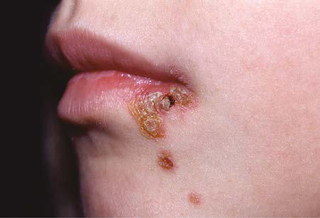

# Chapter 706: Cutaneous Bacterial Infections — Board-Style Self-Assessment MCQs
**Part XXIX: The Skin** | [📖 Read Wiki Chapter](../chapters/706.md) | [🃏 Chapter Flashcards](../flashcards/706_flashcards.md) | [🏠 Course Master Index](../../index.md)

Total questions: **5** *(Click "Show Answer & Rationale" beneath each question)*

### Question 1 (Clinical Pediatrics Vignette)
A pediatric patient is evaluated for the following clinical and diagnostic profile: Cat or dog bites; Pasteurella species, Capnocytophaga; canimorsus; Penetrating trauma; Staphylococcus aureus; Freshwater immersion; Aeromonas hydrophila; Saltwater immersion; Vibrio species; Freshwater, saltwater fish; Streptococcus iniae; Swine, pou. Which of the following conditions or syndromes is the most likely diagnosis?

- **A.** CAUSES OF CELLULITIS
- **B.** Subcutaneous Tissue Infections (Cutaneous Bacterial Infections)
- **C.** Impetigo (Cutaneous Bacterial Infections)
- **D.** Cutaneous Bacterial Infections

<b>Show Answer & Rationale</b>

**Correct Answer: A** — CAUSES OF CELLULITIS

**Rationale:** **CAUSES OF CELLULITIS** is characterized by: Cat or dog bites; Pasteurella species, Capnocytophaga; canimorsus; Penetrating trauma; Staphylococcus aureus; Freshwater immersion; Aeromonas hydrophila; Saltwater immersion; Vibrio species; Freshwater, saltwater fish; Streptococcus iniae; Swine, poultry, fish; Erysipelothrix rhusiopathiae; Periorbital or facial cellul.

**Why Other Options Are Incorrect:** **Subcutaneous Tissue Infections (Cutaneous Bacterial Infections)** is incorrect (characterized by Bullous impetigo is always caused by S. aureus strains that produce exfoliative toxins.). **Impetigo (Cutaneous Bacterial Infections)** is incorrect (characterized by Bullous impetigo is always caused by S. aureus strains that produce exfoliative toxins.). **Cutaneous Bacterial Infections** is incorrect (characterized by ETIOLOGY/PATHOGENESIS Impetigo is the most common skin infection in children throughout the world.).

### Question 2 (Clinical Pediatrics Vignette)
A pediatric patient is evaluated for the following clinical and diagnostic profile: ETIOLOGY/PATHOGENESIS Impetigo is the most common skin infection in children throughout the world.. Which of the following conditions or syndromes is the most likely diagnosis?

- **A.** Cutaneous Bacterial Infections
- **B.** Impetigo (Cutaneous Bacterial Infections)
- **C.** Subcutaneous Tissue Infections (Cutaneous Bacterial Infections)
- **D.** CAUSES OF CELLULITIS

<b>Show Answer & Rationale</b>

**Correct Answer: A** — Cutaneous Bacterial Infections

**Rationale:** **Cutaneous Bacterial Infections** is characterized by: ETIOLOGY/PATHOGENESIS Impetigo is the most common skin infection in children throughout the world..

**Why Other Options Are Incorrect:** **Impetigo (Cutaneous Bacterial Infections)** is incorrect (characterized by Bullous impetigo is always caused by S. aureus strains that produce exfoliative toxins.). **Subcutaneous Tissue Infections (Cutaneous Bacterial Infections)** is incorrect (characterized by Bullous impetigo is always caused by S. aureus strains that produce exfoliative toxins.). **CAUSES OF CELLULITIS** is incorrect (characterized by Cat or dog bites; Pasteurella species, Capnocytophaga; canimorsus; Penetrating trauma; Staphylococcu).

### Question 3 (Visual Diagnosis & Clinical Spotter)

A pediatric patient undergoes evaluation for **Cutaneous Bacterial Infections**, yielding the clinical or diagnostic finding shown below. Which of the following best characterizes the illustrated finding?

- **A.** Multiple crusted and oozing lesions of impetigo.
- **B.** ETIOLOGY/PATHOGENESIS Impetigo is the most common skin infection in children throughout the world.
- **C.** The most common lesions that precede nonbullous impe tigo are insect bites, abrasions, lacerations, chickenpox, scabies pedicu losis, and burns.
- **D.** Bullous impetigo is always caused by S. aureus strains that produce exfoliative toxins.

<b>Show Answer & Rationale</b>

**Correct Answer: A** — Multiple crusted and oozing lesions of impetigo.

**Rationale:** **Fig. 706.1**: Multiple crusted and oozing lesions of impetigo.

### Question 4 (Differential Diagnosis (706.1 Impetigo Stephen R. Humphrey))
During a pediatric consultation regarding **Cutaneous Bacterial Infections**, which clinical entity or concept is described by the following profile? "Impetigo is the most common skin infection in children throughout the world."

- **A.** PERIANAL INFECTIOUS DERMATITIS
- **B.** Treatment
- **C.** DIFFERENTIAL DIAGNOSIS
- **D.** ETIOLOGY/PATHOGENESIS

<b>Show Answer & Rationale</b>

**Correct Answer: D** — ETIOLOGY/PATHOGENESIS

**Rationale:** ETIOLOGY/PATHOGENESIS Impetigo is the most common skin infection in children throughout the world.

### Question 5 (Pediatric Board Mastery (Cutaneous Bacterial Infections))
When formulating an evidence-based diagnostic and management plan for **Cutaneous Bacterial Infections** (*Part XXIX: The Skin*), which of the following pediatric clinical statements is **ACCURATE**? (Item 1)

- **A.** First-line management relies on immediate high-dose aspirin therapy in febrile infants.
- **B.** The condition is an entirely benign physiologic variant that never warrants laboratory or clinical evaluation.
- **C.** ETIOLOGY/PATHOGENESIS Impetigo is the most common skin infection in children throughout the world.
- **D.** Systemic tetracyclines and fluoroquinolones are universally required as routine prophylaxis in all healthy newborns.

<b>Show Answer & Rationale</b>

**Correct Answer: C** — ETIOLOGY/PATHOGENESIS Impetigo is the most common skin infection in children throughout the world.

**Rationale:** **Pediatric Clinical Principle (Cutaneous Bacterial Infections):** ETIOLOGY/PATHOGENESIS Impetigo is the most common skin infection in children throughout the world.

