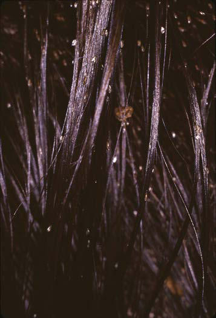

# Chapter 710: Acne — Board-Style Self-Assessment MCQs
**Part XXIX: The Skin** | [📖 Read Wiki Chapter](../chapters/710.md) | [🃏 Chapter Flashcards](../flashcards/710_flashcards.md) | [🏠 Course Master Index](../../index.md)

Total questions: **5** *(Click "Show Answer & Rationale" beneath each question)*

### Question 1 (Clinical Pediatrics Vignette)
A pediatric patient is evaluated for the following clinical and diagnostic profile: Mild; Comedones (noninflammatory lesions) are; the main lesions. Papules and pustules; may be present but are small and few in; number (generally <10).; Moderate; Moderate numbers of papules and pustules; (10-40) and comedones (10-40) are; present. M. Which of the following conditions or syndromes is the most likely diagnosis?

- **A.** HORMONAL AGENTS¶ (Acne)
- **B.** Retinoids (Acne)
- **C.** DESCRIPTION (Acne)
- **D.** Antimicrobials (Acne)

<b>Show Answer & Rationale</b>

**Correct Answer: C** — DESCRIPTION (Acne)

**Rationale:** **DESCRIPTION (Acne)** is characterized by: Mild; Comedones (noninflammatory lesions) are; the main lesions. Papules and pustules; may be present but are small and few in; number (generally <10).; Moderate; Moderate numbers of papules and pustules; (10-40) and comedones (10-40) are; present. Mild disease of the back and; trunk may also be present.; Moderately se.

**Why Other Options Are Incorrect:** **HORMONAL AGENTS¶ (Acne)** is incorrect (characterized by Spironolactone#; 50-200 mg in 1-2 divided doses; Temporary menstrual irregularities; and breast tend). **Retinoids (Acne)** is incorrect (characterized by Tretinoin; Applied once nightly; strengths of; 0.025–0.1% available; Irritation (redness and scaling). **Antimicrobials (Acne)** is incorrect (characterized by Benzoyl peroxide, 2.5–10%; Applied once or twice daily; Benzoyl peroxide can bleach; clothing and be).

### Question 2 (Clinical Pediatrics Vignette)
A pediatric patient is evaluated for the following clinical and diagnostic profile: Initial therapy; options*,†; Topical retinoid. Which of the following conditions or syndromes is the most likely diagnosis?

- **A.** ORAL ANTIBIOTICS (Acne)
- **B.** SCARRING) (Acne)
- **C.** Antimicrobials (Acne)
- **D.** DESCRIPTION (Acne)

<b>Show Answer & Rationale</b>

**Correct Answer: B** — SCARRING) (Acne)

**Rationale:** **SCARRING) (Acne)** is characterized by: Initial therapy; options*,†; Topical retinoid.

**Why Other Options Are Incorrect:** **ORAL ANTIBIOTICS (Acne)** is incorrect (characterized by Tetracycline#; 250-500 mg once or twice daily; Gastrointestinal upset, intracranial; hypertension; I). **Antimicrobials (Acne)** is incorrect (characterized by Benzoyl peroxide, 2.5–10%; Applied once or twice daily; Benzoyl peroxide can bleach; clothing and be). **DESCRIPTION (Acne)** is incorrect (characterized by Mild; Comedones (noninflammatory lesions) are; the main lesions. Papules and pustules; may be presen).

### Question 3 (Visual Diagnosis & Clinical Spotter)

A pediatric patient undergoes evaluation for **Acne**, yielding the clinical or diagnostic finding shown below. Which of the following best characterizes the illustrated finding?

- **A.** The differential diagnosis includes sarcoidosis, angiofibromas, keratosis pilaris, chloracne, rosacea, and fibrofolliculomas.
- **B.** Intact nits on human hairs.
- **C.** The eruption appears to be caused by an allergic hypersensitivity reaction to venom from larvae of the thimble jellyfish (Linuche unguiculata).
- **D.** Clinical Manifestations Acne vulgaris is characterized by four basic types of lesions: open and closed comedones, papules, pustules, and nodu locystic lesions.

<b>Show Answer & Rationale</b>

**Correct Answer: B** — Intact nits on human hairs.

**Rationale:** **Fig. 709.9**: Intact nits on human hairs.

### Question 4 (Differential Diagnosis (Acne))
During a pediatric consultation regarding **Acne**, which clinical entity or concept is described by the following profile? "transmitted by skin-to-skin or sexual con tact with an infested individual; the chance of acquiring the lice with one sexual exposure is 95%."

- **A.** Surgical Therapy
- **B.** ACNE VULGARIS
- **C.** Pediculosis pubis
- **D.** Clinical Manifestations

<b>Show Answer & Rationale</b>

**Correct Answer: C** — Pediculosis pubis

**Rationale:** Pediculosis pubis is transmitted by skin-to-skin or sexual con tact with an infested individual; the chance of acquiring the lice with one sexual exposure is 95%.

### Question 5 (Pediatric Board Mastery (Acne))
When formulating an evidence-based diagnostic and management plan for **Acne** (*Part XXIX: The Skin*), which of the following pediatric clinical statements is **ACCURATE**? (Item 1)

- **A.** The eruption appears to be caused by an allergic hypersensitivity reaction to venom from larvae of the thimble jellyfish (Linuche unguiculata).
- **B.** Diagnostic confirmation relies solely on plain skull radiographs without biochemical, microbiologic, or clinical correlation.
- **C.** Clinical manifestations are permanently restricted to late adulthood and never present during infancy, childhood, or adolescence.
- **D.** The condition is an entirely benign physiologic variant that never warrants laboratory or clinical evaluation.

<b>Show Answer & Rationale</b>

**Correct Answer: A** — The eruption appears to be caused by an allergic hypersensitivity reaction to venom from larvae of the thimble jellyfish (Linuche unguiculata).

**Rationale:** **Pediatric Clinical Principle (Acne):** The eruption appears to be caused by an allergic hypersensitivity reaction to venom from larvae of the thimble jellyfish (Linuche unguiculata).

