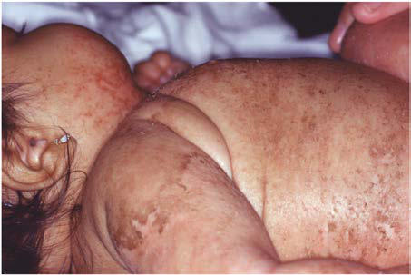

# Chapter 712: Nutritional Dermatoses — Board-Style Self-Assessment MCQs
**Part XXIX: The Skin** | [📖 Read Wiki Chapter](../chapters/712.md) | [🃏 Chapter Flashcards](../flashcards/712_flashcards.md) | [🏠 Course Master Index](../../index.md)

Total questions: **5** *(Click "Show Answer & Rationale" beneath each question)*

### Question 1 (Clinical Pediatrics Vignette)
A pediatric patient is evaluated for the following clinical and diagnostic profile: Exfoliative erythroderma; Kwashiorkor; Atopic dermatitis, psoriasis, staphylococcal; scalded skin syndrome; Phrynoderma; Vitamin A deficiency, vitamin B–complex; deficiencies, vitamin C deficiency, essential; fatty acid deficiency; Keratosis pilaris,. Which of the following conditions or syndromes is the most likely diagnosis?

- **A.** Nutritional Dermatoses
- **B.** Neurologic (Refeeding Syndrome)
- **C.** ODOR (Poisoning)
- **D.** SELECTED DIFFERENTIAL DIAGNOSIS

<b>Show Answer & Rationale</b>

**Correct Answer: D** — SELECTED DIFFERENTIAL DIAGNOSIS

**Rationale:** **SELECTED DIFFERENTIAL DIAGNOSIS** is characterized by: Exfoliative erythroderma; Kwashiorkor; Atopic dermatitis, psoriasis, staphylococcal; scalded skin syndrome; Phrynoderma; Vitamin A deficiency, vitamin B–complex; deficiencies, vitamin C deficiency, essential; fatty acid deficiency; Keratosis pilaris, pityriasis rubra pilaris; Petechiae, purpura; Vitamin K deficiency, v.

**Why Other Options Are Incorrect:** **Nutritional Dermatoses** is incorrect (characterized by The facies of patients with this syndrome are characterized by tem poroparietal bossing, prominent s). **Neurologic (Refeeding Syndrome)** is incorrect (characterized by Paresthesia; Weakness; Confusion; Disorientation; Lethargy; Areflexic paralysis; Seizures; Coma; Hem). **ODOR (Poisoning)** is incorrect (characterized by Bitter almonds; Cyanide; Acetone; Isopropyl alcohol, methanol, paraldehyde, salicylates; Rotten eggs).

### Question 2 (Clinical Pediatrics Vignette)
A pediatric patient is evaluated for the following clinical and diagnostic profile: The facies of patients with this syndrome are characterized by tem poroparietal bossing, prominent supraorbital ridges, a broad nasal root, ocular hypertelorism or dystopia canthorum, and prognathism.. Which of the following conditions or syndromes is the most likely diagnosis?

- **A.** (GSK) (Health Advice for Children Traveling Internationally)
- **B.** SELECTED DIFFERENTIAL DIAGNOSIS
- **C.** ESTIMATED RISK (Risks of Blood Transfusions)
- **D.** Nutritional Dermatoses

<b>Show Answer & Rationale</b>

**Correct Answer: D** — Nutritional Dermatoses

**Rationale:** **Nutritional Dermatoses** (associated with **`RET, SLC39A4`**) is characterized by: The facies of patients with this syndrome are characterized by tem poroparietal bossing, prominent supraorbital ridges, a broad nasal root, ocular hypertelorism or dystopia canthorum, and prognathism..

**Why Other Options Are Incorrect:** **(GSK) (Health Advice for Children Traveling Internationally)** is incorrect (characterized by 2-12 mo; 0.5 mL). **SELECTED DIFFERENTIAL DIAGNOSIS** is incorrect (characterized by Exfoliative erythroderma; Kwashiorkor; Atopic dermatitis, psoriasis, staphylococcal; scalded skin sy). **ESTIMATED RISK (Risks of Blood Transfusions)** is incorrect (characterized by Human immunodeficiency virus (HIV)-1 and HIV-2; 1:2 million; Hepatitis B; 1:2 million; Hepatitis C; ).

### Question 3 (Visual Diagnosis & Clinical Spotter)

A pediatric patient undergoes evaluation for **Nutritional Dermatoses**, yielding the clinical or diagnostic finding shown below. Which of the following best characterizes the illustrated finding?

- **A.** The facies of patients with this syndrome are characterized by tem poroparietal bossing, prominent supraorbital ridges, a broad nasal root, ocular hypertelorism or dystopia canthorum, and pr
- **B.** The syndrome is caused by pathogenic variants in the tyrosine kinase domain of the RET gene.
- **C.** Erosions and scaling in kwashiorkor.
- **D.** MUCOSAL NEUROMA SYNDROME (MULTIPLE ENDOCRINE NEOPLASIA TYPE IIB) Mucosal neuroma syndrome, an autosomal dominant trait, is charac terized by an asthenic or marfanoid habitus with scoliosis,

<b>Show Answer & Rationale</b>

**Correct Answer: C** — Erosions and scaling in kwashiorkor.

**Rationale:** **Fig. 712.3**: Erosions and scaling in kwashiorkor.

### Question 4 (Differential Diagnosis (Nutritional Dermatoses))
During a pediatric consultation regarding **Nutritional Dermatoses**, which clinical entity or concept is described by the following profile? "There are many cutaneous manifestations of nutritional deficiencies (Table 712."

- **A.** OVERVIEW
- **B.** Nutritional Dermatoses
- **C.** Cardiac Looping (Cardiac Development)
- **D.** SELECTED DIFFERENTIAL DIAGNOSIS

<b>Show Answer & Rationale</b>

**Correct Answer: A** — OVERVIEW

**Rationale:** OVERVIEW There are many cutaneous manifestations of nutritional deficiencies (Table 712.

### Question 5 (Pediatric Board Mastery (Nutritional Dermatoses))
When formulating an evidence-based diagnostic and management plan for **Nutritional Dermatoses** (*Part XXIX: The Skin*), which of the following pediatric clinical statements is **ACCURATE**? (Item 1)

- **A.** Clinical manifestations are permanently restricted to late adulthood and never present during infancy, childhood, or adolescence.
- **B.** Diagnostic confirmation relies solely on plain skull radiographs without biochemical, microbiologic, or clinical correlation.
- **C.** First-line management relies on immediate high-dose aspirin therapy in febrile infants.
- **D.** The facies of patients with this syndrome are characterized by tem poroparietal bossing, prominent supraorbital ridges, a broad nasal root, ocular hypertelorism or dystopia canthorum, and prognathism.

<b>Show Answer & Rationale</b>

**Correct Answer: D** — The facies of patients with this syndrome are characterized by tem poroparietal bossing, prominent supraorbital ridges, a broad nasal root, ocular hypertelorism or dystopia canthorum, and prognathism.

**Rationale:** **Pediatric Clinical Principle (Nutritional Dermatoses):** The facies of patients with this syndrome are characterized by tem poroparietal bossing, prominent supraorbital ridges, a broad nasal root, ocular hypertelorism or dystopia canthorum, and prognathism.

