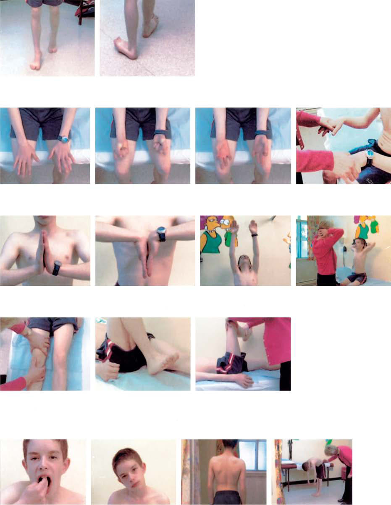

# Chapter 714: Orthopedic Evaluation of the Child — Board-Style Self-Assessment MCQs
**Part XXX: Bone and Joint Disorders** | [📖 Read Wiki Chapter](../chapters/714.md) | [🃏 Chapter Flashcards](../flashcards/714_flashcards.md) | [🏠 Course Master Index](../../index.md)

Total questions: **5** *(Click "Show Answer & Rationale" beneath each question)*

### Question 1 (Clinical Pediatrics Vignette)
A pediatric patient is evaluated for the following clinical and diagnostic profile: Head control; 3-6 mo; Sitting; 6-9 mo; Crawling; 8 mo; Pulling to stand; 8-12 mo; Ambulating; 12-18 mo. Which of the following conditions or syndromes is the most likely diagnosis?

- **A.** Duration: Whether transient, only lasting for minutes, or lasting for
- **B.** Radiation: Pain radiating to upper or lower extremities or complaints
- **C.** Onset: Was it acute and related to specific trauma or was it
- **D.** ACHIEVED BY (Orthopedic Evaluation of the Child)

<b>Show Answer & Rationale</b>

**Correct Answer: D** — ACHIEVED BY (Orthopedic Evaluation of the Child)

**Rationale:** **ACHIEVED BY (Orthopedic Evaluation of the Child)** is characterized by: Head control; 3-6 mo; Sitting; 6-9 mo; Crawling; 8 mo; Pulling to stand; 8-12 mo; Ambulating; 12-18 mo.

**Why Other Options Are Incorrect:** **Duration: Whether transient, only lasting for minutes, or lasting for** is incorrect (characterized by hours or days. Pain lasting for longer than 3-4 weeks suggests a; serious underlying problem.). **Radiation: Pain radiating to upper or lower extremities or complaints** is incorrect (characterized by of numbness, tingling, or weakness require appropriate workup.). **Onset: Was it acute and related to specific trauma or was it** is incorrect (characterized by insidious? Acute pain and history of trauma are more commonly; associated with fractures.).

### Question 2 (Visual Diagnosis & Clinical Spotter)

A pediatric patient undergoes evaluation for **Orthopedic Evaluation of the Child**, yielding the clinical or diagnostic finding shown below. Which of the following best characterizes the illustrated finding?

- **A.** Limping can be considered either painful (antalgic)* or painless*, with the dif ferential diagnosis ranging from benign to serious causes (e.g., septic hip, tumor).
- **B.** Early ambulation is characterized by short stride length, a fast cadence, and slow velocity with a wide-based stance.
- **C.** Appropriate radiographic imaging and, occasionally, laboratory testing may be necessary to support the clini cal diagnosis.
- **D.** The components of pediatric gait, arms, legs, spine (pGALS) screen, with illustration of movement. Screening questions: (1) Do you have any pain or stiffness in your joints, muscles, or back? (2)

<b>Show Answer & Rationale</b>

**Correct Answer: D** — The components of pediatric gait, arms, legs, spine (pGALS) screen, with illustration of movement. Screening questions: (1) Do you have any pain or stiffness in your joints, muscles, or back? (2)

**Rationale:** **Fig. 714.1**: The components of pediatric gait, arms, legs, spine (pGALS) screen, with illustration of movement. Screening questions: (1) Do you have any pain or stiffness in your joints, muscles, or back? (2) Do you have any difficulty getting yourself dressed without any help? (3) Do you have any difficulty going up and down stairs? *Additions and amendments to the original adult gait, arms, legs, spine screen. (From Foster HE, Kay LJ, Friswell M, et al. Musculoskeletal screening examination [pGALS] for school-age children based on the adult GALS screen. Arthritis Rheum. 2006;55:709–716.)

### Question 3 (Differential Diagnosis (Orthopedic Evaluation of the Child))
During a pediatric consultation regarding **Orthopedic Evaluation of the Child**, which clinical entity or concept is described by the following profile? "A comprehensive this pediatric condition should include details about the prenatal, peri natal, and postnatal periods."

- **A.** Nuclear Medicine Imaging
- **B.** HISTORY
- **C.** Palpation
- **D.** Radiation: Pain radiating to upper or lower extremities or complaints

<b>Show Answer & Rationale</b>

**Correct Answer: B** — HISTORY

**Rationale:** HISTORY A comprehensive history should include details about the prenatal, peri natal, and postnatal periods.

### Question 4 (Differential Diagnosis (Orthopedic Evaluation of the Child))
During a pediatric consultation regarding **Orthopedic Evaluation of the Child**, which clinical entity or concept is described by the following profile? "The orthopedic this pediatric condition includes a thorough examination of the musculoskeletal system along with a comprehensive neurologic examination."

- **A.** NEUROLOGIC EVALUATION
- **B.** Ultrasonography
- **C.** PHYSICAL EXAMINATION
- **D.** LIMPING

<b>Show Answer & Rationale</b>

**Correct Answer: C** — PHYSICAL EXAMINATION

**Rationale:** PHYSICAL EXAMINATION The orthopedic physical examination includes a thorough examination of the musculoskeletal system along with a comprehensive neurologic examination.

### Question 5 (Pediatric Board Mastery (Orthopedic Evaluation of the Child))
When formulating an evidence-based diagnostic and management plan for **Orthopedic Evaluation of the Child** (*Part XXX: Bone and Joint Disorders*), which of the following pediatric clinical statements is **ACCURATE**? (Item 1)

- **A.** Inheritance is exclusively holandric (Y-linked) with 100% penetrance restricted to male neonates.
- **B.** Appropriate radiographic imaging and, occasionally, laboratory testing may be necessary to support the clini cal diagnosis.
- **C.** Clinical manifestations are permanently restricted to late adulthood and never present during infancy, childhood, or adolescence.
- **D.** Diagnostic confirmation relies solely on plain skull radiographs without biochemical, microbiologic, or clinical correlation.

<b>Show Answer & Rationale</b>

**Correct Answer: B** — Appropriate radiographic imaging and, occasionally, laboratory testing may be necessary to support the clini cal diagnosis.

**Rationale:** **Pediatric Clinical Principle (Orthopedic Evaluation of the Child):** Appropriate radiographic imaging and, occasionally, laboratory testing may be necessary to support the clini cal diagnosis.

