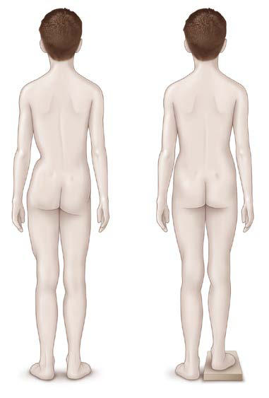

# Chapter 717: Leg-Length Discrepancy — Board-Style Self-Assessment MCQs
**Part XXX: Bone and Joint Disorders** | [📖 Read Wiki Chapter](../chapters/717.md) | [🃏 Chapter Flashcards](../flashcards/717_flashcards.md) | [🏠 Course Master Index](../../index.md)

Total questions: **5** *(Click "Show Answer & Rationale" beneath each question)*

### Question 1 (Clinical Pediatrics Vignette)
A pediatric patient is evaluated for the following clinical and diagnostic profile: Hemiatrophy; Skeletal dysplasias; Short femur; Proximal focal femoral deficiency; Fibular, tibial hemimelia; Developmental dysplasia of the; hip*. Which of the following conditions or syndromes is the most likely diagnosis?

- **A.** INFECTION (Leg-Length Discrepancy)
- **B.** CONGENITAL (Leg-Length Discrepancy)
- **C.** SYNDROMES) (Leg-Length Discrepancy)
- **D.** TRAUMA (Leg-Length Discrepancy)

<b>Show Answer & Rationale</b>

**Correct Answer: B** — CONGENITAL (Leg-Length Discrepancy)

**Rationale:** **CONGENITAL (Leg-Length Discrepancy)** is characterized by: Hemiatrophy; Skeletal dysplasias; Short femur; Proximal focal femoral deficiency; Fibular, tibial hemimelia; Developmental dysplasia of the; hip*.

**Why Other Options Are Incorrect:** **INFECTION (Leg-Length Discrepancy)** is incorrect (characterized by Osteomyelitis*; Septic arthritis; Tuberculosis). **SYNDROMES) (Leg-Length Discrepancy)** is incorrect (characterized by Beckwith-Wiedemann syndrome; PIK3CA related overgrowth; spectrum (PROS); Klippel-Trenaunay syndrome;). **TRAUMA (Leg-Length Discrepancy)** is incorrect (characterized by Physeal injury; Failed joint replacement; Osteotomy, atrophic nonunion; Overlapping, malposition of;).

### Question 2 (Clinical Pediatrics Vignette)
A pediatric patient is evaluated for the following clinical and diagnostic profile: Developmental; Neurofibromatosis; Multiple exostosis; Enchondromatosis (Ollier disease); Osteochondromatosis; Fibrous dysplasia (Albright; syndrome); Punctate epiphyseal dysplasia; Dysplasia epiphysealis hemimelica; (Trevor disease); Radiation therap. Which of the following conditions or syndromes is the most likely diagnosis?

- **A.** TUMOR (Leg-Length Discrepancy)
- **B.** TRAUMA (Leg-Length Discrepancy)
- **C.** NEUROMUSCULAR DISEASE
- **D.** SYNDROMES) (Leg-Length Discrepancy)

<b>Show Answer & Rationale</b>

**Correct Answer: A** — TUMOR (Leg-Length Discrepancy)

**Rationale:** **TUMOR (Leg-Length Discrepancy)** is characterized by: Developmental; Neurofibromatosis; Multiple exostosis; Enchondromatosis (Ollier disease); Osteochondromatosis; Fibrous dysplasia (Albright; syndrome); Punctate epiphyseal dysplasia; Dysplasia epiphysealis hemimelica; (Trevor disease); Radiation therapy before skeletal; maturity (physeal arrest)*; Resection of benign or .

**Why Other Options Are Incorrect:** **TRAUMA (Leg-Length Discrepancy)** is incorrect (characterized by Physeal injury; Failed joint replacement; Osteotomy, atrophic nonunion; Overlapping, malposition of;). **NEUROMUSCULAR DISEASE** is incorrect (characterized by Poliomyelitis; Cerebral palsy*; Myelomeningocele; Peripheral neuropathy; Focal cerebral lesions (hem). **SYNDROMES) (Leg-Length Discrepancy)** is incorrect (characterized by Beckwith-Wiedemann syndrome; PIK3CA related overgrowth; spectrum (PROS); Klippel-Trenaunay syndrome;).

### Question 3 (Visual Diagnosis & Clinical Spotter)

A pediatric patient undergoes evaluation for **Leg-Length Discrepancy**, yielding the clinical or diagnostic finding shown below. Which of the following best characterizes the illustrated finding?

- **A.** DIAGNOSIS AND CLINICAL FINDINGS Gait asymmetry is the most frequent complaint.
- **B.** Assessments at 6- to 12-month intervals are most common depending on the rate of change.
- **C.** The discrepancy may be caused by hypoplasia, hyperplasia, or angular deformity (structural discrepancy), by softtissue contracture at the hips, knees, or ankles (apparent or functional short
- **D.** Clinical assessment of limb length inequality with the aid of graduated blocks. (A) True leg length inequality (or fixed function al discrepancy) results in asymmetric iliac crest or posterior il

<b>Show Answer & Rationale</b>

**Correct Answer: D** — Clinical assessment of limb length inequality with the aid of graduated blocks. (A) True leg length inequality (or fixed function al discrepancy) results in asymmetric iliac crest or posterior il

**Rationale:** **Fig. 717.1**: Clinical assessment of limb length inequality with the aid of graduated blocks. (A) True leg length inequality (or fixed function al discrepancy) results in asymmetric iliac crest or posterior iliac spine heights with the patient standing erect. The examiner must be sure that the patient is standing evenly on the legs, with the knees straight and the feet flat on the floor. (B) A reasonably accurate estimation of leg length inequality can be made by having the patient stand erect on suf ficient graduated blocks under the shorter limb to level the pelvis. (From Podeszwa D. Limb length discrepancy. In: Herring JA, ed. Tachdjian’s Pediatric Orthopaedics, 6th ed. Philadelphia: Elsevier, 2022: Fig 20.3.)

### Question 4 (Differential Diagnosis (Leg-Length Discrepancy))
During a pediatric consultation regarding **Leg-Length Discrepancy**, which clinical entity or concept is described by the following profile? "Gait asymmetry is the most frequent complaint."

- **A.** RADIOGRAPHIC EVALUATION
- **B.** DIAGNOSIS AND CLINICAL FINDINGS
- **C.** TRAUMA (Leg-Length Discrepancy)
- **D.** Diaphragmatic Hernia

<b>Show Answer & Rationale</b>

**Correct Answer: B** — DIAGNOSIS AND CLINICAL FINDINGS

**Rationale:** DIAGNOSIS AND CLINICAL FINDINGS Gait asymmetry is the most frequent complaint.

### Question 5 (Pediatric Board Mastery (Leg-Length Discrepancy))
When formulating an evidence-based diagnostic and management plan for **Leg-Length Discrepancy** (*Part XXX: Bone and Joint Disorders*), which of the following pediatric clinical statements is **ACCURATE**? (Item 1)

- **A.** DIAGNOSIS AND CLINICAL FINDINGS Gait asymmetry is the most frequent complaint.
- **B.** Systemic tetracyclines and fluoroquinolones are universally required as routine prophylaxis in all healthy newborns.
- **C.** Clinical manifestations are permanently restricted to late adulthood and never present during infancy, childhood, or adolescence.
- **D.** The condition is an entirely benign physiologic variant that never warrants laboratory or clinical evaluation.

<b>Show Answer & Rationale</b>

**Correct Answer: A** — DIAGNOSIS AND CLINICAL FINDINGS Gait asymmetry is the most frequent complaint.

**Rationale:** **Pediatric Clinical Principle (Leg-Length Discrepancy):** DIAGNOSIS AND CLINICAL FINDINGS Gait asymmetry is the most frequent complaint.

