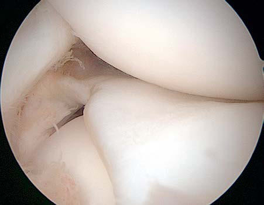

# Chapter 718: The Knee — Board-Style Self-Assessment MCQs
**Part XXX: Bone and Joint Disorders** | [📖 Read Wiki Chapter](../chapters/718.md) | [🃏 Chapter Flashcards](../flashcards/718_flashcards.md) | [🏠 Course Master Index](../../index.md)

Total questions: **5** *(Click "Show Answer & Rationale" beneath each question)*

### Question 1 (Clinical Pediatrics Vignette)
A pediatric patient is evaluated for the following clinical and diagnostic profile: A type I, or complete discoid lat eral meniscus, is characterized by a thickened lateral meniscus with complete coverage of the tibial surface.. Which of the following conditions or syndromes is the most likely diagnosis?

- **A.** Popliteal Cysts (Baker Cysts) (The Knee)
- **B.** Discoid Lateral Meniscus (The Knee)
- **C.** Juvenile Osteochondritis Dissecans (The Knee)
- **D.** The Knee

<b>Show Answer & Rationale</b>

**Correct Answer: D** — The Knee

**Rationale:** **The Knee** is characterized by: A type I, or complete discoid lat eral meniscus, is characterized by a thickened lateral meniscus with complete coverage of the tibial surface..

**Why Other Options Are Incorrect:** **Popliteal Cysts (Baker Cysts) (The Knee)** is incorrect (characterized by CLINICAL MANIFESTATIONS AND DIAGNOSIS All types of DLM can be asymptomatic, especially if they have ). **Discoid Lateral Meniscus (The Knee)** is incorrect (characterized by CLINICAL MANIFESTATIONS AND DIAGNOSIS All types of DLM can be asymptomatic, especially if they have ). **Juvenile Osteochondritis Dissecans (The Knee)** is incorrect (characterized by CLINICAL MANIFESTATIONS AND DIAGNOSIS All types of DLM can be asymptomatic, especially if they have ).

### Question 2 (Clinical Pediatrics Vignette)
A pediatric patient is evaluated for the following clinical and diagnostic profile: CLINICAL MANIFESTATIONS AND DIAGNOSIS All types of DLM can be asymptomatic, especially if they have stable peripheral attachments and no tears.. Which of the following conditions or syndromes is the most likely diagnosis?

- **A.** The Knee
- **B.** Discoid Lateral Meniscus (The Knee)
- **C.** Juvenile Osteochondritis Dissecans (The Knee)
- **D.** Popliteal Cysts (Baker Cysts) (The Knee)

<b>Show Answer & Rationale</b>

**Correct Answer: B** — Discoid Lateral Meniscus (The Knee)

**Rationale:** **Discoid Lateral Meniscus (The Knee)** is characterized by: CLINICAL MANIFESTATIONS AND DIAGNOSIS All types of DLM can be asymptomatic, especially if they have stable peripheral attachments and no tears..

**Why Other Options Are Incorrect:** **The Knee** is incorrect (characterized by A type I, or complete discoid lat eral meniscus, is characterized by a thickened lateral meniscus wi). **Juvenile Osteochondritis Dissecans (The Knee)** is incorrect (characterized by CLINICAL MANIFESTATIONS AND DIAGNOSIS All types of DLM can be asymptomatic, especially if they have ). **Popliteal Cysts (Baker Cysts) (The Knee)** is incorrect (characterized by CLINICAL MANIFESTATIONS AND DIAGNOSIS All types of DLM can be asymptomatic, especially if they have ).

### Question 3 (Visual Diagnosis & Clinical Spotter)

A pediatric patient undergoes evaluation for **The Knee**, yielding the clinical or diagnostic finding shown below. Which of the following best characterizes the illustrated finding?

- **A.** A type I, or complete discoid lat eral meniscus, is characterized by a thickened lateral meniscus with complete coverage of the tibial surface.
- **B.** Diagnosis on MRI is made if the ratio of the minimal meniscal width to the maximal tibial width in the coronal plane is >20% and/or if continuity between the anterior and posterior horns of
- **C.** Surgical treatment of discoid lateral meniscus. Arthroscop ic images of a complete discoid lateral meniscus before (A) and after (B) partial meniscectomy.
- **D.** CLINICAL MANIFESTATIONS AND DIAGNOSIS All types of DLM can be asymptomatic, especially if they have stable peripheral attachments and no tears.

<b>Show Answer & Rationale</b>

**Correct Answer: C** — Surgical treatment of discoid lateral meniscus. Arthroscop ic images of a complete discoid lateral meniscus before (A) and after (B) partial meniscectomy.

**Rationale:** **Fig. 718.2**: Surgical treatment of discoid lateral meniscus. Arthroscop ic images of a complete discoid lateral meniscus before (A) and after (B) partial meniscectomy.

### Question 4 (Differential Diagnosis (The Knee))
During a pediatric consultation regarding **The Knee**, which clinical entity or concept is described by the following profile? "The knee is the largest joint in the body and acts primarily as a modi fied hinge."

- **A.** Sinding-Larsen-Johansson (SLJ) syndrome
- **B.** CLINICAL MANIFESTATIONS AND DIAGNOSIS
- **C.** ANATOMY AND RANGE OF MOTION
- **D.** J sign

<b>Show Answer & Rationale</b>

**Correct Answer: C** — ANATOMY AND RANGE OF MOTION

**Rationale:** ANATOMY AND RANGE OF MOTION The knee is the largest joint in the body and acts primarily as a modi fied hinge.

### Question 5 (Pediatric Board Mastery (The Knee))
When formulating an evidence-based diagnostic and management plan for **The Knee** (*Part XXX: Bone and Joint Disorders*), which of the following pediatric clinical statements is **ACCURATE**? (Item 1)

- **A.** The condition is an entirely benign physiologic variant that never warrants laboratory or clinical evaluation.
- **B.** Systemic tetracyclines and fluoroquinolones are universally required as routine prophylaxis in all healthy newborns.
- **C.** A type I, or complete discoid lat eral meniscus, is characterized by a thickened lateral meniscus with complete coverage of the tibial surface.
- **D.** Inheritance is exclusively holandric (Y-linked) with 100% penetrance restricted to male neonates.

<b>Show Answer & Rationale</b>

**Correct Answer: C** — A type I, or complete discoid lat eral meniscus, is characterized by a thickened lateral meniscus with complete coverage of the tibial surface.

**Rationale:** **Pediatric Clinical Principle (The Knee):** A type I, or complete discoid lat eral meniscus, is characterized by a thickened lateral meniscus with complete coverage of the tibial surface.

