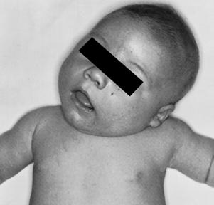

# Chapter 721: The Neck — Board-Style Self-Assessment MCQs
**Part XXX: Bone and Joint Disorders** | [📖 Read Wiki Chapter](../chapters/721.md) | [🃏 Chapter Flashcards](../flashcards/721_flashcards.md) | [🏠 Course Master Index](../../index.md)

Total questions: **5** *(Click "Show Answer & Rationale" beneath each question)*

### Question 1 (Clinical Pediatrics Vignette)
A pediatric patient is evaluated for the following clinical and diagnostic profile: Muscular torticollis; Positional deformation; Hemivertebra (cervical spine); Unilateral atlanto-occipital fusion; Klippel-Feil syndrome; Unilateral absence of sternocleidomastoid; Pterygium colli. Which of the following conditions or syndromes is the most likely diagnosis?

- **A.** CONGENITAL (The Neck)
- **B.** SUBTYPES (The Neck)
- **C.** TRAUMA (The Neck)
- **D.** NEUROLOGIC (The Neck)

<b>Show Answer & Rationale</b>

**Correct Answer: A** — CONGENITAL (The Neck)

**Rationale:** **CONGENITAL (The Neck)** is characterized by: Muscular torticollis; Positional deformation; Hemivertebra (cervical spine); Unilateral atlanto-occipital fusion; Klippel-Feil syndrome; Unilateral absence of sternocleidomastoid; Pterygium colli.

**Why Other Options Are Incorrect:** **SUBTYPES (The Neck)** is incorrect (characterized by Congenital; Cranio-occipital defects (occipital vertebrae,; basilar impression, occipital dysplasias). **TRAUMA (The Neck)** is incorrect (characterized by Muscular injury (cervical muscles); Fibromatosis coli (sternocleidomastoid tumor of infancy); Atlant). **NEUROLOGIC (The Neck)** is incorrect (characterized by Visual disturbances (nystagmus, superior oblique or lateral rectus; paresis); Dystonic drug reaction).

### Question 2 (Clinical Pediatrics Vignette)
A pediatric patient is evaluated for the following clinical and diagnostic profile: Muscular injury (cervical muscles); Fibromatosis coli (sternocleidomastoid tumor of infancy); Atlanto-occipital subluxation; Atlantoaxial subluxation; C2-3 subluxation; Rotary subluxation; Fractures; Foreign body. Which of the following conditions or syndromes is the most likely diagnosis?

- **A.** INFLAMMATION (The Neck)
- **B.** CONGENITAL (The Neck)
- **C.** SUBTYPES (The Neck)
- **D.** TRAUMA (The Neck)

<b>Show Answer & Rationale</b>

**Correct Answer: D** — TRAUMA (The Neck)

**Rationale:** **TRAUMA (The Neck)** is characterized by: Muscular injury (cervical muscles); Fibromatosis coli (sternocleidomastoid tumor of infancy); Atlanto-occipital subluxation; Atlantoaxial subluxation; C2-3 subluxation; Rotary subluxation; Fractures; Foreign body.

**Why Other Options Are Incorrect:** **INFLAMMATION (The Neck)** is incorrect (characterized by Cervical lymphadenitis; Retropharyngeal abscess; Cervical vertebral osteomyelitis; Grisel syndrome (). **CONGENITAL (The Neck)** is incorrect (characterized by Muscular torticollis; Positional deformation; Hemivertebra (cervical spine); Unilateral atlanto-occi). **SUBTYPES (The Neck)** is incorrect (characterized by Congenital; Cranio-occipital defects (occipital vertebrae,; basilar impression, occipital dysplasias).

### Question 3 (Visual Diagnosis & Clinical Spotter)

A pediatric patient undergoes evaluation for **The Neck**, yielding the clinical or diagnostic finding shown below. Which of the following best characterizes the illustrated finding?

- **A.** Congenital muscular torticollis. A, Torticollis secondary to a contracted left sternocleidomastoid (SCM) muscle. B, Mass in right SCM (arrow) of a newborn. Note intrauterine folding deformity of
- **B.** Surgical management results in satisfactory function and acceptable cosmesis in more than 90% of patients; however, with early diagnosis and treatment, surgery should be required in only a m
- **C.** Torticollis, literally meaning “twisted neck,” is not a diagnosis but rather a clinical manifestation of a variety of underlying conditions.
- **D.** Although congenital muscular torticollis is the most common diagnosis in cases presenting at or close to the time of birth, the differential diagnosis for acquired torticollis is large.

<b>Show Answer & Rationale</b>

**Correct Answer: A** — Congenital muscular torticollis. A, Torticollis secondary to a contracted left sternocleidomastoid (SCM) muscle. B, Mass in right SCM (arrow) of a newborn. Note intrauterine folding deformity of

**Rationale:** **Fig. 721.1**: Congenital muscular torticollis. A, Torticollis secondary to a contracted left sternocleidomastoid (SCM) muscle. B, Mass in right SCM (arrow) of a newborn. Note intrauterine folding deformity of the right ear. C, Flattening of the left occipital area and left ear formation resulting from supine positioning of a child with right congenital torticollis. (From Johnson CE. Disorders of the neck. In: Herring JA, ed. Tachdjian’s Pediatric Orthopaedics, 6th ed. Philadelphia: Elsevier; 2022: Fig 8.6, p. 93.)

### Question 4 (Differential Diagnosis (721.1 Torticollis R. Justin Mistovich, Keith D. Baldwin, and David A. Spiegel))
During a pediatric consultation regarding **The Neck**, which clinical entity or concept is described by the following profile? "this pediatric condition (CMT) is due to a contracture of the sternocleidomastoid (SCM) muscle, which results in a tilting of the head and neck toward the side of the contracted muscle with rotation of the head to the opposite side (Fig."

- **A.** PHYSICAL EXAMINATION
- **B.** Scoliosis
- **C.** CONGENITAL MUSCULAR TORTICOLLIS
- **D.** OS ODONTOIDEUM

<b>Show Answer & Rationale</b>

**Correct Answer: C** — CONGENITAL MUSCULAR TORTICOLLIS

**Rationale:** CONGENITAL MUSCULAR TORTICOLLIS Congenital muscular torticollis (CMT) is due to a contracture of the sternocleidomastoid (SCM) muscle, which results in a tilting of the head and neck toward the side of the contracted muscle with rotation of the head to the opposite side (Fig.

### Question 5 (Pediatric Board Mastery (The Neck))
When formulating an evidence-based diagnostic and management plan for **The Neck** (*Part XXX: Bone and Joint Disorders*), which of the following pediatric clinical statements is **ACCURATE**? (Item 1)

- **A.** Torticollis, literally meaning “twisted neck,” is not a diagnosis but rather a clinical manifestation of a variety of underlying conditions.
- **B.** The condition is an entirely benign physiologic variant that never warrants laboratory or clinical evaluation.
- **C.** Clinical manifestations are permanently restricted to late adulthood and never present during infancy, childhood, or adolescence.
- **D.** Inheritance is exclusively holandric (Y-linked) with 100% penetrance restricted to male neonates.

<b>Show Answer & Rationale</b>

**Correct Answer: A** — Torticollis, literally meaning “twisted neck,” is not a diagnosis but rather a clinical manifestation of a variety of underlying conditions.

**Rationale:** **Pediatric Clinical Principle (The Neck):** Torticollis, literally meaning “twisted neck,” is not a diagnosis but rather a clinical manifestation of a variety of underlying conditions.

