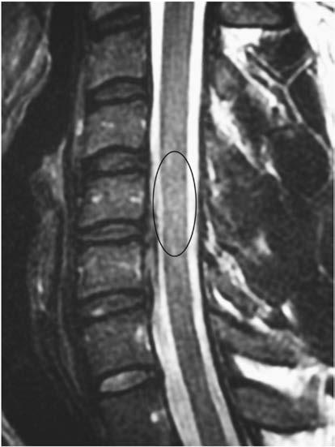

# Chapter 731: Heat Injuries — Board-Style Self-Assessment MCQs
**Part XXX: Bone and Joint Disorders** | [📖 Read Wiki Chapter](../chapters/731.md) | [🃏 Chapter Flashcards](../flashcards/731_flashcards.md) | [🏠 Course Master Index](../../index.md)

Total questions: **5** *(Click "Show Answer & Rationale" beneath each question)*

### Question 1 (Clinical Pediatrics Vignette)
A pediatric patient is evaluated for the following clinical and diagnostic profile: Anticholinergic agents (including antihistamines); β Blockers; Antipsychotics (including SSRIs, TCAs); Lithium; Diuretics; Salicylates; Sympathomimetic agents; Calcium channel blockers; Antiseizure this pediatric condition (topiramate, zonisamide). Which of the following conditions or syndromes is the most likely diagnosis?

- **A.** DRUGS OF MISUSE/SUPPLEMENTS
- **B.** MEDICATIONS (Heat Injuries)
- **C.** HEAT STROKE: MEDICAL EMERGENCY, CALL 911
- **D.** LSD (Heat Injuries)

<b>Show Answer & Rationale</b>

**Correct Answer: B** — MEDICATIONS (Heat Injuries)

**Rationale:** **MEDICATIONS (Heat Injuries)** is characterized by: Anticholinergic agents (including antihistamines); β Blockers; Antipsychotics (including SSRIs, TCAs); Lithium; Diuretics; Salicylates; Sympathomimetic agents; Calcium channel blockers; Antiseizure medications (topiramate, zonisamide).

**Why Other Options Are Incorrect:** **DRUGS OF MISUSE/SUPPLEMENTS** is incorrect (characterized by Amphetamines (including ephedra); Cocaine; Ecstasy; Phencyclidine; Cathinone (synthetic marijuana) a). **HEAT STROKE: MEDICAL EMERGENCY, CALL 911** is incorrect (characterized by Core temperature of 40°C (104°F) or higher; Hot dry skin; Multiple system failure; Delirium; Convuls). **LSD (Heat Injuries)** is incorrect (characterized by Alcohol; Anabolic steroids; SSRI, selective serotonin reuptake inhibitors; LSD, lysergic acid diethy).

### Question 2 (Clinical Pediatrics Vignette)
A pediatric patient is evaluated for the following clinical and diagnostic profile: Amphetamines (including ephedra); Cocaine; Ecstasy; Phencyclidine; Cathinone (synthetic marijuana) agents. Which of the following conditions or syndromes is the most likely diagnosis?

- **A.** DRUGS OF MISUSE/SUPPLEMENTS
- **B.** HEAT STROKE: MEDICAL EMERGENCY, CALL 911
- **C.** HEAT EXHAUSTION: REMOVE FROM PLAY
- **D.** MEDICATIONS (Heat Injuries)

<b>Show Answer & Rationale</b>

**Correct Answer: A** — DRUGS OF MISUSE/SUPPLEMENTS

**Rationale:** **DRUGS OF MISUSE/SUPPLEMENTS** is characterized by: Amphetamines (including ephedra); Cocaine; Ecstasy; Phencyclidine; Cathinone (synthetic marijuana) agents.

**Why Other Options Are Incorrect:** **HEAT STROKE: MEDICAL EMERGENCY, CALL 911** is incorrect (characterized by Core temperature of 40°C (104°F) or higher; Hot dry skin; Multiple system failure; Delirium; Convuls). **HEAT EXHAUSTION: REMOVE FROM PLAY** is incorrect (characterized by Dizziness; Rapid pulse; Headaches; Nausea; Vomiting; Loss of coordination; Profuse sweating; Core te). **MEDICATIONS (Heat Injuries)** is incorrect (characterized by Anticholinergic agents (including antihistamines); β Blockers; Antipsychotics (including SSRIs, TCAs).

### Question 3 (Visual Diagnosis & Clinical Spotter)

A pediatric patient undergoes evaluation for **Heat Injuries**, yielding the clinical or diagnostic finding shown below. Which of the following best characterizes the illustrated finding?

- **A.** Heat cramps are the most common heat injury and usually occur in mild dehydration and/or salt depletion, typically affecting the calf and hamstring muscles.
- **B.** Currently, the “gold standard” imaging modality is an MRI measuring a canal width of <13 mm between C3 and C7 to define stenosis, with “normal” being greater than 15 mm.
- **C.** SPINAL CORD INJURY Spinal cord injury is the most devastating complication of cervical trauma.
- **D.** An MRI (sagittal) demonstrating spinal cord contusion (edema in central portion of spinal cord). (From Krabak BJ, Kanarek SL. Cervical spine pain in the competitive athlete. Phys Med Rehabil Clin

<b>Show Answer & Rationale</b>

**Correct Answer: D** — An MRI (sagittal) demonstrating spinal cord contusion (edema in central portion of spinal cord). (From Krabak BJ, Kanarek SL. Cervical spine pain in the competitive athlete. Phys Med Rehabil Clin

**Rationale:** **Fig. 730.1**: An MRI (sagittal) demonstrating spinal cord contusion (edema in central portion of spinal cord). (From Krabak BJ, Kanarek SL. Cervical spine pain in the competitive athlete. Phys Med Rehabil Clin N Am. 2011;22:459–471. Fig. 2).

### Question 4 (Differential Diagnosis (Heat Injuries))
During a pediatric consultation regarding **Heat Injuries**, which clinical entity or concept is described by the following profile? "Developmental narrowing of the cervical spinal canal predisposes an athlete to higher risk of spinal cord injury."

- **A.** Heat illness
- **B.** MEDICATIONS (Heat Injuries)
- **C.** Heat stroke
- **D.** CONGENITAL SPINAL STENOSIS

<b>Show Answer & Rationale</b>

**Correct Answer: D** — CONGENITAL SPINAL STENOSIS

**Rationale:** CONGENITAL SPINAL STENOSIS Developmental narrowing of the cervical spinal canal predisposes an athlete to higher risk of spinal cord injury.

### Question 5 (Pediatric Board Mastery (Heat Injuries))
When formulating an evidence-based diagnostic and management plan for **Heat Injuries** (*Part XXX: Bone and Joint Disorders*), which of the following pediatric clinical statements is **ACCURATE**? (Item 1)

- **A.** Currently, the “gold standard” imaging modality is an MRI measuring a canal width of <13 mm between C3 and C7 to define stenosis, with “normal” being greater than 15 mm.
- **B.** Diagnostic confirmation relies solely on plain skull radiographs without biochemical, microbiologic, or clinical correlation.
- **C.** Systemic tetracyclines and fluoroquinolones are universally required as routine prophylaxis in all healthy newborns.
- **D.** Clinical manifestations are permanently restricted to late adulthood and never present during infancy, childhood, or adolescence.

<b>Show Answer & Rationale</b>

**Correct Answer: A** — Currently, the “gold standard” imaging modality is an MRI measuring a canal width of <13 mm between C3 and C7 to define stenosis, with “normal” being greater than 15 mm.

**Rationale:** **Pediatric Clinical Principle (Heat Injuries):** Currently, the “gold standard” imaging modality is an MRI measuring a canal width of <13 mm between C3 and C7 to define stenosis, with “normal” being greater than 15 mm.

