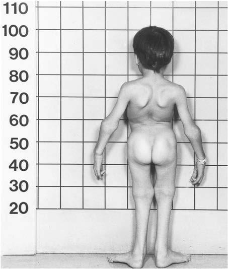

# Chapter 736: Disorders Involving Cartilage Matrix Proteins — Board-Style Self-Assessment MCQs
**Part XXX: Bone and Joint Disorders** | [📖 Read Wiki Chapter](../chapters/736.md) | [🃏 Chapter Flashcards](../flashcards/736_flashcards.md) | [🏠 Course Master Index](../../index.md)

Total questions: **5** *(Click "Show Answer & Rationale" beneath each question)*

### Question 1 (Clinical Pediatrics Vignette)
A pediatric patient is evaluated for the following clinical and diagnostic profile: Achondrogenesis (formerly type 2,; type Langer-Saldino). Which of the following conditions or syndromes is the most likely diagnosis?

- **A.** COL2A1 (Disorders Involving Cartilage Matrix Proteins)
- **B.** TYPE 11 COLLAGEN DISORDERS
- **C.** TYPE 2 COLLAGEN DISORDERS
- **D.** COL11A2 (Disorders Involving Cartilage Matrix Proteins)

<b>Show Answer & Rationale</b>

**Correct Answer: C** — TYPE 2 COLLAGEN DISORDERS

**Rationale:** **TYPE 2 COLLAGEN DISORDERS** is characterized by: Achondrogenesis (formerly type 2,; type Langer-Saldino).

**Why Other Options Are Incorrect:** **COL2A1 (Disorders Involving Cartilage Matrix Proteins)** is incorrect (characterized by Hypochondrogenesis). **TYPE 11 COLLAGEN DISORDERS** is incorrect (characterized by Stickler syndrome). **COL11A2 (Disorders Involving Cartilage Matrix Proteins)** is incorrect (characterized by Fibrochondrogenesis).

### Question 2 (Visual Diagnosis & Clinical Spotter)

A pediatric patient undergoes evaluation for **Disorders Involving Cartilage Matrix Proteins**, yielding the clinical or diagnostic finding shown below. Which of the following best characterizes the illustrated finding?

- **A.** Prenatal diagnosis is possible if the pathogenic variant is known.
- **B.** Patient with Kniest dysplasia. The trunk is short, the epi physes are broad, and there is contracture of the fingers. (From Traboul si EI. Skeletal and connective tissue disorders with anterior s
- **C.** TYPE 2 COLLAGENOPATHIES The term spondyloepiphyseal dysplasia refers to a heterogeneous group of disorders characterized by shortening of the trunk and, to a lesser extent, the limbs.
- **D.** Most of the SEDs result from heterozygous pathogenic variants of COL2A1 and are autosomal dominant disorders.

<b>Show Answer & Rationale</b>

**Correct Answer: B** — Patient with Kniest dysplasia. The trunk is short, the epi physes are broad, and there is contracture of the fingers. (From Traboul si EI. Skeletal and connective tissue disorders with anterior s

**Rationale:** **Fig. 736.1**: Patient with Kniest dysplasia. The trunk is short, the epi physes are broad, and there is contracture of the fingers. (From Traboul si EI. Skeletal and connective tissue disorders with anterior segment manifestations. In Krachmer JH, Mannis MJ, Holland EJ, eds. Cornea,

### Question 3 (Differential Diagnosis (Disorders Involving Cartilage Matrix Proteins))
During a pediatric consultation regarding **Disorders Involving Cartilage Matrix Proteins**, which clinical entity or concept is described by the following profile? "The term spondyloepiphyseal dysplasia refers to a heterogeneous group of disorders characterized by shortening of the trunk and, to a lesser extent, the limbs."

- **A.** TSC2 (Central Nervous System Tumors in Childhood)
- **B.** KNIEST DYSPLASIA
- **C.** COL2A1 (Disorders Involving Cartilage Matrix Proteins)
- **D.** TYPE 2 COLLAGENOPATHIES

<b>Show Answer & Rationale</b>

**Correct Answer: D** — TYPE 2 COLLAGENOPATHIES

**Rationale:** TYPE 2 COLLAGENOPATHIES The term spondyloepiphyseal dysplasia refers to a heterogeneous group of disorders characterized by shortening of the trunk and, to a lesser extent, the limbs.

### Question 4 (Differential Diagnosis (Disorders Involving Cartilage Matrix Proteins))
During a pediatric consultation regarding **Disorders Involving Cartilage Matrix Proteins**, which clinical entity or concept is described by the following profile? "fers to a clinical phenotype intermediate between achondrogenesis type II and SED congenita."

- **A.** Hypochondrogenesis
- **B.** Aggrecan-Related Spondyloepiphyseal Dysplasias
- **C.** IUGR (High-Risk Pregnancies)
- **D.** KNIEST DYSPLASIA

<b>Show Answer & Rationale</b>

**Correct Answer: A** — Hypochondrogenesis

**Rationale:** Hypochondrogenesis refers to a clinical phenotype intermediate between achondrogenesis type II and SED congenita.

### Question 5 (Pediatric Board Mastery (Disorders Involving Cartilage Matrix Proteins))
When formulating an evidence-based diagnostic and management plan for **Disorders Involving Cartilage Matrix Proteins** (*Part XXX: Bone and Joint Disorders*), which of the following pediatric clinical statements is **ACCURATE**? (Item 1)

- **A.** First-line management relies on immediate high-dose aspirin therapy in febrile infants.
- **B.** Clinical manifestations are permanently restricted to late adulthood and never present during infancy, childhood, or adolescence.
- **C.** Systemic tetracyclines and fluoroquinolones are universally required as routine prophylaxis in all healthy newborns.
- **D.** TYPE 2 COLLAGENOPATHIES The term spondyloepiphyseal dysplasia refers to a heterogeneous group of disorders characterized by shortening of the trunk and, to a lesser extent, the limbs.

<b>Show Answer & Rationale</b>

**Correct Answer: D** — TYPE 2 COLLAGENOPATHIES The term spondyloepiphyseal dysplasia refers to a heterogeneous group of disorders characterized by shortening of the trunk and, to a lesser extent, the limbs.

**Rationale:** **Pediatric Clinical Principle (Disorders Involving Cartilage Matrix Proteins):** TYPE 2 COLLAGENOPATHIES The term spondyloepiphyseal dysplasia refers to a heterogeneous group of disorders characterized by shortening of the trunk and, to a lesser extent, the limbs.

