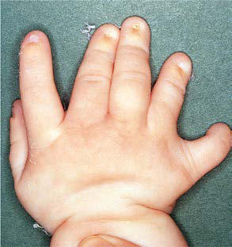

# Chapter 741: Other Inherited Disorders of Skeletal Development — Board-Style Self-Assessment MCQs
**Part XXX: Bone and Joint Disorders** | [📖 Read Wiki Chapter](../chapters/741.md) | [🃏 Chapter Flashcards](../flashcards/741_flashcards.md) | [🏠 Course Master Index](../../index.md)

Total questions: **5** *(Click "Show Answer & Rationale" beneath each question)*

### Question 1 (Clinical Pediatrics Vignette)
A pediatric patient is evaluated for the following clinical and diagnostic profile: ARO w/renal tubular acidosis (RTA). Which of the following conditions or syndromes is the most likely diagnosis?

- **A.** TCIRG1 (Other Inherited Disorders of Skeletal Development)
- **B.** TNFRSF11A (Other Inherited Disorders of Skeletal Development)
- **C.** CA2 (Other Inherited Disorders of Skeletal Development)
- **D.** OSTM1 (Other Inherited Disorders of Skeletal Development)

<b>Show Answer & Rationale</b>

**Correct Answer: C** — CA2 (Other Inherited Disorders of Skeletal Development)

**Rationale:** **CA2 (Other Inherited Disorders of Skeletal Development)** (associated with **`CA2`**) is characterized by: ARO w/renal tubular acidosis (RTA).

**Why Other Options Are Incorrect:** **TCIRG1 (Other Inherited Disorders of Skeletal Development)** is incorrect (characterized by TCIRG1-related ARO). **TNFRSF11A (Other Inherited Disorders of Skeletal Development)** is incorrect (characterized by Osteoclast-poor ARO). **OSTM1 (Other Inherited Disorders of Skeletal Development)** is incorrect (characterized by OSTM1-related ARO).

### Question 2 (Clinical Pediatrics Vignette)
A pediatric patient is evaluated for the following clinical and diagnostic profile: this pediatric condition-related ARO. Which of the following conditions or syndromes is the most likely diagnosis?

- **A.** SNX10 (Other Inherited Disorders of Skeletal Development)
- **B.** PLEKHM1 (Other Inherited Disorders of Skeletal Development)
- **C.** OSTM1 (Other Inherited Disorders of Skeletal Development)
- **D.** CA2 (Other Inherited Disorders of Skeletal Development)

<b>Show Answer & Rationale</b>

**Correct Answer: C** — OSTM1 (Other Inherited Disorders of Skeletal Development)

**Rationale:** **OSTM1 (Other Inherited Disorders of Skeletal Development)** (associated with **`OSTM1`**) is characterized by: OSTM1-related ARO.

**Why Other Options Are Incorrect:** **SNX10 (Other Inherited Disorders of Skeletal Development)** is incorrect (characterized by SNX10-related ARO). **PLEKHM1 (Other Inherited Disorders of Skeletal Development)** is incorrect (characterized by PLEKHM1-related ARO). **CA2 (Other Inherited Disorders of Skeletal Development)** is incorrect (characterized by ARO w/renal tubular acidosis (RTA)).

### Question 3 (Pediatric Genetics & Molecular Etiology)
A child is diagnosed with **CA2 (Other Inherited Disorders of Skeletal Development)** after presenting with ARO w/renal tubular acidosis (RTA). Pathogenic variants in which of the following genes are most classically implicated?

- **A.** SUFU
- **B.** FBP1
- **C.** SLC45A2
- **D.** CA2

<b>Show Answer & Rationale</b>

**Correct Answer: D** — CA2

**Rationale:** Pathogenic variants in **`CA2`** (Bone and Joint Disorders) are associated with **CA2 (Other Inherited Disorders of Skeletal Development)** (ARO w/renal tubular acidosis (RTA)).

**Why Other Options Are Incorrect:** **SLC45A2** is incorrect (associated with SLC45A2 (Defects in Metabolism of Amino Acids)).

### Question 4 (Visual Diagnosis & Clinical Spotter)

A pediatric patient undergoes evaluation for **Other Inherited Disorders of Skeletal Development**, yielding the clinical or diagnostic finding shown below. Which of the following best characterizes the illustrated finding?

- **A.** Zitelli and Davis’ Atlas of Pediatric Physical Diagnosis, 6th ed.
- **B.** Ellis-van Creveld syndrome is an autosomal recessive condition that occurs with increased frequency in the Amish and Finnish founder populations than in the general population.
- **C.** A, Ellis-van Creveld syndrome in a young female. Note short stature, joint contractures at the elbows, and marked genu val gum. B, Multiple digits (polydactyly) in a different patient with Ellis-
- **D.** This condition results from a disturbance of primary cilia, most often from patho genic variants of the gene encoding cytoplasmic dynein 2 heavy chain 1 (DYNC2H1).

<b>Show Answer & Rationale</b>

**Correct Answer: C** — A, Ellis-van Creveld syndrome in a young female. Note short stature, joint contractures at the elbows, and marked genu val gum. B, Multiple digits (polydactyly) in a different patient with Ellis-

**Rationale:** **Fig. 741.1**: A, Ellis-van Creveld syndrome in a young female. Note short stature, joint contractures at the elbows, and marked genu val gum. B, Multiple digits (polydactyly) in a different patient with Ellis-van Creveld syndrome. (A from Zipes DP, Libby P, Bonow R, Braunwald E, eds. Braunwald’s Heart Disease: a textbook of cardiovascular medicine, 7th ed. Philadelphia: WB Saunders, 2004. Fig 70.6; B from Beerman LB, Kreutzer J, Allada V. Cardiology. In: Zitelli BJ, McIntire SC, Nowalk AJ, eds. Zitelli and Davis’ Atlas of Pediatric Physical Diagnosis, 6th ed. Philadelphia: Elsevier, 2012. Fig 5.6.)

### Question 5 (Pediatric Board Mastery (Other Inherited Disorders of Skeletal Development))
When formulating an evidence-based diagnostic and management plan for **Other Inherited Disorders of Skeletal Development** (*Part XXX: Bone and Joint Disorders*), which of the following pediatric clinical statements is **ACCURATE**? (Item 1)

- **A.** Diagnostic confirmation relies solely on plain skull radiographs without biochemical, microbiologic, or clinical correlation.
- **B.** Inheritance is exclusively holandric (Y-linked) with 100% penetrance restricted to male neonates.
- **C.** Ellis-van Creveld syndrome is an autosomal recessive condition that occurs with increased frequency in the Amish and Finnish founder populations than in the general population.
- **D.** First-line management relies on immediate high-dose aspirin therapy in febrile infants.

<b>Show Answer & Rationale</b>

**Correct Answer: C** — Ellis-van Creveld syndrome is an autosomal recessive condition that occurs with increased frequency in the Amish and Finnish founder populations than in the general population.

**Rationale:** **Pediatric Clinical Principle (Other Inherited Disorders of Skeletal Development):** Ellis-van Creveld syndrome is an autosomal recessive condition that occurs with increased frequency in the Amish and Finnish founder populations than in the general population.

