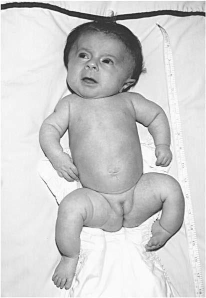

# Chapter 742: Osteogenesis Imperfecta — Board-Style Self-Assessment MCQs
**Part XXX: Bone and Joint Disorders** | [📖 Read Wiki Chapter](../chapters/742.md) | [🃏 Chapter Flashcards](../flashcards/742_flashcards.md) | [🏠 Course Master Index](../../index.md)

Total questions: **5** *(Click "Show Answer & Rationale" beneath each question)*

### Question 1 (Pediatric Genetics & Molecular Etiology)
A child is diagnosed with **COL1A1, COL1A2 (Osteogenesis Imperfecta)** after presenting with OMIM as OI type I. Pathogenic variants in which of the following genes are most classically implicated?

- **A.** COL1A1
- **B.** PDX1
- **C.** GAA
- **D.** NPC2

<b>Show Answer & Rationale</b>

**Correct Answer: A** — COL1A1

**Rationale:** Pathogenic variants in **`COL1A1`** (Bone and Joint Disorders) are associated with **COL1A1, COL1A2 (Osteogenesis Imperfecta)** (OMIM as OI type I).

**Why Other Options Are Incorrect:** **PDX1** is incorrect (associated with Embryology, Anatomy, and Physiology of the Pancreas).

### Question 2 (Visual Diagnosis & Clinical Spotter)

A pediatric patient undergoes evaluation for **Osteogenesis Imperfecta**, yielding the clinical or diagnostic finding shown below. Which of the following best characterizes the illustrated finding?

- **A.** These cases are caused by recessive null pathogenic variants in any of the three components of the collagen prolyl 3-hydroxylation complex, prolyl 3-hydroxylase 1 (encoded by LEPRE1) or its
- **B.** These cases are typically caused by defects in genes whose protein products interact with type I collagen.
- **C.** EPIDEMIOLOGY The autosomal dominant forms of OI occur equally in all racial and ethnic groups, whereas recessive forms occur predominantly in eth nic groups with consanguineous marriages or
- **D.** Infant with type III osteogenesis imperfecta displays short ened bowed extremities, thoracic deformity, and relative macrocephaly.

<b>Show Answer & Rationale</b>

**Correct Answer: D** — Infant with type III osteogenesis imperfecta displays short ened bowed extremities, thoracic deformity, and relative macrocephaly.

**Rationale:** **Fig. 742.1**: Infant with type III osteogenesis imperfecta displays short ened bowed extremities, thoracic deformity, and relative macrocephaly.

### Question 3 (Differential Diagnosis (Osteogenesis Imperfecta))
During a pediatric consultation regarding **Osteogenesis Imperfecta**, which clinical entity or concept is described by the following profile? "Structural or quantitative defects in type I collagen cause the full clini cal spectrum of OI (types I-IV)."

- **A.** NEC (Pulmonary Hemorrhage)
- **B.** ETIOLOGY
- **C.** Osteogenesis Imperfecta Type I (Mild)
- **D.** Central Diabetes Insipidus

<b>Show Answer & Rationale</b>

**Correct Answer: B** — ETIOLOGY

**Rationale:** ETIOLOGY Structural or quantitative defects in type I collagen cause the full clini cal spectrum of OI (types I-IV).

### Question 4 (Differential Diagnosis (Osteogenesis Imperfecta))
During a pediatric consultation regarding **Osteogenesis Imperfecta**, which clinical entity or concept is described by the following profile? "The autosomal dominant forms of OI occur equally in all racial and ethnic groups, whereas recessive forms occur predominantly in eth nic groups with consanguineous marriages or as a founder effect in an isolated population."

- **A.** Osteogenesis Imperfecta Type I (Mild)
- **B.** CLINICAL MANIFESTATIONS
- **C.** ETIOLOGY
- **D.** EPIDEMIOLOGY

<b>Show Answer & Rationale</b>

**Correct Answer: D** — EPIDEMIOLOGY

**Rationale:** EPIDEMIOLOGY The autosomal dominant forms of OI occur equally in all racial and ethnic groups, whereas recessive forms occur predominantly in eth nic groups with consanguineous marriages or as a founder effect in an isolated population.

### Question 5 (Pediatric Board Mastery (Osteogenesis Imperfecta))
When formulating an evidence-based diagnostic and management plan for **Osteogenesis Imperfecta** (*Part XXX: Bone and Joint Disorders*), which of the following pediatric clinical statements is **ACCURATE**? (Item 1)

- **A.** Clinical manifestations are permanently restricted to late adulthood and never present during infancy, childhood, or adolescence.
- **B.** These cases are typically caused by defects in genes whose protein products interact with type I collagen.
- **C.** Inheritance is exclusively holandric (Y-linked) with 100% penetrance restricted to male neonates.
- **D.** The condition is an entirely benign physiologic variant that never warrants laboratory or clinical evaluation.

<b>Show Answer & Rationale</b>

**Correct Answer: B** — These cases are typically caused by defects in genes whose protein products interact with type I collagen.

**Rationale:** **Pediatric Clinical Principle (Osteogenesis Imperfecta):** These cases are typically caused by defects in genes whose protein products interact with type I collagen.

