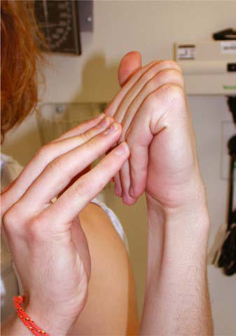

# Chapter 743: Marfan Syndrome — Board-Style Self-Assessment MCQs
**Part XXX: Bone and Joint Disorders** | [📖 Read Wiki Chapter](../chapters/743.md) | [🃏 Chapter Flashcards](../flashcards/743_flashcards.md) | [🏠 Course Master Index](../../index.md)

Total questions: **5** *(Click "Show Answer & Rationale" beneath each question)*

### Question 1 (Clinical Pediatrics Vignette)
A pediatric patient is evaluated for the following clinical and diagnostic profile: 1. Aortic root z score ≥2 AND ectopia lentis; 2. Aortic root z score ≥2 AND a bona fide the causative gene pathogenic variant;; 3. Aortic root z score ≥2 AND a systemic score ≥7; 4. Ectopia lentis AND a bona fide the causative gene pathogenic variant. Which of the following conditions or syndromes is the most likely diagnosis?

- **A.** (OMIM: 132900) (Marfan Syndrome)
- **B.** AORTIC ANEURYSM SYNDROMES
- **C.** CAN BE ESTABLISHED IN FOUR DISTINCT SCENARIOS
- **D.** DIAGNOSES INCLUDE (Marfan Syndrome)

<b>Show Answer & Rationale</b>

**Correct Answer: C** — CAN BE ESTABLISHED IN FOUR DISTINCT SCENARIOS

**Rationale:** **CAN BE ESTABLISHED IN FOUR DISTINCT SCENARIOS** (associated with **`FBN1`**) is characterized by: 1. Aortic root z score ≥2 AND ectopia lentis; 2. Aortic root z score ≥2 AND a bona fide FBN1 pathogenic variant;; 3. Aortic root z score ≥2 AND a systemic score ≥7; 4. Ectopia lentis AND a bona fide FBN1 pathogenic variant known; to cause aortic disease.

**Why Other Options Are Incorrect:** **(OMIM: 132900) (Marfan Syndrome)** is incorrect (characterized by TGFBR2, ACTA2, others; • Generally none; • Rare forms with patent; ductus arteriosus; • Aortic root ). **AORTIC ANEURYSM SYNDROMES** is incorrect (characterized by Loeys-Dietz syndromes (types I-V)). **DIAGNOSES INCLUDE (Marfan Syndrome)** is incorrect (characterized by 1. Ectopia lentis ± systemic score AND FBN1 pathogenic variant not; known to associate with aortic a).

### Question 2 (Clinical Pediatrics Vignette)
A pediatric patient is evaluated for the following clinical and diagnostic profile: 1. Ectopia lentis; 2. A systemic score ≥7; 3. Aortic root z score ≥2 if older than 20 years or ≥3 if younger than; 20 years. Which of the following conditions or syndromes is the most likely diagnosis?

- **A.** AORTIC ANEURYSM SYNDROMES
- **B.** CAN BE ESTABLISHED IN THE PRESENCE OF
- **C.** (OMIM: 132900) (Marfan Syndrome)
- **D.** TGFB3 (Marfan Syndrome)

<b>Show Answer & Rationale</b>

**Correct Answer: B** — CAN BE ESTABLISHED IN THE PRESENCE OF

**Rationale:** **CAN BE ESTABLISHED IN THE PRESENCE OF** is characterized by: 1. Ectopia lentis; 2. A systemic score ≥7; 3. Aortic root z score ≥2 if older than 20 years or ≥3 if younger than; 20 years.

**Why Other Options Are Incorrect:** **AORTIC ANEURYSM SYNDROMES** is incorrect (characterized by Loeys-Dietz syndromes (types I-V)). **(OMIM: 132900) (Marfan Syndrome)** is incorrect (characterized by TGFBR2, ACTA2, others; • Generally none; • Rare forms with patent; ductus arteriosus; • Aortic root ). **TGFB3 (Marfan Syndrome)** is incorrect (characterized by • Patent ductus; arteriosus; • Atrial septal defect; • Bicuspid aortic valve; • Aortic root aneurysm).

### Question 3 (Pediatric Genetics & Molecular Etiology)
A child is diagnosed with **CAN BE ESTABLISHED IN FOUR DISTINCT SCENARIOS** after presenting with 1. Aortic root z score ≥2 AND ectopia lentis; 2. Aortic root z score ≥2 AND a bona fide the causative gene pathogenic variant;; 3. Aortic root z score ≥2 AND a systemic score ≥7; 4. Ectopia lentis AND a bona fi. Pathogenic variants in which of the following genes are most classically implicated?

- **A.** PEX1
- **B.** ACTA1
- **C.** FBN1
- **D.** ARG1

<b>Show Answer & Rationale</b>

**Correct Answer: C** — FBN1

**Rationale:** Pathogenic variants in **`FBN1`** (Bone and Joint Disorders) are associated with **CAN BE ESTABLISHED IN FOUR DISTINCT SCENARIOS** (1. Aortic root z score ≥2 AND ectopia lentis; 2. Aortic root z score ≥2 AND a bona fide FBN1 pathogenic variant;; 3. Aortic root z score ≥2 AND a systemic score ≥7; 4. Ectopia lentis AND a bona fide FBN1 pathogenic variant known; to cause aortic disease).

### Question 4 (Visual Diagnosis & Clinical Spotter)

A pediatric patient undergoes evaluation for **Marfan Syndrome**, yielding the clinical or diagnostic finding shown below. Which of the following best characterizes the illustrated finding?

- **A.** Marfan syndrome. Note the joint laxity (A), Steinberg thumb sign (B), ability to join thumb and fifth finger around the wrist (Walker- Murdoch sign) (C), pes planus (D), and striae over hips and
- **B.** Orthopedic management of OI is aimed at fracture management and correction of deformity to enable function.
- **C.** The long-term prognosis for most recessive types is still emerging, and many adults with OI have not had molecular testing.
- **D.** PROGNOSIS OI is a chronic condition that may limit both life span and functional level.

<b>Show Answer & Rationale</b>

**Correct Answer: A** — Marfan syndrome. Note the joint laxity (A), Steinberg thumb sign (B), ability to join thumb and fifth finger around the wrist (Walker- Murdoch sign) (C), pes planus (D), and striae over hips and

**Rationale:** **Fig. 743.1**: Marfan syndrome. Note the joint laxity (A), Steinberg thumb sign (B), ability to join thumb and fifth finger around the wrist (Walker- Murdoch sign) (C), pes planus (D), and striae over hips and back (E). (From Jones KL, Jones MC, Del Campo M. Smith’s Recognizable Patterns of Human Malformation, 8th ed. Philadelphia: Elsevier, 2022; Fig. 2, p. 664.)

### Question 5 (Pediatric Board Mastery (Marfan Syndrome))
When formulating an evidence-based diagnostic and management plan for **Marfan Syndrome** (*Part XXX: Bone and Joint Disorders*), which of the following pediatric clinical statements is **ACCURATE**? (Item 1)

- **A.** Inheritance is exclusively holandric (Y-linked) with 100% penetrance restricted to male neonates.
- **B.** Systemic tetracyclines and fluoroquinolones are universally required as routine prophylaxis in all healthy newborns.
- **C.** Orthopedic management of OI is aimed at fracture management and correction of deformity to enable function.
- **D.** Clinical manifestations are permanently restricted to late adulthood and never present during infancy, childhood, or adolescence.

<b>Show Answer & Rationale</b>

**Correct Answer: C** — Orthopedic management of OI is aimed at fracture management and correction of deformity to enable function.

**Rationale:** **Pediatric Clinical Principle (Marfan Syndrome):** Orthopedic management of OI is aimed at fracture management and correction of deformity to enable function.

