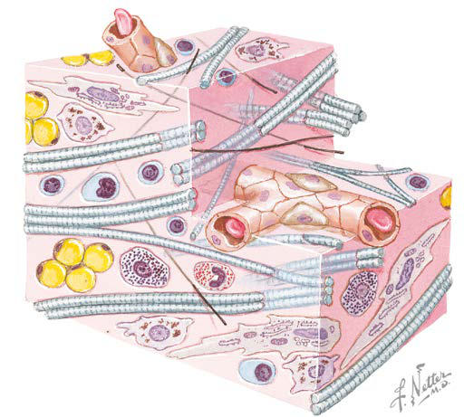

# Chapter 744: Ehlers-Danlos Syndrome — Board-Style Self-Assessment MCQs
**Part XXX: Bone and Joint Disorders** | [📖 Read Wiki Chapter](../chapters/744.md) | [🃏 Chapter Flashcards](../flashcards/744_flashcards.md) | [🏠 Course Master Index](../../index.md)

Total questions: **5** *(Click "Show Answer & Rationale" beneath each question)*

### Question 1 (Clinical Pediatrics Vignette)
A pediatric patient is evaluated for the following clinical and diagnostic profile: Specific pathogenic; variant; c.934C>T. Which of the following conditions or syndromes is the most likely diagnosis?

- **A.** COL3A1 (Ehlers-Danlos Syndrome)
- **B.** FKBP14 (Ehlers-Danlos Syndrome)
- **C.** CLASSIC VARIANTS (Ehlers-Danlos Syndrome)
- **D.** COL1A1 (Ehlers-Danlos Syndrome)

<b>Show Answer & Rationale</b>

**Correct Answer: D** — COL1A1 (Ehlers-Danlos Syndrome)

**Rationale:** **COL1A1 (Ehlers-Danlos Syndrome)** (associated with **`COL1A1`**) is characterized by: Specific pathogenic; variant; c.934C>T.

**Why Other Options Are Incorrect:** **COL3A1 (Ehlers-Danlos Syndrome)** is incorrect (characterized by Rare variants in COL1A1; Thin, translucent skin,; bruising, early varicosi; ties, acrogeria; Small j). **FKBP14 (Ehlers-Danlos Syndrome)** is incorrect (characterized by Soft, hyperextensible skin,; bruising, atrophic scars; Hypermobility). **CLASSIC VARIANTS (Ehlers-Danlos Syndrome)** is incorrect (characterized by Cardiac valvular; Biallelic loss of function; for COL1A2; Classic EDS features).

### Question 2 (Clinical Pediatrics Vignette)
A pediatric patient is evaluated for the following clinical and diagnostic profile: Cardiac valvular; Biallelic loss of function; for the causative gene; Classic EDS features. Which of the following conditions or syndromes is the most likely diagnosis?

- **A.** CLASSIC VARIANTS (Ehlers-Danlos Syndrome)
- **B.** COL3A1 (Ehlers-Danlos Syndrome)
- **C.** AEBP1 (Ehlers-Danlos Syndrome)
- **D.** C1S (Ehlers-Danlos Syndrome)

<b>Show Answer & Rationale</b>

**Correct Answer: A** — CLASSIC VARIANTS (Ehlers-Danlos Syndrome)

**Rationale:** **CLASSIC VARIANTS (Ehlers-Danlos Syndrome)** (associated with **`COL1A2`**) is characterized by: Cardiac valvular; Biallelic loss of function; for COL1A2; Classic EDS features.

**Why Other Options Are Incorrect:** **COL3A1 (Ehlers-Danlos Syndrome)** is incorrect (characterized by Rare variants in COL1A1; Thin, translucent skin,; bruising, early varicosi; ties, acrogeria; Small j). **AEBP1 (Ehlers-Danlos Syndrome)** is incorrect (characterized by Hyperextensibility, marked; hypermobility, severe; bruising, velvety skin, no; scarring tendency; Jo). **C1S (Ehlers-Danlos Syndrome)** is incorrect (characterized by Can have classic EDS; features; Can have; hypermobility).

### Question 3 (Pediatric Genetics & Molecular Etiology)
A child is diagnosed with **COL1A1 (Ehlers-Danlos Syndrome)** after presenting with Specific pathogenic; variant; c.934C>T. Pathogenic variants in which of the following genes are most classically implicated?

- **A.** PKD1
- **B.** COL1A1
- **C.** HBB
- **D.** KCNQ2

<b>Show Answer & Rationale</b>

**Correct Answer: B** — COL1A1

**Rationale:** Pathogenic variants in **`COL1A1`** (Bone and Joint Disorders) are associated with **COL1A1 (Ehlers-Danlos Syndrome)** (Specific pathogenic; variant; c.934C>T).

**Why Other Options Are Incorrect:** **PKD1** is incorrect (associated with PKD1 (Anatomic Abnormalities Associated with Hematuria)). **HBB** is incorrect (associated with Development of the Hematopoietic System).

### Question 4 (Visual Diagnosis & Clinical Spotter)

A pediatric patient undergoes evaluation for **Ehlers-Danlos Syndrome**, yielding the clinical or diagnostic finding shown below. Which of the following best characterizes the illustrated finding?

- **A.** The hypermobility type (hEDS) is the most common form and has no clear molecular etiology.
- **B.** PROGNOSIS The major cause of mortality is aortic root dilatation, dissection, and rupture, with the majority of fatal events occurring in the third and fourth decades of life.
- **C.** A reevaluation of life expectancy in MFS suggested that early diagnosis and refined medical and sur gical management has greatly improved the prognosis for patients with the condition.
- **D.** Complex connective tissue mac roenvironment illustrated by intermingled col lagen and elastin fibers, nerves, mast cells, and capillaries. Both structure and function can be impacted by an abnorm

<b>Show Answer & Rationale</b>

**Correct Answer: D** — Complex connective tissue mac roenvironment illustrated by intermingled col lagen and elastin fibers, nerves, mast cells, and capillaries. Both structure and function can be impacted by an abnorm

**Rationale:** **Fig. 744.1**: Complex connective tissue mac roenvironment illustrated by intermingled col lagen and elastin fibers, nerves, mast cells, and capillaries. Both structure and function can be impacted by an abnormal connective tissue ma trix. (Courtesy Netter Images, Image ID 13192. https://netterimages.com/loose-connective-tissue- ovalle-histology-figure-31-labeled-ovalle-histology- frank-h-netter-13192.html)

### Question 5 (Pediatric Board Mastery (Ehlers-Danlos Syndrome))
When formulating an evidence-based diagnostic and management plan for **Ehlers-Danlos Syndrome** (*Part XXX: Bone and Joint Disorders*), which of the following pediatric clinical statements is **ACCURATE**? (Item 1)

- **A.** The condition is an entirely benign physiologic variant that never warrants laboratory or clinical evaluation.
- **B.** PROGNOSIS The major cause of mortality is aortic root dilatation, dissection, and rupture, with the majority of fatal events occurring in the third and fourth decades of life.
- **C.** Systemic tetracyclines and fluoroquinolones are universally required as routine prophylaxis in all healthy newborns.
- **D.** Clinical manifestations are permanently restricted to late adulthood and never present during infancy, childhood, or adolescence.

<b>Show Answer & Rationale</b>

**Correct Answer: B** — PROGNOSIS The major cause of mortality is aortic root dilatation, dissection, and rupture, with the majority of fatal events occurring in the third and fourth decades of life.

**Rationale:** **Pediatric Clinical Principle (Ehlers-Danlos Syndrome):** PROGNOSIS The major cause of mortality is aortic root dilatation, dissection, and rupture, with the majority of fatal events occurring in the third and fourth decades of life.

