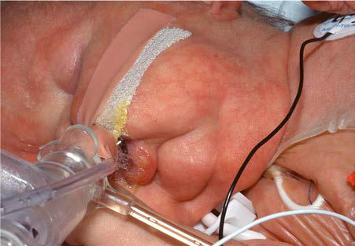

# Chapter 745: Cutis Laxa — Board-Style Self-Assessment MCQs
**Part XXX: Bone and Joint Disorders** | [📖 Read Wiki Chapter](../chapters/745.md) | [🃏 Chapter Flashcards](../flashcards/745_flashcards.md) | [🏠 Course Master Index](../../index.md)

Total questions: **5** *(Click "Show Answer & Rationale" beneath each question)*

### Question 1 (Clinical Pediatrics Vignette)
A pediatric patient is evaluated for the following clinical and diagnostic profile: the causative gene- related; cutis laxa. Which of the following conditions or syndromes is the most likely diagnosis?

- **A.** Postneonatal Vitamin K Deficiency
- **B.** Allergy and the Immunologic Basis of Atopic Disease
- **C.** DELAY (Cutis Laxa)
- **D.** DISORDERS OF FATTY ACID METABOLISM

<b>Show Answer & Rationale</b>

**Correct Answer: C** — DELAY (Cutis Laxa)

**Rationale:** **DELAY (Cutis Laxa)** (associated with **`ALDH18A1`**) is characterized by: ALDH18A1- related; cutis laxa.

**Why Other Options Are Incorrect:** **Postneonatal Vitamin K Deficiency** is incorrect (characterized by Intestinal malabsorption of fats may accompany cystic fibrosis, biliary atresia, or other liver dise). **Allergy and the Immunologic Basis of Atopic Disease** is incorrect (characterized by Early development of a T-helper type 1 (Th1) response together with T-regulatory cell (Treg) respons). **DISORDERS OF FATTY ACID METABOLISM** is incorrect (characterized by Medium-chain acyl-CoA dehydrogenase deficiency; Very-long-chain acyl-CoA dehydrogenase deficiency; L).

### Question 2 (Clinical Pediatrics Vignette)
A pediatric patient is evaluated for the following clinical and diagnostic profile: Management of chronic pain in Ehlers-Danlos syndrome.. Which of the following conditions or syndromes is the most likely diagnosis?

- **A.** Legislation (Adolescent Physical and Social Development)
- **B.** POSTRENAL (Renal Failure)
- **C.** Acute Necrotic Collection (ANC)
- **D.** Cutis Laxa

<b>Show Answer & Rationale</b>

**Correct Answer: D** — Cutis Laxa

**Rationale:** **Cutis Laxa** (associated with **`ALDH18A1, AR, ATP6V0A2, ATP7A, FBLN5`**) is characterized by: Management of chronic pain in Ehlers-Danlos syndrome..

**Why Other Options Are Incorrect:** **Legislation (Adolescent Physical and Social Development)** is incorrect (characterized by 18 yr as the minimum; age of marriage; Allow provision of; contraception to; legal minors; Legalize ). **POSTRENAL (Renal Failure)** is incorrect (characterized by Posterior urethral valves; Ureteropelvic junction obstruction; Ureterovesical junction obstruction; ). **Acute Necrotic Collection (ANC)** is incorrect (characterized by <4 weeks after necrotizing pancreatitis; heterogeneous fluid and necrotic parenchyma; avoid early in).

### Question 3 (Pediatric Genetics & Molecular Etiology)
A child is diagnosed with **DELAY (Cutis Laxa)** after presenting with the causative gene- related; cutis laxa. Pathogenic variants in which of the following genes are most classically implicated?

- **A.** ALDH18A1
- **B.** CASR
- **C.** COL7A1
- **D.** CYP21A2

<b>Show Answer & Rationale</b>

**Correct Answer: A** — ALDH18A1

**Rationale:** Pathogenic variants in **`ALDH18A1`** (Bone and Joint Disorders) are associated with **DELAY (Cutis Laxa)** (ALDH18A1- related; cutis laxa).

**Why Other Options Are Incorrect:** **CASR** is incorrect (associated with A. Congenital (Hypoparathyroidism)). **CYP21A2** is incorrect (associated with CYP17A1 (Autoimmune Polyglandular Syndromes)).

### Question 4 (Visual Diagnosis & Clinical Spotter)

A pediatric patient undergoes evaluation for **Cutis Laxa**, yielding the clinical or diagnostic finding shown below. Which of the following best characterizes the illustrated finding?

- **A.** Cutis laxa syndromes encompass a group of rare multisystem disorders that include loose redundant skinfolds as hallmark clinical feature.
- **B.** Characteristics of pain in Ehlers-Danlos syndrome that progress in clinical stages. (From Zhou Z, Rewari A, Shanthanna H. Management of chronic pain in Ehlers-Danlos syndrome. Medicine. 2018;97:e
- **C.** Cutis laxa results from impaired elastic fiber assembly and homeo stasis, and the known underlying gene defects affect different extracellular matrix proteins, intracellular trafficking, or
- **D.** Management of chronic pain in Ehlers-Danlos syndrome.

<b>Show Answer & Rationale</b>

**Correct Answer: B** — Characteristics of pain in Ehlers-Danlos syndrome that progress in clinical stages. (From Zhou Z, Rewari A, Shanthanna H. Management of chronic pain in Ehlers-Danlos syndrome. Medicine. 2018;97:e

**Rationale:** **Fig. 744.7**: Characteristics of pain in Ehlers-Danlos syndrome that progress in clinical stages. (From Zhou Z, Rewari A, Shanthanna H. Management of chronic pain in Ehlers-Danlos syndrome. Medicine. 2018;97:e13115.)

### Question 5 (Pediatric Board Mastery (Cutis Laxa))
When formulating an evidence-based diagnostic and management plan for **Cutis Laxa** (*Part XXX: Bone and Joint Disorders*), which of the following pediatric clinical statements is **ACCURATE**? (Item 1)

- **A.** Management of chronic pain in Ehlers-Danlos syndrome.
- **B.** First-line management relies on immediate high-dose aspirin therapy in febrile infants.
- **C.** Diagnostic confirmation relies solely on plain skull radiographs without biochemical, microbiologic, or clinical correlation.
- **D.** Clinical manifestations are permanently restricted to late adulthood and never present during infancy, childhood, or adolescence.

<b>Show Answer & Rationale</b>

**Correct Answer: A** — Management of chronic pain in Ehlers-Danlos syndrome.

**Rationale:** **Pediatric Clinical Principle (Cutis Laxa):** Management of chronic pain in Ehlers-Danlos syndrome.

