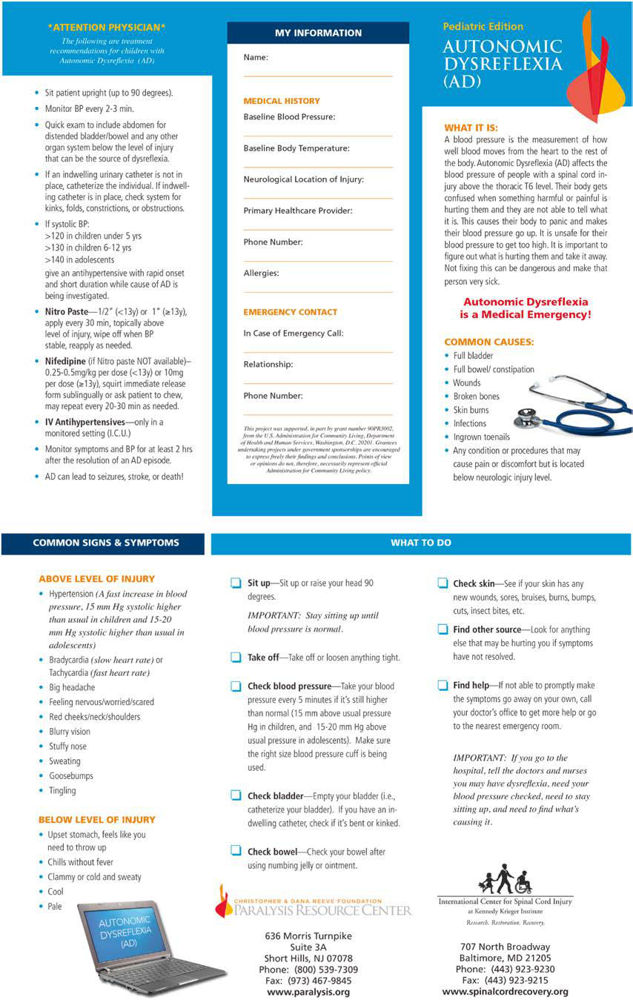

# Chapter 751: Spinal Cord Injury and Autonomic Dysreflexia Management — Board-Style Self-Assessment MCQs
**Part XXXI: Rehabilitation Medicine** | [📖 Read Wiki Chapter](../chapters/751.md) | [🃏 Chapter Flashcards](../flashcards/751_flashcards.md) | [🏠 Course Master Index](../../index.md)

Total questions: **5** *(Click "Show Answer & Rationale" beneath each question)*

### Question 1 (Clinical Pediatrics Vignette)
A pediatric patient is evaluated for the following clinical and diagnostic profile: 1. Clinical features occur; simultaneously; 2. Episodes are paroxysmal in nature; 3. Sympathetic overactivity to normally; nonpainful stimuli; 4. Features persist > 3 consecutive; days; 5. Features persist > 1 week postinjury; 6. Features persist des. Which of the following conditions or syndromes is the most likely diagnosis?

- **A.** GASTROINTESTINAL SYSTEM
- **B.** URINARY SYSTEM (Spinal Cord Injury and Autonomic Dysreflexia Management)
- **C.** MUSCULOSKELETAL SYSTEM
- **D.** PRESENT/ABSENT (1/0)

<b>Show Answer & Rationale</b>

**Correct Answer: D** — PRESENT/ABSENT (1/0)

**Rationale:** **PRESENT/ABSENT (1/0)** is characterized by: 1. Clinical features occur; simultaneously; 2. Episodes are paroxysmal in nature; 3. Sympathetic overactivity to normally; nonpainful stimuli; 4. Features persist > 3 consecutive; days; 5. Features persist > 1 week postinjury; 6. Features persist despite treatment; of alternative differential diagnoses; 7. At least sin.

**Why Other Options Are Incorrect:** **GASTROINTESTINAL SYSTEM** is incorrect (characterized by • Bowel distention; • Bowel impaction; • Gallstones; • Appendicitis; • Gastric ulcers; • Gastritis; ). **URINARY SYSTEM (Spinal Cord Injury and Autonomic Dysreflexia Management)** is incorrect (characterized by • Bladder distention; • Bladder or kidney stones; • Blocked/kinked catheter; • Detrusor sphincter dy). **MUSCULOSKELETAL SYSTEM** is incorrect (characterized by • Fractures; • Heterotopic ossification; • Functional electrical stimulation).

### Question 2 (Clinical Pediatrics Vignette)
A pediatric patient is evaluated for the following clinical and diagnostic profile: Unlikely; 17; PSH-AM, paroxysmal sympathetic hyperactivity assessment measure; PCFS, pediatric; clinical feature scale; PDLT, pediatric diagnosis likelihood tool.. Which of the following conditions or syndromes is the most likely diagnosis?

- **A.** PRESENT/ABSENT (1/0)
- **B.** GASTROINTESTINAL SYSTEM
- **C.** (PCFS + PDLT) (Spinal Cord Injury and Autonomic Dysreflexia Management)
- **D.** MUSCULOSKELETAL SYSTEM

<b>Show Answer & Rationale</b>

**Correct Answer: C** — (PCFS + PDLT) (Spinal Cord Injury and Autonomic Dysreflexia Management)

**Rationale:** **(PCFS + PDLT) (Spinal Cord Injury and Autonomic Dysreflexia Management)** is characterized by: Unlikely; 17; PSH-AM, paroxysmal sympathetic hyperactivity assessment measure; PCFS, pediatric; clinical feature scale; PDLT, pediatric diagnosis likelihood tool..

**Why Other Options Are Incorrect:** **PRESENT/ABSENT (1/0)** is incorrect (characterized by 1. Clinical features occur; simultaneously; 2. Episodes are paroxysmal in nature; 3. Sympathetic ove). **GASTROINTESTINAL SYSTEM** is incorrect (characterized by • Bowel distention; • Bowel impaction; • Gallstones; • Appendicitis; • Gastric ulcers; • Gastritis; ). **MUSCULOSKELETAL SYSTEM** is incorrect (characterized by • Fractures; • Heterotopic ossification; • Functional electrical stimulation).

### Question 3 (Visual Diagnosis & Clinical Spotter)

A pediatric patient undergoes evaluation for **Spinal Cord Injury and Autonomic Dysreflexia Management**, yielding the clinical or diagnostic finding shown below. Which of the following best characterizes the illustrated finding?

- **A.** Example of pediatric autonomic dysreflexia emergency card, which can be downloaded in multiple languages for free from the Chris topher & Dana Reeve Foundation Paralysis Resource Center website (
- **B.** The most common manifestations include bradycardia, hypo tension, temperature dysregulation, and, once spinal shock has resolved, autonomic dysreflexia (AD).
- **C.** Emergent management of AD is necessary because of the risk of stroke and additional organ damage resulting from sustained hypertension.
- **D.** Management includes pharmacologic therapy, stretching, splinting, and positioning to reduce tone.

<b>Show Answer & Rationale</b>

**Correct Answer: A** — Example of pediatric autonomic dysreflexia emergency card, which can be downloaded in multiple languages for free from the Chris topher & Dana Reeve Foundation Paralysis Resource Center website (

**Rationale:** **Fig. 751.3**: Example of pediatric autonomic dysreflexia emergency card, which can be downloaded in multiple languages for free from the Chris topher & Dana Reeve Foundation Paralysis Resource Center website (https://www.christopherreeve.org/living-with-paralysis/free-resources-and- downloads/wallet-cards).

### Question 4 (Differential Diagnosis (Spinal Cord Injury and Autonomic Dysreflexia Management))
During a pediatric consultation regarding **Spinal Cord Injury and Autonomic Dysreflexia Management**, which clinical entity or concept is described by the following profile? "Immediately after an SCI, there is typically a period of spinal shock with low tone and absent reflexes."

- **A.** upper motor neuron
- **B.** CLINICAL MANIFESTATIONS
- **C.** RHYTHM DISORDERS (General Principles of Treatment of Congenital Heart Disease)
- **D.** GASTROINTESTINAL SYSTEM

<b>Show Answer & Rationale</b>

**Correct Answer: B** — CLINICAL MANIFESTATIONS

**Rationale:** CLINICAL MANIFESTATIONS Immediately after an SCI, there is typically a period of spinal shock with low tone and absent reflexes.

### Question 5 (Pediatric Board Mastery (Spinal Cord Injury and Autonomic Dysreflexia Management))
When formulating an evidence-based diagnostic and management plan for **Spinal Cord Injury and Autonomic Dysreflexia Management** (*Part XXXI: Rehabilitation Medicine*), which of the following pediatric clinical statements is **ACCURATE**? (Item 1)

- **A.** Inheritance is exclusively holandric (Y-linked) with 100% penetrance restricted to male neonates.
- **B.** Systemic tetracyclines and fluoroquinolones are universally required as routine prophylaxis in all healthy newborns.
- **C.** Clinical manifestations are permanently restricted to late adulthood and never present during infancy, childhood, or adolescence.
- **D.** The most common manifestations include bradycardia, hypo tension, temperature dysregulation, and, once spinal shock has resolved, autonomic dysreflexia (AD).

<b>Show Answer & Rationale</b>

**Correct Answer: D** — The most common manifestations include bradycardia, hypo tension, temperature dysregulation, and, once spinal shock has resolved, autonomic dysreflexia (AD).

**Rationale:** **Pediatric Clinical Principle (Spinal Cord Injury and Autonomic Dysreflexia Management):** The most common manifestations include bradycardia, hypo tension, temperature dysregulation, and, once spinal shock has resolved, autonomic dysreflexia (AD).

