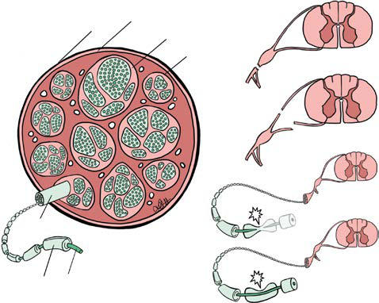

# Chapter 753: Birth Brachial Plexus Palsy — Board-Style Self-Assessment MCQs
**Part XXXI: Rehabilitation Medicine** | [📖 Read Wiki Chapter](../chapters/753.md) | [🃏 Chapter Flashcards](../flashcards/753_flashcards.md) | [🏠 Course Master Index](../../index.md)

Total questions: **5** *(Click "Show Answer & Rationale" beneath each question)*

### Question 1 (Clinical Pediatrics Vignette)
A pediatric patient is evaluated for the following clinical and diagnostic profile: It is by far the most common injury seen in BBPP.. Which of the following conditions or syndromes is the most likely diagnosis?

- **A.** GER (Brief Resolved Unexplained Events and Other Acute Events in Infants)
- **B.** Birth Brachial Plexus Palsy
- **C.** Cryptococcus neoformans and Cryptococcus gattii
- **D.** B. Genetic Defects of Insulin Action

<b>Show Answer & Rationale</b>

**Correct Answer: B** — Birth Brachial Plexus Palsy

**Rationale:** **Birth Brachial Plexus Palsy** is characterized by: It is by far the most common injury seen in BBPP..

**Why Other Options Are Incorrect:** **GER (Brief Resolved Unexplained Events and Other Acute Events in Infants)** is incorrect (characterized by Intussusception; Volvulus; Oropharyngeal dysphagia; Coughing, vomiting, choking,; gasping temporally). **Cryptococcus neoformans and Cryptococcus gattii** is incorrect (characterized by In patients who have undergone organ transplantation, cryptococcosis is the third most common fungal). **B. Genetic Defects of Insulin Action** is incorrect (characterized by 1. Type A insulin resistance; 2. Donohue syndrome; 3. Rabson-Mendenhall syndrome; 4. Lipoatrophic di).

### Question 2 (Visual Diagnosis & Clinical Spotter)

A pediatric patient undergoes evaluation for **Birth Brachial Plexus Palsy**, yielding the clinical or diagnostic finding shown below. Which of the following best characterizes the illustrated finding?

- **A.** It is by far the most common injury seen in BBPP.
- **B.** The parents also are informed of the higher risk of BBPP for future infants, and so the families are encouraged to speak with the obste trician about optimal management in future deliveries.
- **C.** Anatomy of peripheral nerve and injury type. (Courtesy Kendall Hulk, DO.)
- **D.** Spinal accessory to suprascapular nerve transfer and radial nerve (long head of triceps branch) to axillary nerve transfer has been reported as the most common dual nerve transfer procedure.

<b>Show Answer & Rationale</b>

**Correct Answer: C** — Anatomy of peripheral nerve and injury type. (Courtesy Kendall Hulk, DO.)

**Rationale:** **Fig. 753.1**: Anatomy of peripheral nerve and injury type. (Courtesy Kendall Hulk, DO.)

### Question 3 (Differential Diagnosis (Birth Brachial Plexus Palsy))
During a pediatric consultation regarding **Birth Brachial Plexus Palsy**, which clinical entity or concept is described by the following profile? "the least severe of these types and is a reversible loss of nerve conduction."

- **A.** Neurapraxia
- **B.** Axonotmesis
- **C.** Neurotmesis
- **D.** PHYSICAL EXAMINATION

<b>Show Answer & Rationale</b>

**Correct Answer: A** — Neurapraxia

**Rationale:** Neurapraxia is the least severe of these types and is a reversible loss of nerve conduction.

### Question 4 (Differential Diagnosis (Birth Brachial Plexus Palsy))
During a pediatric consultation regarding **Birth Brachial Plexus Palsy**, which clinical entity or concept is described by the following profile? "the most severe and is a total and complete disruption of the nerve."

- **A.** Neurapraxia
- **B.** SYNDROMIC (Diseases of the Myocardium)
- **C.** DIETARY SOURCES (Micronutrient Mineral Deficiencies)
- **D.** Neurotmesis

<b>Show Answer & Rationale</b>

**Correct Answer: D** — Neurotmesis

**Rationale:** Neurotmesis is the most severe and is a total and complete disruption of the nerve.

### Question 5 (Pediatric Board Mastery (Birth Brachial Plexus Palsy))
When formulating an evidence-based diagnostic and management plan for **Birth Brachial Plexus Palsy** (*Part XXXI: Rehabilitation Medicine*), which of the following pediatric clinical statements is **ACCURATE**? (Item 1)

- **A.** Clinical manifestations are permanently restricted to late adulthood and never present during infancy, childhood, or adolescence.
- **B.** First-line management relies on immediate high-dose aspirin therapy in febrile infants.
- **C.** Diagnostic confirmation relies solely on plain skull radiographs without biochemical, microbiologic, or clinical correlation.
- **D.** It is by far the most common injury seen in BBPP.

<b>Show Answer & Rationale</b>

**Correct Answer: D** — It is by far the most common injury seen in BBPP.

**Rationale:** **Pediatric Clinical Principle (Birth Brachial Plexus Palsy):** It is by far the most common injury seen in BBPP.

