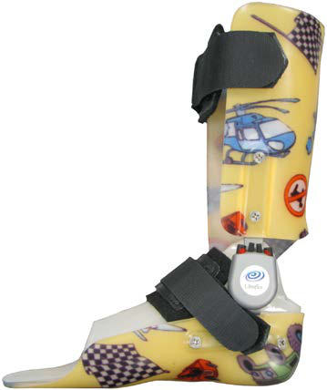

# Chapter 755: Upper and Lower Extremity Assistive Devices — Board-Style Self-Assessment MCQs
**Part XXXI: Rehabilitation Medicine** | [📖 Read Wiki Chapter](../chapters/755.md) | [🃏 Chapter Flashcards](../flashcards/755_flashcards.md) | [🏠 Course Master Index](../../index.md)

Total questions: **5** *(Click "Show Answer & Rationale" beneath each question)*

### Question 1 (Clinical Pediatrics Vignette)
A pediatric patient is evaluated for the following clinical and diagnostic profile: Neoprene thumb abductor; Places thumb in abduction to promote functional use; of hand; Will not overcome severe cortical thumb position; Thumb spica; Immobilizes and protects the thumb and provides a; stable post against which the index finger can pi. Which of the following conditions or syndromes is the most likely diagnosis?

- **A.** COMMENTS (Upper and Lower Extremity Assistive Devices)
- **B.** COL1A1, COL1A2, IFITM5
- **C.** (KAFO) (Upper and Lower Extremity Assistive Devices)
- **D.** MAC (Nontuberculous Mycobacteria)

<b>Show Answer & Rationale</b>

**Correct Answer: A** — COMMENTS (Upper and Lower Extremity Assistive Devices)

**Rationale:** **COMMENTS (Upper and Lower Extremity Assistive Devices)** is characterized by: Neoprene thumb abductor; Places thumb in abduction to promote functional use; of hand; Will not overcome severe cortical thumb position; Thumb spica; Immobilizes and protects the thumb and provides a; stable post against which the index finger can pinch; Need to allow for full metacarpophalangeal (MCP); flexion of the .

**Why Other Options Are Incorrect:** **COL1A1, COL1A2, IFITM5** is incorrect (characterized by OMIM as OI type III). **(KAFO) (Upper and Lower Extremity Assistive Devices)** is incorrect (characterized by Provides support at the knee when there is quadriceps; weakness to promote an upright posture with; ). **MAC (Nontuberculous Mycobacteria)** is incorrect (characterized by M. scrofulaceum, M. malmoense (northern Europe),; M. abscessus, M. fortuitum, M. lentiflavum,; M. tu).

### Question 2 (Clinical Pediatrics Vignette)
A pediatric patient is evaluated for the following clinical and diagnostic profile: Provides support at the knee when there is quadriceps; weakness to promote an upright posture with; standing or walking; Less commonly used because of large size of brace; but may be appropriate for child with spina bifida or; spinal cord injury; Wal. Which of the following conditions or syndromes is the most likely diagnosis?

- **A.** GASTROINTESTINAL DISORDERS
- **B.** SYSTEMIC THERAPIES
- **C.** Invasive Disease (Aspergillus)
- **D.** (KAFO) (Upper and Lower Extremity Assistive Devices)

<b>Show Answer & Rationale</b>

**Correct Answer: D** — (KAFO) (Upper and Lower Extremity Assistive Devices)

**Rationale:** **(KAFO) (Upper and Lower Extremity Assistive Devices)** is characterized by: Provides support at the knee when there is quadriceps; weakness to promote an upright posture with; standing or walking; Less commonly used because of large size of brace; but may be appropriate for child with spina bifida or; spinal cord injury; Walking assistance exoskeleton; Bionic robot for use in paraplegic patien.

**Why Other Options Are Incorrect:** **GASTROINTESTINAL DISORDERS** is incorrect (characterized by Inflammatory bowel disease; Peritoneal dialysis; Chronic active hepatitis). **SYSTEMIC THERAPIES** is incorrect (characterized by Suppression of androgen production; Combined oral contraceptives (ethinyl estradiol + progestin with). **Invasive Disease (Aspergillus)** is incorrect (characterized by There are eight primary diagnostic criteria for ABPA: episodic bronchial obstruction, peripheral eos).

### Question 3 (Visual Diagnosis & Clinical Spotter)

A pediatric patient undergoes evaluation for **Upper and Lower Extremity Assistive Devices**, yielding the clinical or diagnostic finding shown below. Which of the following best characterizes the illustrated finding?

- **A.** ORTHOSES An orthosis is a device that is applied to the surface of the body to maintain alignment or position, to prevent or assist movement of the body part, or to provide support.
- **B.** The type of lower-extremity orthosis prescribed is based on the child’s diagnosis, functional status, prognosis, and the goals of treat ment, with the prescription frequently modified over t
- **C.** Hinged ankle-foot orthosis. (Courtesy Ultraflex Systems, Inc., Pottstown, PA.)
- **D.** The type of wheelchair prescribed will depend on the child’s underlying diagnosis, cognition, vision, motor skills (such as head and trunk control), strength and endurance of upper limbs, mu

<b>Show Answer & Rationale</b>

**Correct Answer: C** — Hinged ankle-foot orthosis. (Courtesy Ultraflex Systems, Inc., Pottstown, PA.)

**Rationale:** **Fig. 755.1**: Hinged ankle-foot orthosis. (Courtesy Ultraflex Systems, Inc., Pottstown, PA.)

### Question 4 (Differential Diagnosis (Upper and Lower Extremity Assistive Devices))
During a pediatric consultation regarding **Upper and Lower Extremity Assistive Devices**, which clinical entity or concept is described by the following profile? "An orthosis is a device that is applied to the surface of the body to maintain alignment or position, to prevent or assist movement of the body part, or to provide support."

- **A.** ORTHOSES
- **B.** Walkers
- **C.** WHEELCHAIR
- **D.** Vesicoureteral Reflux

<b>Show Answer & Rationale</b>

**Correct Answer: A** — ORTHOSES

**Rationale:** ORTHOSES An orthosis is a device that is applied to the surface of the body to maintain alignment or position, to prevent or assist movement of the body part, or to provide support.

### Question 5 (Pediatric Board Mastery (Upper and Lower Extremity Assistive Devices))
When formulating an evidence-based diagnostic and management plan for **Upper and Lower Extremity Assistive Devices** (*Part XXXI: Rehabilitation Medicine*), which of the following pediatric clinical statements is **ACCURATE**? (Item 1)

- **A.** The type of lower-extremity orthosis prescribed is based on the child’s diagnosis, functional status, prognosis, and the goals of treat ment, with the prescription frequently modified over time as the chil
- **B.** Diagnostic confirmation relies solely on plain skull radiographs without biochemical, microbiologic, or clinical correlation.
- **C.** Systemic tetracyclines and fluoroquinolones are universally required as routine prophylaxis in all healthy newborns.
- **D.** Clinical manifestations are permanently restricted to late adulthood and never present during infancy, childhood, or adolescence.

<b>Show Answer & Rationale</b>

**Correct Answer: A** — The type of lower-extremity orthosis prescribed is based on the child’s diagnosis, functional status, prognosis, and the goals of treat ment, with the prescription frequently modified over time as the chil

**Rationale:** **Pediatric Clinical Principle (Upper and Lower Extremity Assistive Devices):** The type of lower-extremity orthosis prescribed is based on the child’s diagnosis, functional status, prognosis, and the goals of treat ment, with the prescription frequently modified over time as the child changes.

