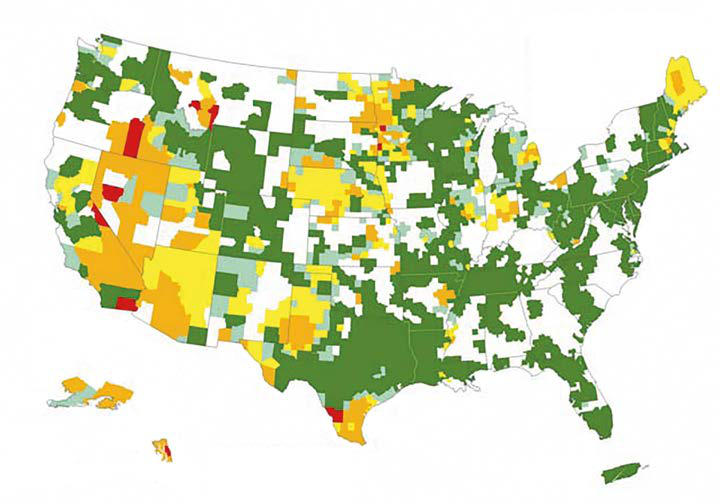

# Chapter 760: Heavy Metal Intoxication — Board-Style Self-Assessment MCQs
**Part XXXII: Environmental Health** | [📖 Read Wiki Chapter](../chapters/760.md) | [🃏 Chapter Flashcards](../flashcards/760_flashcards.md) | [🏠 Course Master Index](../../index.md)

Total questions: **5** *(Click "Show Answer & Rationale" beneath each question)*

### Question 1 (Clinical Pediatrics Vignette)
A pediatric patient is evaluated for the following clinical and diagnostic profile: Gastrointestinal system; Submucosal vesicles, watery or bloody; diarrhea, severe hematemesis,; pancreatitis, jaundice, toxic hepatitis; Cardiovascular system; Reduced myocardial contractility,; prolonged QT intervals,; tachyarrhythmias, torsades de p. Which of the following conditions or syndromes is the most likely diagnosis?

- **A.** MERCURY (Heavy Metal Intoxication)
- **B.** CNS (Heavy Metal Intoxication)
- **C.** EFFECTS OF ARSENIC
- **D.** ORGANIC (ALKYL) (Heavy Metal Intoxication)

<b>Show Answer & Rationale</b>

**Correct Answer: C** — EFFECTS OF ARSENIC

**Rationale:** **EFFECTS OF ARSENIC** is characterized by: Gastrointestinal system; Submucosal vesicles, watery or bloody; diarrhea, severe hematemesis,; pancreatitis, jaundice, toxic hepatitis; Cardiovascular system; Reduced myocardial contractility,; prolonged QT intervals,; tachyarrhythmias, torsades de pointes,; pericarditis; Vasodilation, hypotension, shock; Kidneys; Hema.

**Why Other Options Are Incorrect:** **MERCURY (Heavy Metal Intoxication)** is incorrect (characterized by Molecular weight; 74.9 Da; 200.59 Da; Acceptable blood level; 35 μg/L (>175 nmol/L); Intervene at ur). **CNS (Heavy Metal Intoxication)** is incorrect (characterized by Tremor; Tremor, erethism (irritability); Paresthesias, ataxia, tremor, tunnel; vision, dysarthria; P). **ORGANIC (ALKYL) (Heavy Metal Intoxication)** is incorrect (characterized by Primary route of exposure; Inhalation; Oral; Oral; Primary tissue distribution; CNS, kidney; Blood ().

### Question 2 (Clinical Pediatrics Vignette)
A pediatric patient is evaluated for the following clinical and diagnostic profile: Molecular weight; 74.9 Da; 200.59 Da; Acceptable blood level; 35 μg/L (>175 nmol/L); Intervene at urine level; >100 μg/L (>13.3 nmol/L) 24-hr urine sample; >150 μg/L (>750 nmol/L). Which of the following conditions or syndromes is the most likely diagnosis?

- **A.** ORGANIC (ALKYL) (Heavy Metal Intoxication)
- **B.** EFFECTS OF ARSENIC
- **C.** MERCURY (Heavy Metal Intoxication)
- **D.** CNS (Heavy Metal Intoxication)

<b>Show Answer & Rationale</b>

**Correct Answer: C** — MERCURY (Heavy Metal Intoxication)

**Rationale:** **MERCURY (Heavy Metal Intoxication)** is characterized by: Molecular weight; 74.9 Da; 200.59 Da; Acceptable blood level; 35 μg/L (>175 nmol/L); Intervene at urine level; >100 μg/L (>13.3 nmol/L) 24-hr urine sample; >150 μg/L (>750 nmol/L).

**Why Other Options Are Incorrect:** **ORGANIC (ALKYL) (Heavy Metal Intoxication)** is incorrect (characterized by Primary route of exposure; Inhalation; Oral; Oral; Primary tissue distribution; CNS, kidney; Blood (). **EFFECTS OF ARSENIC** is incorrect (characterized by Gastrointestinal system; Submucosal vesicles, watery or bloody; diarrhea, severe hematemesis,; pancr). **CNS (Heavy Metal Intoxication)** is incorrect (characterized by Tremor; Tremor, erethism (irritability); Paresthesias, ataxia, tremor, tunnel; vision, dysarthria; P).

### Question 3 (Visual Diagnosis & Clinical Spotter)

A pediatric patient undergoes evaluation for **Heavy Metal Intoxication**, yielding the clinical or diagnostic finding shown below. Which of the following best characterizes the illustrated finding?

- **A.** A rise in blood mercury levels following a single dose of hepatitis vaccine was seen in preterm infants, but the clinical significance is unknown.
- **B.** Chronic inorganic mercury intoxication produces the classic triad consisting of tremor, neuropsychiatric disturbances, and gingivosto matitis.
- **C.** U.S. Geological Survey map of arsenic in groundwater. Groundwater may also contain elevated concentrations of ar senic from agricultural runoff, contamina tion from runoff from wood preservatives
- **D.** Subacute toxicity is characterized by prolonged fatigue, malaise, weight loss, headache, chronic encephalopathy, peripheral senso rimotor neuropathy, leukopenia, anemia, thrombocytopenia, ch

<b>Show Answer & Rationale</b>

**Correct Answer: C** — U.S. Geological Survey map of arsenic in groundwater. Groundwater may also contain elevated concentrations of ar senic from agricultural runoff, contamina tion from runoff from wood preservatives

**Rationale:** **Fig. 760.1**: U.S. Geological Survey map of arsenic in groundwater. Groundwater may also contain elevated concentrations of ar senic from agricultural runoff, contamina tion from runoff from wood preservatives containing arsenic, improperly disposed arsenical chemicals, or mining. For the latest on the US Geological survey: https://www.usgs. gov/mission-areas/water-resources/science/ arsenic-and-drinking-water#overview. (Modified from Agency for Toxic Substanc es and Disease Registry: Arsenic toxicity. What Are the Routes of Exposure for Arsenic? Fig 1. https://www.atsdr.cdc.gov/csem/ arsenic/what_routes.html.)

### Question 4 (Differential Diagnosis (Heavy Metal Intoxication))
During a pediatric consultation regarding **Heavy Metal Intoxication**, which clinical entity or concept is described by the following profile? "this pediatric condition is a metalloid that exists in four forms: elemental this pediatric condition, arsine gas, inorganic this pediatric condition salts (pentavalent arsenate form or trivalent arse nite form), and organic this pediatric condition compounds."

- **A.** Elemental mercury
- **B.** Bowen disease
- **C.** ARSENIC
- **D.** TREATMENT OF ARSENIC AND MERCURY INTOXICATION

<b>Show Answer & Rationale</b>

**Correct Answer: C** — ARSENIC

**Rationale:** ARSENIC Arsenic is a metalloid that exists in four forms: elemental arsenic, arsine gas, inorganic arsenic salts (pentavalent arsenate form or trivalent arse nite form), and organic arsenic compounds.

### Question 5 (Pediatric Board Mastery (Heavy Metal Intoxication))
When formulating an evidence-based diagnostic and management plan for **Heavy Metal Intoxication** (*Part XXXII: Environmental Health*), which of the following pediatric clinical statements is **ACCURATE**? (Item 1)

- **A.** Clinical manifestations are permanently restricted to late adulthood and never present during infancy, childhood, or adolescence.
- **B.** Diagnostic confirmation relies solely on plain skull radiographs without biochemical, microbiologic, or clinical correlation.
- **C.** Subacute toxicity is characterized by prolonged fatigue, malaise, weight loss, headache, chronic encephalopathy, peripheral senso rimotor neuropathy, leukopenia, anemia, thrombocytopenia, chronic cough, an
- **D.** The condition is an entirely benign physiologic variant that never warrants laboratory or clinical evaluation.

<b>Show Answer & Rationale</b>

**Correct Answer: C** — Subacute toxicity is characterized by prolonged fatigue, malaise, weight loss, headache, chronic encephalopathy, peripheral senso rimotor neuropathy, leukopenia, anemia, thrombocytopenia, chronic cough, an

**Rationale:** **Pediatric Clinical Principle (Heavy Metal Intoxication):** Subacute toxicity is characterized by prolonged fatigue, malaise, weight loss, headache, chronic encephalopathy, peripheral senso rimotor neuropathy, leukopenia, anemia, thrombocytopenia, chronic cough, and gastroenteritis.

