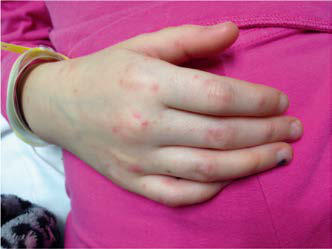

# Chapter 766: Rat Bite Fever — Board-Style Self-Assessment MCQs
**Part XXXII: Environmental Health** | [📖 Read Wiki Chapter](../chapters/766.md) | [🃏 Chapter Flashcards](../flashcards/766_flashcards.md) | [🏠 Course Master Index](../../index.md)

Total questions: **5** *(Click "Show Answer & Rationale" beneath each question)*

### Question 1 (Clinical Pediatrics Vignette)
A pediatric patient is evaluated for the following clinical and diagnostic profile: The illness is characterized by an abrupt onset of fever up to 41°C (105.8°F) in over 90% of reported cases, as well as severe throbbing headache, intense myalgias, chills, and vom iting.. Which of the following conditions or syndromes is the most likely diagnosis?

- **A.** PRERENAL (Renal Failure)
- **B.** adult): Peripheral pulses either rapid and weak or absent; decreased
- **C.** Rat Bite Fever
- **D.** GROWTH FACTORS (Feeding Healthy Infants, Children, and Adolescents)

<b>Show Answer & Rationale</b>

**Correct Answer: C** — Rat Bite Fever

**Rationale:** **Rat Bite Fever** is characterized by: The illness is characterized by an abrupt onset of fever up to 41°C (105.8°F) in over 90% of reported cases, as well as severe throbbing headache, intense myalgias, chills, and vom iting..

**Why Other Options Are Incorrect:** **PRERENAL (Renal Failure)** is incorrect (characterized by Dehydration (hypovolemia); Gastroenteritis (hypovolemia); Hemorrhage (hypovolemia); Burns; Sepsis; S). **adult): Peripheral pulses either rapid and weak or absent; decreased** is incorrect (characterized by blood pressure; no urine output; very sunken eyes and fontanel; no; tears; parched mucous membranes;). **GROWTH FACTORS (Feeding Healthy Infants, Children, and Adolescents)** is incorrect (characterized by Epidermal growth factor; Luminal surveillance, repair of intestine; Transforming growth; factor (TGF).

### Question 2 (Visual Diagnosis & Clinical Spotter)

A pediatric patient undergoes evaluation for **Rat Bite Fever**, yielding the clinical or diagnostic finding shown below. Which of the following best characterizes the illustrated finding?

- **A.** Morbilliform rash on the hands/palms (A) and feet (B) of a patient with rat bite fever. (From Vetter NM, Feder HM Jr, Ratzan RM. Rat bite fever caused by a kiss. Am J Emer Med. 2015;34:1190.e3– 1
- **B.** A wide range of complications are reported in patients with rat bite fever, the most common being pneumonia, persistent arthritis, brain and soft tissue abscesses, and, less commonly, myocar
- **C.** The illness is characterized by an abrupt onset of fever up to 41°C (105.8°F) in over 90% of reported cases, as well as severe throbbing headache, intense myalgias, chills, and vom iting.
- **D.** PREVENTION It is possible to reduce the risk of animal bite injury with anticipa tory guidance.

<b>Show Answer & Rationale</b>

**Correct Answer: A** — Morbilliform rash on the hands/palms (A) and feet (B) of a patient with rat bite fever. (From Vetter NM, Feder HM Jr, Ratzan RM. Rat bite fever caused by a kiss. Am J Emer Med. 2015;34:1190.e3– 1

**Rationale:** **Fig. 766.1**: Morbilliform rash on the hands/palms (A) and feet (B) of a patient with rat bite fever. (From Vetter NM, Feder HM Jr, Ratzan RM. Rat bite fever caused by a kiss. Am J Emer Med. 2015;34:1190.e3– 1190.e4. Figs. 1 and 3.)

### Question 3 (Differential Diagnosis (Rat Bite Fever))
During a pediatric consultation regarding **Rat Bite Fever**, which clinical entity or concept is described by the following profile? "The incubation period for the streptobacillary form of rat bite fever is variable, ranging from 3-10 days."

- **A.** CLINICAL COURSE
- **B.** HIV (Autonomic Neuropathies)
- **C.** PREMUTATION CARRIERS (55-200 CGG REPEATS)
- **D.** PREVENTION

<b>Show Answer & Rationale</b>

**Correct Answer: A** — CLINICAL COURSE

**Rationale:** CLINICAL COURSE The incubation period for the streptobacillary form of rat bite fever is variable, ranging from 3-10 days.

### Question 4 (Differential Diagnosis (Rat Bite Fever))
During a pediatric consultation regarding **Rat Bite Fever**, which clinical entity or concept is described by the following profile? "It is possible to reduce the risk of animal bite injury with anticipa tory guidance."

- **A.** Rat Bite Fever
- **B.** DELAY (Cutis Laxa)
- **C.** Disorders of the Conjunctiva
- **D.** PREVENTION

<b>Show Answer & Rationale</b>

**Correct Answer: D** — PREVENTION

**Rationale:** PREVENTION It is possible to reduce the risk of animal bite injury with anticipa tory guidance.

### Question 5 (Pediatric Board Mastery (Rat Bite Fever))
When formulating an evidence-based diagnostic and management plan for **Rat Bite Fever** (*Part XXXII: Environmental Health*), which of the following pediatric clinical statements is **ACCURATE**? (Item 1)

- **A.** The illness is characterized by an abrupt onset of fever up to 41°C (105.8°F) in over 90% of reported cases, as well as severe throbbing headache, intense myalgias, chills, and vom iting.
- **B.** Diagnostic confirmation relies solely on plain skull radiographs without biochemical, microbiologic, or clinical correlation.
- **C.** Systemic tetracyclines and fluoroquinolones are universally required as routine prophylaxis in all healthy newborns.
- **D.** Clinical manifestations are permanently restricted to late adulthood and never present during infancy, childhood, or adolescence.

<b>Show Answer & Rationale</b>

**Correct Answer: A** — The illness is characterized by an abrupt onset of fever up to 41°C (105.8°F) in over 90% of reported cases, as well as severe throbbing headache, intense myalgias, chills, and vom iting.

**Rationale:** **Pediatric Clinical Principle (Rat Bite Fever):** The illness is characterized by an abrupt onset of fever up to 41°C (105.8°F) in over 90% of reported cases, as well as severe throbbing headache, intense myalgias, chills, and vom iting.

